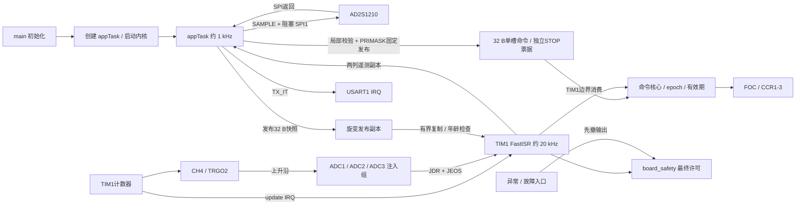

# 当前架构：STM32H750 纯 C 控制程序

本页只维护**已经实现的当前架构**；拟议机制留在 spec。入口见 [docs/README.md](README.md)，移植路线见 [003 第7节](specs/003-c-port-architecture.md#7-移植表与顺序)。目标是参考 ODrive 的组织与算法，用 C 实现，不接入其 C++ 对象体系。

版本锚点：2026-11-07，`Xiao_ODrive`，已提交基线 `9650972` 加005未提交实现；函数/符号为定位依据，旧审查行号仅辅助。当前新增命令入口源码已核对，HOST核心与实际FOC接入测试通过；BUILD PASS：ARMCC5全量0错误0警告；结果和指纹见 [005验证记录](validation/005-command-handoff.txt)。**005本轮待机4项有限观察PASS**，实际发布/STOP/到期、物理输出与闭环仍未板测；截图与用户增量构建对应关系见[005追加记录](validation/005-command-handoff.txt)。002截图不继承为005证据。

003旧AXF差异原因仍未知；原发现及当时重建保留在[原记录](validation/003-architecture-build.txt)。当前验收层级逐项查[005](specs/005-command-handoff.md)。

## 启动与执行上下文

命令箭头表示已接入的函数入口；尚无实际RX或自动请求生产者，固件范围配置未确认，拒绝START/UPDATE。图中的 `board_safety` 是共享安全入口，不是独立任务；HAL 启动也会写 MOE/CEN，见下方完整写者表。

1. [启动文件](../MDK-ARM/startup_stm32h750xx.s) `Reset_Handler:237`：`ExitRun0Mode → SystemInit → __main`，C 运行库初始化静态对象后进入 `main`。
2. [main.c](../Core/Src/main.c) `main:73`：`MPU_Config → HAL_Init → BoardSafety_InitSafe → SystemClock_Config/PeriphCommonClock_Config`。首次软件撤输出在 HAL 初始化之后，不能证明复位到此时的引脚电平。
3. 同一 `main:103–111`：初始化 GPIO、TIM1、ADC1/2/3、SPI1、USART1，再调用 [app_runtime.c](../Core/Src/app_runtime.c) `AppRuntime_Init`，恢复功率 GPIO 低、校准 ADC、初始化监测/旋变/FOC和命令核心；初始化失败进入 Fatal。
4. `main:115–125` 调用 `osKernelInitialize → MX_FREERTOS_Init → osKernelStart`；[freertos.c](../Core/Src/freertos.c) `MX_FREERTOS_Init:94` 只建一个业务任务 `appTask`，检查创建结果。内核返回走 Fatal，不回裸机循环。
5. `StartAppTask:143 → AppRuntime_TaskStart:174`：启动三组 ADC、启动 CH4、再次撤 MOE，最后启动 TIM1 update IRQ。`CurrentMonitor_Run_20kHz` 消费 2000 帧等待加 4096 帧零偏标定后，appTask 才准备六路 PWM/AF 引脚。
6. `AppRuntime_FastISR` 取得反馈有效性后、任何慢环/FOC计算前，经 `AxisCommandPort_BeginCycle` 接收整组命令。最终短临界区调用 `AxisCommandPort_FinalPermit`，复核许可/期限/故障和原PWM准备/标定/反馈条件，才调用 `BoardSafety_SetOutputsEnabled`。旧 `foc_run_request` 是镜像；当前配置未确认，因此没有运行许可。STOP是撤EN/MOE，不是受控减速。

## 模块分工与实时链

| 模块 / 职责 | 当前上下文与边界 | 函数 / 符号依据 |
| --- | --- | --- |
| 采样触发 | TIM1 CH4 的 OC4REF 经 TRGO2 上升沿触发 ADC 注入组；CPU 不逐次软件启动 | [tim.c](../Core/Src/tim.c) `MX_TIM1_Init:30`；[adc.c](../Core/Src/adc.c) `MX_ADC1/2/3_Init` |
| 快速入口 | TIM1 update IRQ → HAL 回调 → FastISR；不调用 FreeRTOS API | [stm32h7xx_it.c](../Core/Src/stm32h7xx_it.c) `TIM1_UP_IRQHandler:168`；`main.c HAL_TIM_PeriodElapsedCallback:254`；`app_runtime.c AppRuntime_FastISR:228` |
| 电流 / 母线 | 三个 JEOS 全到才消费，未到立即返回；U=ADC1/JDR1，V=ADC2/JDR1，W=ADC3/JDR1，母线=ADC3/JDR2 | [current_sense.c](../Core/Src/current_sense.c) `CurrentSense_HasNewSample:49/GetRaw:64`；`current_monitor.c CurrentMonitor_Run_20kHz:76` |
| 角度 / 速度 | appTask 每 1 tick 尝试 SAMPLE/SPI；TIM1 只拿已发布快照，不做 SPI | [ad2s1210.c](../Core/Src/ad2s1210.c) `AD2S1210_Run_1kHz:798/GetSnapshot:139`；`app_runtime.c BackgroundStep:200` |
| 命令与许可 | appTask唯一发布；TIM1唯一消费/active/epoch；局部校验、固定PRIMASK发布；默认配置未确认 | [axis_command.c](../Core/Src/axis_command.c) `AxisCommandPort_*`；[核心](../Core/Src/axis_command_core.c) `Validate/PublishValidated/Tick/Guard` |
| 原控制状态与 FOC | TIM1 每 20 拍调用慢环处理模式、对齐、速度 PI，再按拍执行电流控制/调制 | [open_foc.c](../Core/Src/open_foc.c) `OpenFOC_Ramp_1ms:492/Run_20kHz:674`；`app_runtime.c:282–315` |
| 安全 / 只读状态 | board_safety 撤输出、锁存；axis_status 只汇报，不拥有启动权或完整 Axis 生命周期 | [board_safety.c](../Core/Src/board_safety.c) `BoardSafety_LatchFault:88`；[axis_status.c](../Core/Src/axis_status.c) `AxisStatus_Publish:5/LatchFault:12` |
| 遥测 / 监测 | appTask 约 5 ms 尝试两列速度 CSV 发送，USART1 IRQ 搬运；约 1000 ms 查询堆/栈；实时有效性检查在 TIM1 | `app_runtime.c SendTelemetry:111/BackgroundStep:200/FastISR:228`；`stm32h7xx_it.c USART1_IRQHandler:182` |
| 不存在的业务模块 | 无 RX 解析、通信任务、独立状态任务、日志任务、事件日志环或持久化日志；USART TX_RX 配置不代表已有 RX 业务 | [usart.c](../Core/Src/usart.c) `MX_USART1_UART_Init:31`；`freertos.c MX_FREERTOS_Init` 的队列/互斥锁等业务区为空 |

FreeRTOS 自带 Idle 和 Timer 服务任务不是额外业务任务，依据 `tasks.c vTaskStartScheduler`、`timers.c xTimerCreateTimerTask`。目前不因功能名称增加线程。

电流换算由 [current_monitor.c](../Core/Src/current_monitor.c) `CurrentMonitor_Run_20kHz:128–145` 完成：控制使用 `U=−(V+W)`，真实 U 仅作诊断；Clarke/Park 使用传入的 `foc_theta`。TIM1 中先更新旋变反馈、分频慢环，再消费电流、运行 FOC、写 PWM，最后复核输出许可并发布状态/遥测。

## 数据交接、生命周期与时间对应

下表里的静态数据位于当前 AXI SRAM 链接区域；任务局部副本位于 appTask 栈，ISR 局部量使用中断栈。`volatile` 只声明访问特性，不能让多字段更新自动变成一笔完整交易。

| 数据 / 单位 | 写者 → 读者；生命周期 | 已实现的交接 / 失效处理 | 位置依据 |
| --- | --- | --- | --- |
| 整组速度命令 / rpm、A、HAL ms | appTask局部副本→32 B单槽→TIM1私有active；静态AXI SRAM | Publish前区外校验；短PRIMASK内复核动态元数据/固定复制/DMB；空槽才接受。TIM1入口消费、末尾再复核 | `axis_command.c AxisCommandPort_Submit/BeginCycle/FinalPermit`；`axis_command_core.c` |
| 运行许可 / STOP / fault | TIM1拥有active/epoch，任务发独立STOP票据，board_safety随时关断 | STOP/到期/ready丢失/故障作废pending与active；旧epoch拒绝；故障先关硬件，软件代次在边界撤销。无自动恢复 | `AxisCommand_Tick/Revoke/Guard`；`BoardSafety_LatchFault` |
| 控制输入 / 调试镜像 | TIM1把已验证active安装至FOC私有command变量；原目标/run/请求模式/限制/step仅镜像 | `OpenFOC_ApplyCommand`整组安装，`OpenFOC_Stop`立即复位且允许未来明确START；`EnforceCommandLimit`每快拍限三个Iq指令/积分量 | `open_foc.c`；当前范围未确认，所有真实START/UPDATE被拒绝 |
| PI/校准参数 | 仍是现有调试/初始化量，未纳入命令合同 | 本轮只接管速度命令字段；不要并发修改PI/方向/零位等参数，后续另设配置合同 | `open_foc.c`原PI/对齐参数 |
| 命令确认/诊断 | 接受seq由Submit返回；TIM1记录applied_seq/control_seq/result_seq/cancelled_seq/stop_applied | 当前Watch只是独立标量，不能当一致通信ACK；无实际协议/ACK队列。control_seq模回绕只作观测，seq/epoch不回绕 | `axis_command.h/.c`与`axis_command_core.h` |
| 旋变角 rad、速度 rpm、双时戳、序号及有效性 | appTask → TIM1/任务；最新固定 32 B 静态快照，读者持有副本 | 发布/读取均保存 PRIMASK、屏蔽中断、固定复制、DMB、恢复；失败也递增尝试序号并发布无效帧；不在临界区做 SPI | `ad2s1210.h AD2S1210_FeedbackSnapshot`；`ad2s1210.c PublishSnapshot:109/GetSnapshot:139/Run_1kHz:811` |
| ADC 电流 / 母线原始码及换算值 A/V | ADC 硬件 JDR → TIM1；寄存器会被后续转换覆盖 | JEOS 检查后顺序读四个 JDR；无源触发帧号/采样时戳，软件消费计数不保证硬件同帧；运行中缺帧撤输出锁存 | `current_sense.c:49/64`；`current_monitor.c:98`；`app_runtime.c:297–308` |
| 积分器、dq 给定、占空比 | main 给初值，运行期间 TIM1 控制代码独占 | 同一执行上下文；后台尚无正式修改接口；板级故障独立覆盖输出 | `open_foc.c OpenFOC_Init/Ramp_1ms/Run_20kHz/FOC_WriteDuty` |
| 两列速度遥测 | TIM1 → appTask 局部副本 → USART1 IRQ；静态发送缓冲 96 B | 两列发布和读副本均在短 PRIMASK 区；区外格式化；UART 忙则计丢帧，不覆盖在发缓冲，READY 后复用 | `app_runtime.c:51/SendTelemetry:111/FastISR:338`；HAL UART `UART_TxISR_8BIT/UART_EndTransmit_IT` |
| axis_status_word / 板级故障 | TIM1 正常发布、故障入口置位 → 调试读取；静态 32 位状态字/故障量 | 状态字保留 FAULT，现有临界区内发布；它和其它 Watch 字段不是同一原子帧；board_fault 仅置位 | `axis_status.c:5/12`；`axis_status.h AXIS_STATUS_KEEP_FAULT`；`board_safety.c:88` |

旋变的当前时间合同：

- `ad2s1210.c PulseSample:295/311–314` 在 SAMPLE 置低并 DSB 后读取 DWT/HAL tick，表示下降沿附近的软件时间；SPI 完成时间不是采样时间，尚无硬件捕获精度证明。
- `Run_1kHz:833–851` 的角度为 `raw×2π/65536`，是**旋变电气角**；代码按旋变 4 极对将差分换成机械 rpm，再作 α=0.10 滤波。`open_foc.c SetRotorFeedback:466–470` 用方向、极对比和偏置换成电机电角；实际极对数尚待硬件确认。
- 首帧没有差分速度；失败或间隔超过 2 ms 后重建速度基准。`app_runtime.c:253–259` 要求位置、速度均有效，DWT 与 HAL 年龄都不超过现有 2 ms；已经使能时失效走锁存关断，未运行时不准启动。
- 2 ms 是当前软件新鲜度门槛，**不是任何转速下的角误差保证**。三个 ADC rank1 与 ADC3 rank2 也非同一瞬间；当前缺少 ADC 物理时戳/源帧号，没有把角度外推到电流采样或 PWM 生效时刻。
- 模式 2 的 Park 使用此前命令角，随后 FOC 推进角度；对齐阶段反馈坐标与固定输出角也不同。当前不能声称已完成 `theta_i/theta_pwm` 对时或补偿，详见 [003 第5节](specs/003-c-port-architecture.md#5-共享数据审查快照与时序方案2026-11-06)。

已实现机制和相对003的取舍见[005](specs/005-command-handoff.md)。运行配置为静态未确认值，拒绝START/UPDATE；缺配置不阻挡STOP。没有实际通信/session，不能声称跨复位防重放。无调用的发布入口及相应核心函数由链接器剔除，已编译/对象审查，不是当前运行路径；真实请求源接入后重测。普通RTOS BASEPRI不能屏蔽TIM1 IRQ0，任务发布保存/恢复PRIMASK；NMI/Fatal先关输出、不触碰邮箱且不返回。主机顺序行为测试不证明目标原子性时长；关中断和最坏IRQ耗时须板测。

## PWM、驱动使能与故障写者

以下列出应用可达入口及其 HAL 下游；未调用的通用 HAL DMA/Stop API 不算活动写者。MOE 是定时器主输出门，EN 是板级驱动使能，50% 占空比不是关门。

| 当前写者 | 寄存器 / 行为及上下文 | 依据 |
| --- | --- | --- |
| MX_GPIO_Init / GateInactive | PB10 EN 拉低；后者还配置 MODER/OTYPER/PUPDR，供全部关断路径调用 | `gpio.c:54`；`board_safety.c GateInactive:22` |
| BoardSafety_InitSafe | 撤 EN/MOE，再把六路功率 PWM 引脚设为低电平 GPIO；main 早期及应用初始化 | `board_safety.c:48–66` |
| MX_TIM1_Init → TIM_Base_SetConfig | CR1/PSC/ARR/RCR/EGR；main 配置计数器 | `tim.c:30/52/61`；HAL `stm32h7xx_hal_tim.c TIM_Base_SetConfig:6935` |
| PWM_ConfigChannel → TIM_OCn_SetConfig | CCR1/2/3 初值 0、CCR4=1250，CCER 与预装载；main | `tim.c:79/83/87/93`；HAL `HAL_TIM_PWM_ConfigChannel:4268` |
| ConfigBreakDeadTime / MspPostInit | 写 BDTR；六路 GPIO 切 AF1，随后应用再次恢复 GPIO 低 | `tim.c:108/138`；HAL `HAL_TIMEx_ConfigBreakDeadTime:2061` |
| AppRuntime_TaskStart → PWM_Start(CH4) | 置 CC4E、MOE、CEN，随后显式撤 MOE；appTask | `app_runtime.c:186/191`；HAL `HAL_TIM_PWM_Start:1463` |
| PreparePowerPWM → PWM_Start/PWMN_Start | 置六路 CCER、MOE、CEN，再撤 MOE、接 AF；准备期间 EN 保持禁止 | `app_runtime.c PreparePowerPWM:65–91`；HAL `HAL_TIMEx_PWMN_Start:1112` |
| TaskStart → Base_Start_IT(TIM1) | 开 update IRQ / CEN；appTask | `app_runtime.c:194`；HAL `HAL_TIM_Base_Start_IT:462` |
| FOC_WriteDuty | 写 CCR1/2/3；main 的 Init 写初始 50%，运行时 Run_20kHz 写调制或无效/停机 50% | `open_foc.c FOC_WriteDuty:231/250–252`、`OpenFOC_Init:430/Run_20kHz:674` |
| BoardSafety_SetOutputsEnabled | 允许时置 MOE、PB10 高；唯一正常调用点在 TIM1；不允许则 DisableOutputs | `board_safety.c:69–77`；`app_runtime.c:335` |
| BoardSafety_DisableOutputs | 先撤 EN、TIM1 有时钟时清 MOE，标志归 0；main/任务/ISR/故障均可调用，保留 CH4/CEN | `board_safety.c:36–45` |
| BoardSafety_LatchFault / Fatal | 先撤输出再清 CH1–3 六路 CCER、锁存；Fatal 另禁 IRQ 且不返回 | `board_safety.c:88–117` |

`open_foc.c OpenFOC_Stop`现在由TIM1的`OpenFOC_ApplyCommand(NULL)`在许可失去沿调用，写50%并立即复位PI/启动沿，保留未来明确START能力；硬件撤输出由命令适配/board_safety先执行。`tim.c HAL_TIM_Base_MspDeInit`仍无应用调用。CCR 预装载最后由定时器更新事件生效，不等同于 CPU 写入时刻。

| 清除 / 恢复对象 | 当前规则与位置 |
| --- | --- |
| 板级 fault / first_fault / ipsr | `board_safety.c:15–17/88` 仅 C 初始化和运行置位；`InitSafe` 不清 fault，无运行清错 API，无应用 `NVIC_SystemReset` 调用 |
| axis_status FAULT | `axis_status.c:3/12` 与 `AXIS_STATUS_KEEP_FAULT` 保持锁存；仅复位初始化回 BOOT，无清错 API |
| AD2S 软件诊断 | `ad2s1210.c Init:507/568/730/758–759` 初始化及启动恢复清诊断；`UpdateFeedbackHealth:335` 每帧覆盖当前值、OR 累计值，均不清 board_fault |
| AD2S 芯片 fault | `ReadAndClearFault:446/458–462` 在初始化/恢复路径 SAMPLE、读 0xFF、再次 SAMPLE；非周期清错，实际器件清除效果未板测 |
| AD2S reset / ADC 事件 / 算法 reset | 0xF0 仅常量、无软件复位写入且 RESET 未接 MCU；`current_sense.c:27–29/58–60` 清 JEOS/JEOC 是事件消费；`open_foc.c:136/144/150` 是 PI/估计器复位，均不授予输出许可 |

故障入口包括 `main.c Error_Handler/assert_failed`、`freertos.c` 栈溢出/malloc/创建失败钩子、`FreeRTOSConfig.h configASSERT`、`stm32h7xx_it.c` CPU 异常和 `AppRuntime_*` 检查。反馈/ADC 运行失效走 `LatchFault` 后返回，保留诊断运行；初始化/内核/HAL 致命错误及 CPU 异常走不返回的 `Fatal`。Break/Break2/AOE 当前关闭，不能宣称已有独立硬件关断保护。

## 时钟、外设与调度

| 项目 | 当前配置 / 约束 | 依据 |
| --- | --- | --- |
| 时钟 / 电压 / Flash 等待 | SYSCLK/HCLK 200 MHz，APB 分频 2；**VOS3**；生成代码 `FLASH_LATENCY_4` | `FOC_T.ioc RCC.CortexFreq_Value/HCLKFreq_Value/PWR_Regulator_Voltage_Scale`；`main.c SystemClock_Config:150/163–189`；这些是配置事实，非电气裕量验收 |
| TIM1 | 输入时钟 200 MHz，PSC=1、ARR=2499、中心对齐、RCR=1；推算 49.98 μs / 约 20.008 kHz；代码算法保留 50 μs 常量 | `tim.c MX_TIM1_Init:46–50`；`app_runtime.c AppRuntime_Init:169`；真实频率/相位待测 |
| HAL / RTOS 时基 | HAL TIM7，RTOS SysTick 1000 Hz；两者起点不同，时间戳不可混算 | `stm32h7xx_hal_timebase_tim.c HAL_InitTick:41`；`FreeRTOSConfig.h configTICK_RATE_HZ`；`main.c HAL_TIM_PeriodElapsedCallback` |
| IRQ | 抢占 TIM1=0、TIM7=4、USART1=5、SysTick/PendSV=15，子优先级均 0；RTOS 系统调用门槛 5，TIM1/TIM7 禁调用 RTOS API | `FOC_T.ioc NVIC.*`；`FreeRTOSConfig.h configLIBRARY_MAX_SYSCALL_INTERRUPT_PRIORITY` |
| RTOS | CMSIS_V2，appTask/StartAppTask/Normal，栈 1024 words=4096 B；heap_4，16384 B，溢出检查 2、malloc hook 开 | `FOC_T.ioc FREERTOS.*`；`freertos.c appTask_attributes:54`；`FreeRTOSConfig.h` |
| ADC | TIM1 TRGO2 上升沿注入；U ADC1 rank1 CH16，V ADC2 rank1 CH19，W ADC3 rank1 CH10，母线 ADC3 rank2 CH1 | `adc.c MX_ADC1/2/3_Init:98–111/161–174/224–246`；禁止沿用 ADC1/JDR2 读 W 的旧假设 |
| AD2S SPI / GPIO | SPI1 Mode 1、8 bit、250 kHz，PB3/4/5；SAMPLE PB8、A1 PB9、A0 PE0、WR PE1；控制/采样来自 appTask | `spi.c MX_SPI1_Init:32/HAL_SPI_MspInit:74`；`main.h:62–69`；`ad2s1210.c` |
| USART / EN | USART1 115200 8N1，现有 TX_IT；PB10 EN 低为禁止、高为使能 | `usart.c MX_USART1_UART_Init:31`；`board_config.h`、`board_safety.c`；物理电平与驱动响应待测 |

## 构建与内存

| 项目 | 当前事实与依据 |
| --- | --- |
| 工具链 / 语言 | ARMCC 5.06 update 7 build 960，C99 + GNU 扩展；工程 55 个 `.c`、1 个 `.s`、0 C++；不从扩展名或 AC6 遗留选项推断语言标准 |
| ABI / 优化 | 实际对象参数 `--cpu Cortex-M7.fp.dp --c99 --gnu -O0 --debug --split_sections`；VFP 硬浮点参数 ABI，MicroLIB；依据 uvprojx、对象属性与 003 记录 |
| Flash | `0x08000000`、128 KiB；压缩后ROM61688 B（代码/RO61588 B＋RW初始化映像100 B） |
| RAM | DTCM `0x20000000`、128 KiB，当前使用 0 B；AXI SRAM `0x24000000`、512 KiB，当前RW+ZI25544 B；依据实际 `FOC_T.sct/map` |
| RTOS heap / appTask | `ucHeap`仍为16384 B，实际地址见005 map记录；appTask 4096 B 栈运行时从此堆分配，不能再计一次静态 RAM |
| 中断栈 / 内核任务 | MSP仍4096 B，实际地址见005 map记录；Idle/Timer 静态栈 512/1024 B、TCB 各 92 B；启动 C 库堆配置 512 B 但已被链接剔除 |

项目依据 [FOC_T.uvprojx](../MDK-ARM/FOC_T.uvprojx) `uAC6=0/useUlib/uC99/uGnu`；scatter 由 uVision 生成（`useFile=0`），实际 `.lnp` 引用 `MDK-ARM/FOC_T/FOC_T.sct`。当前完整版本指纹与 map 摘录见 [005 构建记录](validation/005-command-handoff.txt)，可复现全量/增量及独立策略检查命令见 [003 第4节](specs/003-c-port-architecture.md#4-构建语言标准与内存审查快照2026-11-06)。静态容量足够不等于最坏运行栈已经安全。

## DMA 与 cache：当前现状

- **没有业务 DMA。** Core 无 DMA handle、初始化、`__HAL_LINKDMA` 或启动调用；`.ioc` 没有 DMA IP/请求。`NVIC.ForceEnableDMAVector=true`、HAL DMA/MDMA 模块和驱动文件存在，只说明库可用。
- ADC 直接读 JDR；`ad2s1210.c ReadNormalHAL:490` 用阻塞 `HAL_SPI_TransmitReceive`，超时参数 10 ms；`app_runtime.c SendTelemetry:143` 用 `HAL_UART_Transmit_IT`。当前缓冲是 CPU/IRQ 共享，不是假想的 DMA 所有权链。
- Core/启动路径没有 `SCB_EnableDCache/ICache`、CCR cache 开关写入或 cache 维护。正常复位后应用没有开启 cache；调试器接管场景的实际 `SCB->CCR` 尚待板读，不能仅凭源码报告运行值。
- `main.c MPU_Config:219–242` 只有 4 GiB NO_ACCESS、非缓存、子区域禁用 `0x87` 的区域，再开 privileged default；SRAM 地址落在被禁用的子区域，**这不等于已经把所有 SRAM 配成非缓存 DMA 池**。
- 当前 scatter 无 D2 专区；`system_stm32h7xx.c:86` 的 `DATA_IN_D2_SRAM` 未定义，对应 `SystemInit` D2 SRAM 时钟分支未启用。D2 SRAM3 专用池、可达性/cache 与启停所有权仅为 [003 第9节方案](specs/003-c-port-architecture.md#9-后续-dma内存与-d-cache-合同2026-11-06规划未实施)，未落地，不据此宣称 DMA 已可用。

## 尚未闭合的边界

整组命令原子交接、真实通信 RX、完整 Axis 生命周期、ADC/角度/PWM 对时尚缺实现；最高机械转速、实际电机/旋变极对数、允许电角误差尚未确认。当前输出准备毛刺、故障关断延迟、Break 硬件路径、最坏 ISR/临界区/MSP/任务栈，以及带输出闭环均须独立验收。

继续工作以 [当前入口](README.md)、对应 spec 和版本化 validation 为准。新增方案先写 spec；实现并验证后才更新本页的“当前事实”，旧截图和旧构建记录原位保留。
