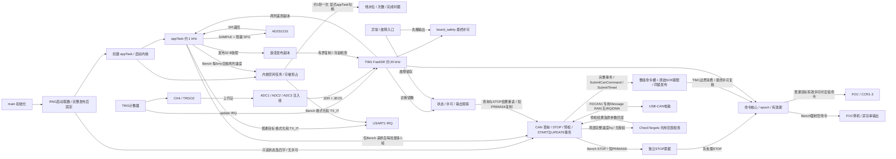

# 当前架构：STM32H750 纯 C 控制程序

本页只维护**已经实现的当前架构**；拟议机制留在 spec。入口见 [docs/README.md](README.md)，移植路线见 [003 第7节](specs/003-c-port-architecture.md#7-移植表与顺序)。目标是参考 ODrive 的组织与算法，用 C 实现，不接入其 C++ 对象体系。

版本锚点为 2026-11-19，Xiao_ODrive / 0489733 加 008.17 工作区。008.15 已在板上捕获相邻 SAMPLE 间隔 1998.79 µs、本次后继 SAMPLE 至软件发布 248.61 µs。008.16 在禁输出 Bench 的后台任务中对同一边沿间隔分段。[008 第 13.12 节](specs/008-can-command-protocol.md#1312-00816-相邻采样间隔分段)

本工程有两个构建目标：`FOC_T`正常配置（未确认范围，拒绝START/UPDATE）；`FOC_T_CommandBench`以编译宏强制禁功率输出，合成命令只进入同一交接核心，FOC始终停机。测试目标已由CAN接入显式STOP及完整START/UPDATE事务，经app_runtime回调发布到同一命令核心；自动Bench演练不再调度，原源码保留供HOST回归，正常目标无生产者。当前验收与板测证据入口见[008](specs/008-can-command-protocol.md)，命令机制及旧演练见[005](specs/005-command-handoff.md)。

003旧AXF差异原因仍未知；原发现及当时重建保留在[原记录](validation/003-architecture-build.txt)。当前验收层级逐项查[008](specs/008-can-command-protocol.md)。

008.08保留的去重：CanLink_LeaseValid每次现读一次固定配置，在TSCV前后各检查动态状态，BeginCycle/FinalPermit两道守卫不变。008.09在原runtime模块增加Bench-only首次active→NOT_READY冻结记录：同拍ready输入/快照、DWT与HAL年龄、epoch及粗任务阶段；TIM1单写，撤销及输出处理之后才冻结，DMB后captured=1。48 B记录和4 B阶段标记不参与控制；正常拍少量标量保存/分支，失败拍包含冻结成本，非无扰动探针。所有保护门槛保持不变；008.11已捕获仅DWT年龄超限2009.475us，具体延迟来源与最坏时序未验收。当前008.17 Bench ROM70508 B、RW+ZI26360 B；普通ROM61556/RAM25776 B，堆栈及链接布局不变。

编译优化现状：仅CommandBench的can_link.c和app_runtime.c为-O1；其它文件和普通目标保持原-O0配置，实际对象Input Comments已核实。008.14沿用配置，不再扩大优化范围；局部变量调试可见性可能降低，重生成/重载工程后应复核文件级覆盖。

008.12后台调度仅Bench：StartAppTask结束本轮后由AppTaskWaitNext判deadline，首次超期最多立即运行新一轮；补跑后下一次必须osDelay(1)，成功返回后才恢复资格并重建期限。正常路径仍osDelayUntil；其osOK不保证内部竞争时实际阻塞，本版保证限定为显式补跑有界。普通目标原等待不变；2ms门槛、真实SAMPLE时间戳和保护不改。补跑改变少量采样间隔，原速度差分按真实时间；反馈超龄仍撤许可，任务超期计数本身不直接控制许可。

008.14电流路径仅Bench：FastISR在原输出安全检查/已有故障撤输出之后、AD2S快照与命令处理之前，唯一检查JEOS并仅成功时读取四路raw到当拍MSP局部变量。原RotorFeedback/Ramp之后才以当处foc_theta调用CurrentMonitor_ProcessRaw_20kHz，沿用原校准、sequence/ready及Clarke/Park处理体；失败不重试/不复用，原active ADC_FRAME关断后才冻结记录。普通目标Run路径和HEX保持不变。该局部交接不依靠volatile/锁，不跨拍保存，也不能证明四JDR同一硬件触发或电流/角度物理同刻；早检查仍可能未就绪。实际FastISR固定软件栈144 B（原120 B，+24 B），不含硬件压栈/被调函数/嵌套，MSP最坏水位仍待验。无新静态缓存，原app_start_rejected_count未使用且被链接移除，当前关键诊断仍保留。

008.15 中，TIM1 的 CaptureReadyLoss 在完成本拍输出处理后，遇到首次包含 DWT 年龄超限的 ready 损失会调用 AD2S1210_ArmAgeTrace，保存用于判定的已发布序号、边沿时间和检查年龄。appTask 在 AD2S1210_PublishSnapshot 中复用 8 个字段复制及 DMB 后已有的 DWT 读数作为软件发布时刻，此读数早于恢复 PRIMASK。恢复后仅在记录处于等待状态时处理配对。若 TIM1 打断发布者的时机处于解屏蔽与配对调用之间，发布者遇到源样本自身的序号会继续等待。相邻序号按无符号递增判断，允许回绕。

触发后最多保留一份 24 B 的 ad2s_age_trace 及 8 B 私有源时间戳。两个阶段的写者先写数据，再用 DMB 发布状态。state=2/3 才读取两个周期间隔。SAMPLE 发生在判定时或之前归入 2，发生在判定之后归入 3。间隔分别表示从源样本到后继样本的 SAMPLE 间距，以及后继 SAMPLE 到该次软件发布时间的时差。两段都可能影响交付时间。初始值 0 也涵盖尚未触发该年龄诊断的其它失效路径。时差检查采用连续运行的时钟，超过配对窗口或信息不一致时记为无法解释。008.15 的台架结果为 state=2。

008.16 的 appTask 在同步采集返回后检查上述配对状态。首次终态由 appTask 核对后继快照有效性、两个序号和边沿顺序，再复用上轮工作结束及本轮入口的已有时间戳。16 B 的 app_task_interval_trace 保存状态和三个周期数。上一轮结束标记取在任务主体尾部，中段覆盖此前标记至下一次任务入口间的一切活动，包括调度记账、等待及中断抢占。三项写完经 DMB 发布最终状态，供 Keil 在同次启动读取。有完整记录时三项之和等于配对边沿间隔。008.17 将记录扩展至 24 B，另给出同一旧轮从 SAMPLE 到采集结束标记、到期遥测入槽或放弃的耗时。两项使用已有工作计时，都属于首段。

## 源码分类导航

这是现有文件的职责分类，**不是新建目录或移动文件**。手写代码目前仍在Core/Src与Core/Inc；Keil两个目标仍使用Application/User/Core等既有工程组。main/freertos与外设文件带CubeMX生成骨架，用户逻辑入口和生成代码边界仍须保留。

同名.c/.h作为一个模块看待：.c是实现，.h是对外接口；只在本模块内使用的辅助函数留在.c，不再单独拆头文件。

| 分类 | 现有文件入口（同名.h在Core/Inc） | 以后什么改动放这里 |
| --- | --- | --- |
| 启动与调度 | [main.c](../Core/Src/main.c)、[freertos.c](../Core/Src/freertos.c)、[app_runtime.c](../Core/Src/app_runtime.c)、[app_policy.h](../Core/Inc/app_policy.h)、[FreeRTOSConfig.h](../Core/Inc/FreeRTOSConfig.h) | 启动、任务节拍、实时/后台调用、运行门禁组合 |
| 控制命令、状态与算法 | [axis_command.c](../Core/Src/axis_command.c)、[axis_command_core.c](../Core/Src/axis_command_core.c)、[axis_status.c](../Core/Src/axis_status.c)、[open_foc.c](../Core/Src/open_foc.c) | 命令交接/同步、纯C许可规则、状态观察、FOC计算；状态观察不授予许可 |
| 采样与反馈 | [ad2s1210.c](../Core/Src/ad2s1210.c)、[current_sense.c](../Core/Src/current_sense.c)、[current_monitor.c](../Core/Src/current_monitor.c) | 旋变读取、电流/母线读取与换算、反馈有效性 |
| 板级配置与安全 | [board_config.h](../Core/Inc/board_config.h)、[board_safety.c](../Core/Src/board_safety.c) | 功率模式、EN/MOE管理、锁存故障与关断 |
| 通信与报文 | [can_link.c](../Core/Src/can_link.c)、[can_link_protocol.c](../Core/Src/can_link_protocol.c)、[telemetry_format.c](../Core/Src/telemetry_format.c) | CAN有界收发、字节编解码、串口遥测格式化；新增查询优先扩展现有文件 |
| 外设与芯片支持 | [adc.c](../Core/Src/adc.c)、[tim.c](../Core/Src/tim.c)、[spi.c](../Core/Src/spi.c)、[usart.c](../Core/Src/usart.c)、[fdcan.c](../Core/Src/fdcan.c)、[rng.c](../Core/Src/rng.c)、[gpio.c](../Core/Src/gpio.c)、Core中stm32h7xx/system_stm32h7xx文件 | CubeMX生成配置、中断入口、HAL时基与芯片初始化；不混入协议/控制业务 |
| 验证代码 | [axis_command_bench.c](../Core/Src/axis_command_bench.c)；[tests](../tests)下的主机测试、桩与运行脚本 | Bench演练与HOST回归；tests不参与板端固件链接 |
| 底层库 | [Drivers](../Drivers)、[Middlewares](../Middlewares) | HAL/CMSIS/FreeRTOS等外部库；不把应用新功能塞进库文件 |

CAN保留两个职责清楚的模块：can_link处理硬件收发与限量服务，can_link_protocol处理字节格式，后者可直接在电脑测试。新增一条查询不对应新增一套.c/.h。axis_command_core与axis_command同理，前者管纯规则，后者管任务/ISR交接。

008.03共用范围函数继续复用。008.04启动身份业务放app_runtime、查询放原CAN模块；新增固件文件仅CubeMX/HAL所需的7个RNG文件，不按查询拆业务模块。新增一个HOST脚本验证实际启动身份块；沿用008文档/证据入口。008.05在原core/port增加处理回执，008.06在原CAN模块增加硬件时间观察，均扩展既有测试、新文件0。旧008.01/02截图只证明对应历史版本。文件归类不改变运行职责，具体调用/时序仍以下文为准。

## 启动与执行上下文

测试目标的STOP箭头由CanLink_Poll→RequestCanStop→AxisCommandPort_Stop驱动；START/UPDATE由CanLink_Poll→CommitTransaction→app_runtime.SubmitCanCommand→AxisCommandPort_SubmitTimed发布完整参数及BEGIN硬件时刻。后台ObserveTime锁定已失效序号，TIM1在BeginCycle/FinalPermit复核期限；自动AxisCommandBench_Init/Step不再调度。整组预检只调用纯范围检查，图中CHECK不连控制邮箱、不缓存待执行参数。正常目标仍无请求生产者/真实RX，范围未确认，拒绝START/UPDATE。测试目标BND→FOC路径仍是ApplyCommand(NULL)。图中的 `board_safety` 是共享安全入口，不是独立任务；HAL 启动也会写 MOE/CEN，见下方完整写者表。

1. [启动文件](../MDK-ARM/startup_stm32h750xx.s) `Reset_Handler:237`：`ExitRun0Mode → SystemInit → __main`，C 运行库初始化静态对象后进入 `main`。
2. [main.c](../Core/Src/main.c) `main`：`MPU_Config → HAL_Init → BoardSafety_InitSafe → SystemClock_Config/PeriphCommonClock_Config`。首次软件撤输出在 HAL 初始化之后，不能证明复位到此时的引脚电平。
3. `main`依次初始化GPIO、TIM1、ADC1/2/3、SPI1、USART1、FDCAN1、RNG（HSI48/CED），再调用[app_runtime.c](../Core/Src/app_runtime.c) `AppRuntime_Init`。恢复功率GPIO低后，`InitBootIdentity`在TIM7 tick运行、调度器/TIM1控制中断尚未启动时一次取数；最多读五字、首字作参考，后四字全部有效才发布私有身份。随后保留原校准ADC、监测/旋变/FOC和命令初始化；RNG/时钟初始化失败进Fatal，身份取数失败则保留FAILED诊断，不授予许可。
4. `main` 调用 `osKernelInitialize → MX_FREERTOS_Init → osKernelStart`；[freertos.c](../Core/Src/freertos.c) `MX_FREERTOS_Init:139` 只建一个业务任务 `appTask`，检查创建结果。内核返回走 Fatal，不回裸机循环。
5. 普通目标的 `StartAppTask:188 → AppRuntime_TaskStart`：启动三组 ADC、启动 CH4、再次撤 MOE，最后启动 TIM1 update IRQ。`CurrentMonitor_Run_20kHz` 消费 2000 帧等待加 4096 帧零偏标定后，appTask 才准备六路 PWM/AF 引脚。
5a. 测试目标：MX_TIM1_Init在USER区域跳过能配置AF的post-init调用，保持六路GPIO低；TaskStart在周期采集前调用CanLink_Init；自动命令演练不再调度，然后直接只置CC4E，再Base_Start_IT，避免HAL启动CH4置MOE；不执行PreparePowerPWM。普通目标保留既有HAL路径。
6. `AppRuntime_FastISR` 取得反馈有效性后、任何慢环/FOC计算前，经 `AxisCommandPort_BeginCycle` 接收整组命令。最终短临界区调用 `AxisCommandPort_FinalPermit`，复核许可/期限/故障和原PWM准备/标定/反馈条件，才调用 `BoardSafety_SetOutputsEnabled`。旧 `foc_run_request` 是镜像；普通目标配置未确认，因此没有运行许可；测试目标的命令许可不等于功率许可。STOP是撤EN/MOE，不是受控减速。

## 模块分工与实时链

| 模块 / 职责 | 当前上下文与边界 | 函数 / 符号依据 |
| --- | --- | --- |
| 采样触发 | TIM1 CH4 的 OC4REF 经 TRGO2 上升沿触发 ADC 注入组；CPU 不逐次软件启动 | [tim.c](../Core/Src/tim.c) `MX_TIM1_Init:30`；[adc.c](../Core/Src/adc.c) `MX_ADC1/2/3_Init` |
| 快速入口 | TIM1 update IRQ → HAL 回调 → FastISR；不调用 FreeRTOS API | [stm32h7xx_it.c](../Core/Src/stm32h7xx_it.c) `TIM1_UP_IRQHandler:168`；`main.c HAL_TIM_PeriodElapsedCallback:254`；`app_runtime.c AppRuntime_FastISR` |
| 电流 / 母线 | 三个 JEOS 全到才消费，未到立即返回；U=ADC1/JDR1，V=ADC2/JDR1，W=ADC3/JDR1，母线=ADC3/JDR2 | [current_sense.c](../Core/Src/current_sense.c) `CurrentSense_HasNewSample / CurrentSense_GetRaw`；`current_monitor.c CurrentMonitor_Run_20kHz / CurrentMonitor_ProcessRaw_20kHz` |
| 角度 / 速度 | appTask 每 1 tick 尝试 SAMPLE/SPI；TIM1 只拿已发布快照，不做 SPI | [ad2s1210.c](../Core/Src/ad2s1210.c) `AD2S1210_Run_1kHz:798/GetSnapshot:139`；`app_runtime.c BackgroundStep` |
| 命令与许可 | appTask唯一发布；TIM1唯一消费/active/epoch；局部校验、固定PRIMASK发布；默认配置未确认 | [axis_command.c](../Core/Src/axis_command.c) `AxisCommandPort_*`；[核心](../Core/Src/axis_command_core.c) `Validate/PublishValidated/Tick/Guard` |
| 历史命令演练 | 原START/UPDATE/STOP自动序列已退出运行调度；源文件保留，HOST独立回归 | `axis_command_bench.c AxisCommandBench_Init/Step`；不再由app_runtime调用 |
| 原控制状态与FOC阶段 | TIM1每20拍慢环处理对齐/速度PI，再按拍执行电流控制；只读Getter从私有command_run/align_ms_left派生IDLE/ALIGNING/CLOSED_LOOP，无第二阶段权威 | [open_foc.c](../Core/Src/open_foc.c) `OpenFOC_GetRunPhase/ApplyCommand/Ramp_1ms/Run_20kHz` |
| 安全 / 只读状态 | board_safety 撤输出、锁存；axis_status 只汇报，不拥有启动权或完整 Axis 生命周期 | [board_safety.c](../Core/Src/board_safety.c) `BoardSafety_LatchFault:88`；[axis_status.c](../Core/Src/axis_status.c) `AxisStatus_Publish:5/LatchFault:12` |
| 遥测 / 堆监测 | 普通目标 appTask 约 5 ms 格式化并启动 UART。Bench 的 appTask 每 5 ms 向单槽交接两列速度，Idle 做格式化并启动发送。USART1 IRQ 搬运字节，堆监测仍属 appTask | `app_runtime.c SendTelemetry/BackgroundStep/FastISR`；`telemetry_format.c TelemetryFormat_SpeedCsv` |
| 栈水位诊断 | 已有Idle任务约1000 ms扫描appTask栈，业务任务和IRQ可抢占；不等待/分配/关调度 | `freertos.c vApplicationIdleHook`；本地`tasks.c uxTaskGetStackHighWaterMark/prvTaskCheckFreeStackSpace` |
| CAN服务 | 仅Bench由appTask轮询，每轮最多1收/1回包入队；PING、12个只读查询、STOP、预检，以及30–38完整START/UPDATE事务和39结果重读。appTask先ObserveTime，再CanLink_Poll；普通目标不启动CAN服务 | `can_link.c CanLink_Init/Poll/RefreshTransaction/CommitTransaction`；`app_runtime.c SubmitCanCommand/ReadCanReceipt/ReadCanStatus` |
| CAN时间观察 | appTask唯一初始化/重装TOCV、读RxTimestamp/TSCV→私有state/reason/age及三项Watch镜像 | 内部PRESC16标称32µs，CONTINUOUS6250计数；不清TOO，失信至复位不恢复；队列8槽进展使模差有界，正常TSW允许。无新帧保留最近年龄观测，未知FFFFFFFF；Watch/查询不授予许可。CCFG=0x444截图符合旁路DIV1；仅该次配置观察，不证明真实计时精度 | `can_link.c CanLink_Init/CheckTime/ReloadServiceTimer/ObserveRxAge`；[008第12节](specs/008-can-command-protocol.md#12-can硬件时间与接收年龄00806已实现2026-11-18) |
| 启动身份 | main唯一生成，调度器前完成；Getter只读不可变RAM，CAN05–09查询不触发取数。Watch状态仅镜像，不能改私有权威 | `app_runtime.c InitBootIdentity/ReadBootWord/AppRuntime_GetBootIdentity`；`rng.c MX_RNG_Init` |
| 不存在的业务模块 | 无独立通信/状态/日志业务任务或持久化日志；USART TX_RX配置不代表已有RX业务 | [usart.c](../Core/Src/usart.c)；[freertos.c](../Core/Src/freertos.c) |

FreeRTOS 自带 Idle 和 Timer 服务任务不是额外业务任务，依据 `tasks.c vTaskStartScheduler`、`timers.c xTimerCreateTimerTask`。目前不因功能名称增加线程。

电流换算由 [current_monitor.c](../Core/Src/current_monitor.c) `CurrentMonitor_Run_20kHz`（普通）或 `CurrentMonitor_ProcessRaw_20kHz`（Bench）的共用处理体完成：控制使用 `U=−(V+W)`，真实U仅作诊断，Clarke/Park使用传入的foc_theta。普通TIM1先更新旋变反馈、分频慢环，再读取/处理电流；Bench先取raw到当拍局部量，反馈/慢环之后才处理。二者随后运行FOC、最终复核输出许可并发布状态/遥测；Bench始终ApplyNULL且功率输出禁用。

## 数据交接、生命周期与时间对应

下表里的静态数据位于当前 AXI SRAM 链接区域；任务局部副本位于 appTask 栈，ISR 局部量使用中断栈。`volatile` 只声明访问特性，不能让多字段更新自动变成一笔完整交易。

| 数据 / 单位 | 写者 → 读者；生命周期 | 已实现的交接 / 失效处理 | 位置依据 |
| --- | --- | --- | --- |
| 整组速度命令 / rpm、A、辅助HAL ms＋原始CAN时刻 | appTask局部副本→32 B邮箱＋12 B pending时间元数据→TIM1 active；静态AXI SRAM | 区外参数校验；PRIMASK内再次核原始期限、发布并绑定内部seq。BeginCycle先核旧active/pending，FinalPermit再次核期限；FRAME/Core/Snapshot布局保持 | `axis_command.c SubmitTimed/BeginCycle/FinalPermit/GuardTimedCommands` |
| 运行许可 / STOP / fault | TIM1拥有active/epoch，任务发独立STOP票据，board_safety随时关断 | STOP/到期/ready丢失/故障作废pending与active；旧epoch拒绝；故障先关硬件，软件代次在边界撤销。无自动恢复 | `AxisCommand_Tick/Revoke/Guard`；`BoardSafety_LatchFault` |
| 控制输入 / 调试镜像 | 普通目标TIM1把已验证active安装至FOC私有command变量；测试目标始终传NULL；原目标/run/请求模式/限制/step仅镜像 | `OpenFOC_ApplyCommand`整组安装，`OpenFOC_Stop`立即复位且允许未来明确START；`EnforceCommandLimit`每快拍限三个Iq指令/积分量 | `open_foc.c`；当前范围未确认，所有真实START/UPDATE被拒绝 |
| PI/校准参数 | 仍是现有调试/初始化量，未纳入命令合同 | 本轮只接管速度命令字段；不要并发修改PI/方向/零位等参数，后续另设配置合同 | `open_foc.c`原PI/对齐参数 |
| 命令确认/诊断 | Submit返回内部seq；TIM1记录applied/receipt/epoch；appTask以外部请求ID缓存结果 | GetSnapshot保持72 B；Watch标量仅观察。一个进行中槽＋一个完成缓存，下一普通单Submit前先缓存前单终态；control_seq仅观测、普通seq/epoch不回绕 | `axis_command.c/h`；`can_link.c RefreshTransaction/FinishTransaction` |
| 普通命令处理回执 | TIM1在pending处理/取消时→静态command_core.receipt→appTask副本；只保留最近一条 | command_seq/result/control_seq共12 B，seq=0为无记录；使用可信last_accepted_seq归属。受理/未受理拒绝、空STOP、active后来失效不覆盖。GetReceipt在PRIMASK内一次复制，不清空/ACK，错误上下文不写输出；CAN等待指定seq并缓存终态 | `axis_command_core.c Tick/Revoke/RetainPendingReceipt`；`axis_command.c AxisCommandPort_GetReceipt` |
| 旋变角 rad、速度 rpm、双时戳、序号及有效性 | appTask → TIM1/任务；最新固定 32 B 静态快照，读者持有副本 | 发布/读取均保存 PRIMASK、屏蔽中断、固定复制、DMB、恢复；失败也递增尝试序号并发布无效帧；不在临界区做 SPI | `ad2s1210.h AD2S1210_FeedbackSnapshot`；`ad2s1210.c PublishSnapshot:109/GetSnapshot:139/Run_1kHz:811` |
| ADC 电流 / 母线原始码及换算值 A/V | ADC 硬件 JDR → TIM1；寄存器会被后续转换覆盖 | JEOS检查后顺序读四JDR；Bench原始码只由TIM1早取、当拍晚处使用、调用结束失效，普通直接原位读取/换算；无触发帧号/采样时戳，不保证硬件同帧；运行中缺帧撤输出锁存 | `current_sense.c CurrentSense_HasNewSample / CurrentSense_GetRaw`；`current_monitor.c:98`；`app_runtime.c AppRuntime_FastISR` |
| 积分器、dq 给定、占空比 | main 给初值，运行期间 TIM1 控制代码独占 | 同一执行上下文；后台尚无正式修改接口；板级故障独立覆盖输出 | `open_foc.c OpenFOC_Init/Ramp_1ms/Run_20kHz/FOC_WriteDuty` |
| CAN收发 | FDCAN RX→appTask栈副本→HAL复制TX RAM；644 B专用RAM，独占FDCAN1 | BLOCKING单消费者，每非空Poll消费/丢弃1帧或时间失信；DLC先检查再HAL复制；无DMA/cache维护；Bus-Off锁停服务并使时间失信；TIM1据硬件期限守卫撤软件许可，不把总线动作当硬件急停 | `can_link.c CanLink_Init/Poll/PollErrors`；[008](specs/008-can-command-protocol.md) |
| CAN诊断及完成标记 | 原6项＋run_epoch→appTask局部28 B→单帧结果 | ReadCanStatus短PRIMASK复制，区外编码；前5项不保证同拍，epoch在Submit内原子复核；STOP票据只在消费后发布 | `app_runtime.c ReadCanStatus`；`axis_command.c PublishDiagnostics` |
| 启动身份 | main→私有4字/状态→appTask局部副本；单次生成后永不改写 | 无效返回全0，错误粘滞；任务启动前完整发布，无并发写者，不靠volatile/关中断同步；查询不分配/等待/续期 | `app_runtime.c InitBootIdentity/AppRuntime_GetBootIdentity`；`can_link.c QueryValue` |
| 整组参数预检 | appTask栈内一帧＋解码pair，检查后返回，未保留运行参数 | int16 rpm/uint16 mA完整解码；const command_limits共用；无Submit/lease/epoch/permit写入，无生效时刻 | `can_link_protocol.c ReadTargetCheck`；`app_runtime.c CheckCanTargets`；`axis_command.c CheckTargets`；`axis_command_core.c ValidateTargets` |
| CAN事务 / 完整请求 | appTask独占两个64 B静态槽，各含8个payload字/首SOF/期限/epoch/内部seq/结果；另有请求号高水位 | 完整boot128、严格顺序、CRC32、同号异参拒绝；同内容重读不续期；39按显式ID重读。CRC非鉴权，token非身份。FAULT/STOP/过期/epoch变化作废未成单 | `can_link.c BeginTransaction/HandleTransaction/CommitTransaction` |
| 硬件期限防复活 | pending/active时间元数据各12 B随命令seq交接；task单写4 B失效seq上限，TIM1只读 | 每轮ObserveTime先于CAN服务，短PRIMASK内检查并锁过期seq，不改Core/输出；TIM1独立检查硬件TOO和期限。task运行而TIM1停住由失效上限覆盖；task长停由TOO覆盖，硬件时钟停摆不在保证内 | `axis_command.c ObserveTime/TimedLeaseValid`；`can_link.c CanLink_LeaseValid` |
| STOP保留结果 | appTask独占last_stop_request_id/last_stop_ticket两个uint32，静态RAM | 同号不执行、小号拒绝、前单pending时新号BUSY；成功才覆盖，TX失败保留；仅本次启动、无回绕、无其它生产者；不需volatile/IRQ同步 | `can_link.c HandleStop`；[008第8节](specs/008-can-command-protocol.md) |
| 两列速度遥测 | TIM1 产生速度对，appTask 取样；普通目标直接提交 UART，Bench 经单槽交给 Idle。发送缓冲 96 B | 复制速度对时短时屏蔽中断。Bench 槽占用则丢新样本并将旧槽标为过期，提交前复核年龄和槽状态。UART 忙、过期或错误计丢帧，USART1 IRQ 搬运 | `app_runtime.c SendTelemetry/FastISR`；`telemetry_format.c TelemetryFormat_SpeedCsv` |
| app_stack_min_free_bytes / probe_count / last_tick_ms | Idle Hook唯一写入 → 调试观察；32位静态标量，appTask不消费 | 显式稳定appTaskHandle；words转bytes，保留历史最小值，完成后计时；UINT32_MAX/count=0为未测。三项不是原子快照，不进入控制许可 | `freertos.c vApplicationIdleHook`；`app_runtime.c`定义与`app_runtime.h`说明 |
| current_sense_fault_trace（Bench） | TIM1驱动保存真实首缺JEOS→runtime原运行故障关断后冻结44 B→Watch | 只读观察，不参与控制；short-circuit后未读ADC未知；检查时间与失败后的DIR/CNT不原子、不是硬件采样帧；captured最后发布，复位前不改 | current_sense.c HasNewSample/RecordMissingCheck/CaptureFault；app_runtime.c FastISR |
| app_ready_loss_trace（Bench） | TIM1首次真实NOT_READY撤销 → Watch只读48 B记录 | 同拍输入、epoch变化且前拍有许可才记录，captured最后发布；task_phase由appTask单字标记，计数只作观察；复位前不重写，不授予许可 | app_runtime.c CaptureReadyLoss/FastISR/BackgroundStep；app_runtime.h |
| axis_status_word / 板级故障 | TIM1正常发布、故障入口置位 → 调试读取；32位观察量 | TIM1用私有阶段Getter判断对齐，仍在最终输出后发布并保留FAULT；观察不授予许可，与其它Watch非原子帧 | `AppRuntime_FastISR`；`AxisStatus_Publish/LatchFault`；`BoardSafety_LatchFault` |

FOC阶段接口`OpenFOC_GetRunPhase`仅在初始化/TIM1同一所有者上下文调用，两私有字段的读取不是跨任务快照。先判无command为IDLE，再按对齐计数派生ALIGNING/CLOSED_LOOP；`foc_aligning`只是兼容镜像，定义、Init、无命令慢拍为0，每次Apply刷新。阶段不证明输出已使能或电机转动，FAULT仍由板级锁存；最终门禁撤销先关输出、FOC复位仍在临界区外完成。详见[006](specs/006-axis-run-phase.md)。

遥测保持两列三位小数CSV及CRLF；按binary32位模式做有界整数转换，最近值/中点取偶，保留负零，不调用printf或分配。NaN/Inf、编码越界或容量不足返回0并保留目标缓冲，调用端计丢帧；编码范围不代表电机运行范围，不保证所有MicroLIB舍入模式逐字节等价。`telemetry_format.c`必须加入两个Keil目标的源清单，`telemetry_format.h`须在包含路径中可达。

栈扫描在最低优先级Idle中执行，显式扫描appTask而非传NULL测Idle；appTask不会删除或重建。扫描跨抢占时可能暂漏本轮更深使用，后续更新；繁忙时可能延迟，以次数/完成时戳识别陈旧。正常目标总启用，测试目标`app_stack_probe_enabled`默认1、仅用于诊断A/B；开关不改变保护或许可。`configCHECK_FOR_STACK_OVERFLOW=2`、malloc失败钩子继续有效；普通目标空闲钩子静态深度 40 B，Idle 静态最大深度 104 B。008.17 Bench 的 Idle 最深调用链经遥测格式化达到 176 B，另预留 208 B 浮点任务上下文和对齐，512 B 栈的静态估算余量为 128 B。实际 Idle 栈低水位须另测。

旋变的当前时间合同：

- `ad2s1210.c PulseSample:295/311–314` 在 SAMPLE 置低并 DSB 后读取 DWT/HAL tick，表示下降沿附近的软件时间；SPI 完成时间不是采样时间，尚无硬件捕获精度证明。
- `Run_1kHz:833–851` 的角度为 `raw×2π/65536`，是**旋变电气角**；代码按旋变 4 极对将差分换成机械 rpm，再作 α=0.10 滤波。`open_foc.c SetRotorFeedback:466–470` 用方向、极对比和偏置换成电机电角；实际极对数尚待硬件确认。
- 首帧没有差分速度；失败或间隔超过 2 ms 后重建速度基准。`app_runtime.c AppRuntime_FastISR` 要求位置、速度均有效，DWT 与 HAL 年龄都不超过现有 2 ms；已经使能时失效走锁存关断，未运行时不准启动。
- 2 ms 是当前软件新鲜度门槛，**不是任何转速下的角误差保证**。三个 ADC rank1 与 ADC3 rank2 也非同一瞬间；当前缺少 ADC 物理时戳/源帧号，没有把角度外推到电流采样或 PWM 生效时刻。
- 模式 2 的 Park 使用此前命令角，随后 FOC 推进角度；对齐阶段反馈坐标与固定输出角也不同。当前不能声称已完成 `theta_i/theta_pwm` 对时或补偿，详见 [003 第5节](specs/003-c-port-architecture.md#5-共享数据审查快照与时序方案2026-11-06)。

已实现机制和相对003的取舍见[005](specs/005-command-handoff.md)。普通目标运行配置仍未确认，拒绝START/UPDATE；Bench用合成范围接收完整CAN事务，但仍对FOC传NULL、禁止功率输出。008.07采用完整启动身份、运行代次、请求高水位、首SOF期限及可靠结果重读；首COMMIT受理不等于TIM1已安装，APPLIED也不等于当前运行。辅助HAL窗口不能延长原始硬件期限。ReadStatus为28 B，Frame32 B、Snapshot72 B、Receipt12 B保持不变；GetReceipt和SubmitTimed已在Bench被实际调用。缺配置不阻挡STOP；STOP回02表示软件停止路径完成，非物理静止。Bus-Off/时间失信由TIM1守卫撤许可，软件无法在CPU完全暂停期间执行关断。普通RTOS BASEPRI不能屏蔽IRQ0，因此完整交接用保存/恢复PRIMASK；NMI/Fatal独立先关输出且不返回。真实关断/最坏IRQ与临界区耗时尚未板验。

## PWM、驱动使能与故障写者

以下列出应用可达入口及其 HAL 下游；未调用的通用 HAL DMA/Stop API 不算活动写者。MOE 是定时器主输出门，EN 是板级驱动使能，50% 占空比不是关门。

| 当前写者 | 寄存器 / 行为及上下文 | 依据 |
| --- | --- | --- |
| MX_GPIO_Init / GateInactive | PB10 EN 拉低；后者还配置 MODER/OTYPER/PUPDR，供全部关断路径调用 | `gpio.c:54`；`board_safety.c GateInactive:22` |
| BoardSafety_InitSafe | 撤 EN/MOE，再把六路功率 PWM 引脚设为低电平 GPIO；main 早期及应用初始化 | `board_safety.c:48–66` |
| MX_TIM1_Init → TIM_Base_SetConfig | CR1/PSC/ARR/RCR/EGR；main 配置计数器 | `tim.c:30/52/61`；HAL `stm32h7xx_hal_tim.c TIM_Base_SetConfig:6935` |
| PWM_ConfigChannel → TIM_OCn_SetConfig | CCR1/2/3 初值 0、CCR4=1250，CCER 与预装载；main | `tim.c:79/83/87/93`；HAL `HAL_TIM_PWM_ConfigChannel:4268` |
| ConfigBreakDeadTime / MspPostInit | 写 BDTR；普通目标六路 GPIO 切 AF1，随后应用再次恢复 GPIO 低；测试目标跳过该AF调用 | `tim.c:108/138`；HAL `HAL_TIMEx_ConfigBreakDeadTime:2061` |
| AppRuntime_TaskStart → PWM_Start(CH4) | 普通目标置 CC4E、MOE、CEN，随后显式撤 MOE；测试目标只直接置 CC4E；appTask | `app_runtime.c AppRuntime_TaskStart`；HAL `HAL_TIM_PWM_Start:1463` |
| PreparePowerPWM → PWM_Start/PWMN_Start | 仅普通目标：置六路 CCER、MOE、CEN，再撤 MOE、接 AF；准备期间 EN 保持禁止 | `app_runtime.c PreparePowerPWM`；HAL `HAL_TIMEx_PWMN_Start:1112` |
| TaskStart → Base_Start_IT(TIM1) | 开 update IRQ / CEN；appTask | `app_runtime.c AppRuntime_TaskStart`；HAL `HAL_TIM_Base_Start_IT:462` |
| FOC_WriteDuty | 写 CCR1/2/3；main 的 Init 写初始 50%，运行时 Run_20kHz 写调制或无效/停机 50% | `open_foc.c FOC_WriteDuty:231/250–252`、`OpenFOC_Init:430/Run_20kHz:674` |
| BoardSafety_SetOutputsEnabled | 普通目标允许时置 MOE、PB10 高；唯一正常调用点在 TIM1；不允许则 DisableOutputs；测试目标恒走关断 | `board_safety.c:69–77`；`app_runtime.c AppRuntime_FastISR` |
| BoardSafety_DisableOutputs | 先撤 EN、TIM1 有时钟时清 MOE，标志归 0；disabled另清六路功率CCER；main/任务/ISR/故障均可调用，保留 CH4/CEN | `board_safety.c:36–45` |
| BoardSafety_LatchFault / Fatal | 先撤输出再清 CH1–3 六路 CCER、锁存；Fatal 另禁 IRQ 且不返回 | `board_safety.c:88–117` |

`open_foc.c OpenFOC_Stop`现在由TIM1的`OpenFOC_ApplyCommand(NULL)`在许可失去沿调用，写50%并立即复位PI/启动沿，保留未来明确START能力；硬件撤输出由命令适配/board_safety先执行。`tim.c HAL_TIM_Base_MspDeInit`仍无应用调用。CCR 预装载最后由定时器更新事件生效，不等同于 CPU 写入时刻。

测试目标隔离：disabled模式也主动拉低PB10，DisableOutputs另清功率CCER；SetOutputsEnabled编译后只走关断。ISR入口只读守卫在例行关断前检查MOE/CCER/EN/六路GPIO，异常锁OUTPUT_GUARD并关断；任务复查。当前MX_TIM1_Init调用点被隔离，HAL_TIM_MspPostInit函数本体仍保留普通目标的AF代码。寄存器保证不等于物理驱动验证。

| 清除 / 恢复对象 | 当前规则与位置 |
| --- | --- |
| 板级 fault / first_fault / ipsr | `board_safety.c:15–17/88` 仅 C 初始化和运行置位；`InitSafe` 不清 fault，无运行清错 API，无应用 `NVIC_SystemReset` 调用 |
| axis_status FAULT | `axis_status.c:3/12` 与 `AXIS_STATUS_KEEP_FAULT` 保持锁存；仅复位初始化回 BOOT，无清错 API |
| AD2S 软件诊断 | `ad2s1210.c Init:507/568/730/758–759` 初始化及启动恢复清诊断；`UpdateFeedbackHealth:335` 每帧覆盖当前值、OR 累计值，均不清 board_fault |
| AD2S 芯片 fault | `ReadAndClearFault:446/458–462` 在初始化/恢复路径 SAMPLE、读 0xFF、再次 SAMPLE；非周期清错，实际器件清除效果未板测 |
| AD2S reset / ADC 事件 / 算法 reset | 0xF0 仅常量、无软件复位写入且 RESET 未接 MCU；`current_sense.c CurrentSense_Init / CurrentSense_HasNewSample` 清 JEOS/JEOC 是事件消费；`open_foc.c:136/144/150` 是 PI/估计器复位，均不授予输出许可 |

故障入口包括 `main.c Error_Handler/assert_failed`、`freertos.c` 栈溢出/malloc/创建失败钩子、`FreeRTOSConfig.h configASSERT`、`stm32h7xx_it.c` CPU 异常和 `AppRuntime_*` 检查。反馈/ADC 运行失效走 `LatchFault` 后返回，保留诊断运行；初始化/内核/HAL 致命错误及 CPU 异常走不返回的 `Fatal`。Break/Break2/AOE 当前关闭，不能宣称已有独立硬件关断保护。

## 时钟、外设与调度

| 项目 | 当前配置 / 约束 | 依据 |
| --- | --- | --- |
| 时钟 / 电压 / Flash 等待 | SYSCLK/HCLK 200 MHz，APB 分频 2；**VOS1**；生成代码 `FLASH_LATENCY_2`（读等待；Flash编程延迟另核） | `FOC_T.ioc RCC.CortexFreq_Value/HCLKFreq_Value/PWR_Regulator_Voltage_Scale`；`main.c SystemClock_Config:150/163–189`；这些是配置事实，非电气裕量验收 |
| TIM1 | 输入时钟 200 MHz，PSC=1、ARR=2499、中心对齐、RCR=1；推算 49.98 μs / 约 20.008 kHz；代码算法保留 50 μs 常量 | `tim.c MX_TIM1_Init:46–50`；`app_runtime.c AppRuntime_Init`；真实频率/相位待测 |
| HAL / RTOS 时基 | HAL TIM7，RTOS SysTick 1000 Hz；两者起点不同，时间戳不可混算 | `stm32h7xx_hal_timebase_tim.c HAL_InitTick:41`；`FreeRTOSConfig.h configTICK_RATE_HZ`；`main.c HAL_TIM_PeriodElapsedCallback` |
| IRQ | 抢占 TIM1=0、TIM7=4、USART1=5、SysTick/PendSV=15，子优先级均 0；RTOS 系统调用门槛 5，TIM1/TIM7 禁调用 RTOS API | `FOC_T.ioc NVIC.*`；`FreeRTOSConfig.h configLIBRARY_MAX_SYSCALL_INTERRUPT_PRIORITY` |
| RTOS | CMSIS_V2，appTask/StartAppTask/Normal，栈 1024 words=4096 B；heap_4，16384 B，溢出检查2、malloc hook及Idle Hook开 | `FOC_T.ioc FREERTOS.*`；`freertos.c appTask_attributes:54`；`FreeRTOSConfig.h` |
| ADC | TIM1 TRGO2 上升沿注入；U ADC1 rank1 CH16，V ADC2 rank1 CH19，W ADC3 rank1 CH10，母线 ADC3 rank2 CH1 | `adc.c MX_ADC1/2/3_Init:98–111/161–174/224–246`；禁止沿用 ADC1/JDR2 读 W 的旧假设 |
| AD2S SPI / GPIO | SPI1 Mode 1、8 bit、250 kHz，PB3/4/5；SAMPLE PB8、A1 PB9、A0 PE0、WR PE1；控制/采样来自 appTask | `spi.c MX_SPI1_Init:32/HAL_SPI_MspInit:74`；`main.h:62–69`；`ad2s1210.c` |
| FDCAN1 | HSE25 MHz，500 kbit/s，PD0 RX/PD1 TX AF9，FIFO0=8、TX FIFO=32、8B，644 B专用RAM；无IRQ/DMA | `fdcan.c MX_FDCAN1_Init/HAL_FDCAN_MspInit`；`can_link.c`只Bench Start/轮询 |
| RNG | HSI48 48 MHz、CED Enable，无IRQ/DMA；两目标均启动取数，普通目标仍无CAN服务 | `main.c SystemClock_Config/main`；`rng.c MX_RNG_Init/HAL_RNG_MspInit`；`app_runtime.c` |
| USART / EN | USART1 115200 8N1，现有 TX_IT；PB10 EN 低为禁止、高为使能 | `usart.c MX_USART1_UART_Init:31`；`board_config.h`、`board_safety.c`；物理电平与驱动响应待测 |

## 构建与内存

| 项目 | 当前事实与依据 |
| --- | --- |
| 工具链 / 语言 | ARMCC 5.06 update 7 build 960，C99 + GNU 扩展；每个目标工程64个`.c`、1个`.s`、0 C++；不从扩展名或 AC6 遗留选项推断语言标准 |
| ABI / 优化 | 实际对象参数 `--cpu Cortex-M7.fp.dp --c99 --gnu -O0 --debug --split_sections`；VFP 硬浮点参数 ABI，MicroLIB；依据 uvprojx、对象属性与 003 记录 |
| Flash | `0x08000000`、128 KiB，仅一个128 KiB擦除扇区；当前普通/测试目标map的实际ROM为61556/70508 B（60.11/68.86 KiB）。不能在程序尾部安排独立擦除参数区；器件头文件`stm32h750xx.h FLASH_SECTOR_TOTAL/SIZE`与RM0433一致 |
| RAM | DTCM `0x20000000`、128 KiB，当前两个目标使用0 B；AXI SRAM `0x24000000`、512 KiB，普通/测试目标RW+ZI为25776/26360 B，已含静态ucHeap及MSP；依据两目标实际sct/map |
| RTOS heap / appTask | `ucHeap`仍为16384 B，实际地址见008.17本轮map及[验证记录](validation/008-can-query-20261116.txt)；appTask 4096 B 栈运行时从此堆分配，不能再计一次静态 RAM |
| 中断栈 / 内核任务 | MSP仍4096 B，实际地址见008.17本轮map及[验证记录](validation/008-can-query-20261116.txt)；Idle/Timer 静态栈 512/1024 B、TCB 各 92 B；启动 C 库堆配置 512 B 但已被链接剔除 |

项目依据 [FOC_T.uvprojx](../MDK-ARM/FOC_T.uvprojx) `uAC6=0/useUlib/uC99/uGnu`；scatter 由 uVision 生成（`useFile=0`），实际 `.lnp` 引用 `MDK-ARM/FOC_T/FOC_T.sct`。当前完整版本指纹与map资源见[008构建记录](validation/008-can-query-20261116.txt)，005原map摘录留作历史；可复现全量/增量及独立策略检查命令见 [003 第4节](specs/003-c-port-architecture.md#4-构建语言标准与内存审查快照2026-11-06)。静态容量足够不等于最坏运行栈已经安全。

008.03在2026-11-17存储审查时的旧map摘录见[003原始记录](validation/003-architecture-build.txt)；本表008.17资源及新指纹见[008当前验证记录](validation/008-can-query-20261116.txt)。用户已确认新板仍为STM32H750并增加W25Q32JV（32 Mbit＝4 MiB）和保护相关运放；这是新板硬件信息，不是现有固件能力。当前IOC未配置QSPI，工程没有外Flash存储/启动实现，链接仍全部使用内部Flash/AXI RAM。新板分区、启动与掉电方案统一见[003第10节](specs/003-c-port-architecture.md#10-新板存储与程序执行规划2026-11-17拟议未实施)，尚未实施/板测；新增运放也不等于硬件关断路径已通过。

## DMA 与 cache：当前现状

- **没有业务 DMA。** Core 无 DMA handle、初始化、`__HAL_LINKDMA` 或启动调用；`.ioc` 没有 DMA IP/请求。`NVIC.ForceEnableDMAVector=true`、HAL DMA/MDMA 模块和驱动文件存在，只说明库可用。
- FDCAN1使用`0x4000AC00..0x4000AE84`（结束不含）的专用Message RAM，不是DMA1/2缓冲区；CPU按Device外设地址访问，工作帧在appTask栈，不新增数据缓存维护或D2 SRAM池。
- ADC 直接读 JDR；`ad2s1210.c ReadNormalHAL:490` 用阻塞 `HAL_SPI_TransmitReceive`，超时参数 10 ms；`app_runtime.c SendTelemetry` 用 `HAL_UART_Transmit_IT`。当前缓冲是 CPU/IRQ 共享，不是假想的 DMA 所有权链。
- Core/启动路径没有 `SCB_EnableDCache/ICache`、CCR cache 开关写入或 cache 维护。正常复位后应用没有开启 cache；调试器接管场景的实际 `SCB->CCR` 尚待板读，不能仅凭源码报告运行值。
- `main.c MPU_Config:219–242` 只有 4 GiB NO_ACCESS、非缓存、子区域禁用 `0x87` 的区域，再开 privileged default；SRAM 地址落在被禁用的子区域，**这不等于已经把所有 SRAM 配成非缓存 DMA 池**。
- 当前 scatter 无 D2 专区；`system_stm32h7xx.c:86` 的 `DATA_IN_D2_SRAM` 未定义，对应 `SystemInit` D2 SRAM 时钟分支未启用。D2 SRAM3 专用池、可达性/cache 与启停所有权仅为 [003 第9节方案](specs/003-c-port-architecture.md#9-后续-dma内存与-d-cache-合同2026-11-06规划未实施)，未落地，不据此宣称 DMA 已可用。

## 尚未闭合的边界

005–008.06的历史构建与有限板测记录保留于对应spec/validation。当前008.07已在Bench接入完整CAN START/UPDATE、原始期限与处理结果重读，SRC/HOST/BUILD通过，接口、首单到期及历史结果重读获HW PASS（有限），不能据软件status推断物理关断或带输出运行。新路径新增任务/IRQ/业务源文件0，唯一新文件是电脑辅助脚本。实际工作仍包括同次启动START→UPDATE与异常事务板测、满负载/最坏时序与栈、正常功率配置和完整Axis生命周期、ADC/角度/PWM对时。最高机械转速、实际极对数、允许角误差及真实保护阈值未定；输出准备毛刺、Break路径、故障关断延迟和带输出闭环均需独立验收。

继续工作以 [当前入口](README.md)、对应 spec 和版本化 validation 为准。新增方案先写 spec；实现并验证后才更新本页的“当前事实”，旧截图和旧构建记录原位保留。
