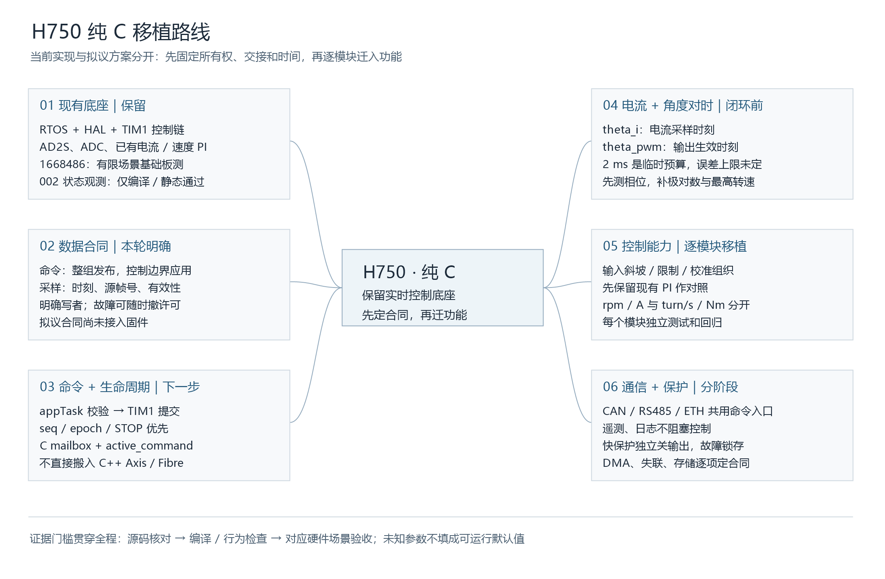
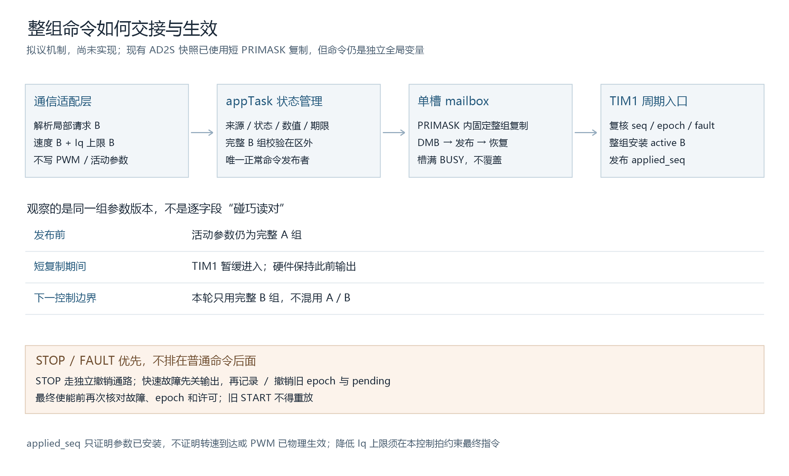

# 003 — 纯 C 移植基线、路线与数据交接合同

**一句话：** 保存纯C移植的数据/时间交接与新板存储方案；已落地部分看对应实施spec和当前架构，不能把这里的草案当作固件现状。

**状态：** 第0–5节为1668486＋002工作区的2026-11-06审查快照，停止同步维护“当前事实”；当前唯一事实入口是[ARCHITECTURE](../ARCHITECTURE.md)。第6节命令方案的落地与取舍查005/008；第7节路线、第9节DMA、第10节新板存储继续在本spec维护。物理对时、DMA与外Flash方案仍为**拟议**。第10节于2026-11-17基于30aa8d1及现有文档工作区补充，本轮未改固件。

| 改了哪里 | 改前 → 改后 | 为什么 | 谁执行、交给谁 | 验证情况 |
| --- | --- | --- | --- | --- |
| 当前事实入口 | 分散审查表 → 当前架构统一维护 | 防止历史与现状混淆 | 源码核对 → 架构页 | 原构建证据保留；文档整理见004 |
| 命令/停止合同 | 独立变量 → 原拟议整组命令与控制边界 | 防半更新、旧命令复活 | appTask → TIM1 | 原方案保留；实施与验证查005/008 |
| 时间与DMA方案 | 临时预算/无DMA → 明确待实现的时间与内存规则 | 避免把完整快照当同步采样 | 未来采集/通信 → 控制 | 参数未知；方案尚未实施 |
| 新板存储 | 型号未记录 → H750＋W25Q32JV确认、分区/启动草案 | 区分存储容量、执行位置和实时约束 | 未来存储服务 → RAM配置快照/启动装载 | 资料/现有map只读复核；新功能未实施 |

**验收：** 原现状源码检查PASS、基准编译PASS仅支持当时固件，见[003证据](../validation/003-architecture-build.txt)；方案主机/板测NOT_RUN（尚未实现）。001旧板测不适用于新增功能；002新增观察统一查[002](002-axis-status-observer.md)。原AXF指纹差异及原因未知的记录保留。

**图的身份：** 现有PNG/SVG是JSON＋PowerShell生成的历史讨论图，不是同名Mermaid的导出。同名.mmd是另写的早期草图；这些旧图稿保留原路径并冻结，不继续多源同步。当前架构只维护架构页内嵌Mermaid；未来方案图确需更新时在本spec选择唯一来源。

**实施去向：** 002有限待机观察已收尾；第6节的命令实施与取舍见[005](005-command-handoff.md)。本节保留原方案身份，当前事实查架构页；DMA和物理对时仍为拟议。未知数值不默认启用输出。日常入口：[README](../README.md)。

## 原审查快照与方案细节

日期：2026-11-06。工程：`D:/stm32H750/High_fengshan/FOC_T`，分支 `Xiao_ODrive`。已提交基线 `1668486`，当前含 002 只读状态观测的未提交改动。本轮审查启动、实时/后台链、全部活动输出写者、故障恢复、构建环境，并形成拟议交接合同；不修改固件行为。

**用户已明确：使用 C 实现所需 ODrive 组织方式与功能，不引入上游 C++ 类、模板、标准库或 Fibre 对象模型。** 机制和所有权现在明确；未知电机/硬件参数不编造。图中拟议模块不是已实现模块。

## 0. 证据等级与边界

| 标记 | 准确含义 |
| --- | --- |
| S：源码已核对 | 调用、读写或配置存在；不证明引脚电平或时序 |
| B：编译/链接通过 | 对应源码可构建、map/反汇编可复核；不是板测 |
| H：限定场景已观察 | 001 用户截图：母线断开，仅控制与传感器供电，基础计数/初始化/内存诊断；非完整波形验收 |
| N：尚未验证/尚未实现 | 分别注明缺测量还是缺代码，不能借用其他版本的 PASS |

1668486 的 H 证据见 [001 第15节](001-rtos-preflight.md)。002 状态字及增加后的 ISR 耗时尚无 H 证据，见 [002](002-axis-status-observer.md)。本轮开始时 002 记录的12项指纹中11项匹配，磁盘 AXF 不匹配，原因未知；本轮重新全量构建，0错误0警告，2分59秒，证据见 [003验证记录](../validation/003-architecture-build.txt)。不抹去原指纹发现。

用户答复：最高机械转速、电机/旋变实际极对数、允许电角度误差均暂未定。代码现有常量不等于已确认的硬件参数。

## 1. 启动流程审查快照（2026-11-06）

以下源码位置均相对工程根目录，行号对应本轮当前源码；每行同时给出函数。未另写目录的应用 `.c` 位于 `Core/Src`、应用 `.h` 位于 `Core/Inc`；HAL、Middleware、启动文件另列实际路径。

| 顺序 | 当前动作与上下文 | 文件 / 函数依据 | 证据 |
| --- | --- | --- | --- |
| 1 | 复位，ExitRun0Mode、SystemInit、C运行库初始化静态对象，再到 main | `MDK-ARM/startup_stm32h750xx.s:237 Reset_Handler` | S/B；复位电平N |
| 2 | MPU、HAL_Init；首次软件撤输出在 HAL_Init 之后 | `Core/Src/main.c:73 main`，81/86/89；`board_safety.c:48 BoardSafety_InitSafe` | S/B；不能证明复位到main期间EN低 |
| 3 | 主/外设时钟；HAL_InitTick配置TIM7毫秒时基 | `main.c:93/96`；`stm32h7xx_hal_timebase_tim.c:41 HAL_InitTick` | S/B，基线tick有H粗查 |
| 4 | GPIO→TIM1→ADC1/2/3→SPI1→USART1 | `main.c:103–109 main` | S/B |
| 5 | 再恢复功率GPIO低；ADC硬件校准、监测初始化、AD2S初始化及检查、FOC初始化及现有目标 | `app_runtime.c:153 AppRuntime_Init`；`current_sense.c:5 CurrentSense_Init`；`ad2s1210.c:507 AD2S1210_Init`；`open_foc.c:404 OpenFOC_Init` | S/B，初始化标志有H |
| 6 | osKernelInitialize，创建唯一业务任务appTask，并检查内核/句柄 | `main.c:115–116`；`freertos.c:94 MX_FREERTOS_Init`，121 osThreadNew，124检查 | S/B，任务有基线H |
| 7 | osKernelStart；若返回则Fatal，不回裸机循环 | `main.c:119/125` | S/B，失败注入N |
| 8 | appTask先启动三组ADC，再CH4，再撤MOE，然后启动TIM1 update IRQ | `freertos.c:143 StartAppTask` → `app_runtime.c:174 AppRuntime_TaskStart`，185/186/191/194；`current_sense.c:32 CurrentSense_Start` | S/B，采样计数H，物理相位N |
| 9 | TIM1消费2000帧等待+4096帧零偏；appTask看到ready后准备六路PWM和AF引脚 | `current_monitor.c:76 CurrentMonitor_Run_20kHz`；`app_runtime.c:200 BackgroundStep` → `:65 PreparePowerPWM` | S/B，ready有H |
| 10 | 明确run请求且条件满足，TIM1最终临界区允许EN/MOE | `app_runtime.c:332–337 AppRuntime_FastISR` → `board_safety.c:69 BoardSafety_SetOutputsEnabled` | S/B；基础测试run=0，带输出N |

**“TIM1拥有正常最终运行许可”不等于“只有TIM1写MOE”。** 步骤8/9的HAL启动函数也会置MOE/CEN，随后应用撤MOE；准备阶段依靠EN保持禁止。实际毛刺、复位默认电平和驱动行为待测。

## 2. 实时链与后台链审查快照（2026-11-06）

### 2.1 实时链

| 环节 | 当前执行者和数据流 | 文件 / 函数依据 | 证据 |
| --- | --- | --- | --- |
| 采样触发 | TIM1 CH4 OC4REF→TRGO2上升沿→ADC注入组，硬件触发每帧 | `Core/Src/tim.c:30 MX_TIM1_Init`，66/91；`adc.c:98/161/224 MX_ADCx_Init` | S/B，计数H；相位N |
| 控制中断 | TIM1 update→IRQ→HAL回调→FastISR | `stm32h7xx_it.c:168 TIM1_UP_IRQHandler`；`main.c:254 HAL_TIM_PeriodElapsedCallback`；`app_runtime.c:228 AppRuntime_FastISR` | S/B，基线H |
| 旋变硬件读取 | appTask操作SPI1/SAMPLE；TIM1只读发布副本 | `ad2s1210.c:798 AD2S1210_Run_1kHz`、139 GetSnapshot；`app_runtime.c:253` | S/B，有效标志H；角度精度N |
| 电流/母线读取 | 三JEOS均就绪才读JDR，未就绪立即返回；U=ADC1/JDR1，V=ADC2/JDR1，W=ADC3/JDR1，母线=ADC3/JDR2 | `current_sense.c:49 HasNewSample`、64 GetRaw；`current_monitor.c:76 Run_20kHz` | S/B，消费计数H；同源帧/量值N |
| 电流换算 | 零偏/量程换算；控制U=−(V+W)，实测U仅诊断；Clarke/Park使用传入foc_theta | `current_monitor.c:128–145 CurrentMonitor_Run_20kHz` | S/B，极性/时间关系N |
| 速度环/模式 | TIM1每20拍调用慢环，处理启动沿、对齐、模式、速度PI | `app_runtime.c:282–287`；`open_foc.c:492 OpenFOC_Ramp_1ms` | S/B，带电功能本轮N |
| FOC计算 | dq电流反馈→对齐电压、dq电流PI或开环角度→调制 | `app_runtime.c:313–315`；`open_foc.c:674 OpenFOC_Run_20kHz` | S/B，完整闭环N |
| PWM数据写入 | WritePhaseDuty→WriteDuty→CCR1/2/3；硬件更新事件才使预装载生效 | `open_foc.c:255/231/250–252`；`tim.c:79–93` | S/B，输出截止点/波形N |
| 最终许可/发布 | 复核前提、EN/MOE、只读状态、两列遥测 | `app_runtime.c:329–343`；`board_safety.c:69` | S/B，002观测HW=N |

TIM1时钟200MHz、PSC1、ARR2499、中心对齐、RCR1，推算周期49.98us、约20.008kHz；算法保留50us/1ms常量，约0.04%差异。本轮不改参数。依据 `tim.c:46–50`、`app_runtime.c:169`、`open_foc.c` 顶部时间常量；真实频率/相位不是源码推算就能验收。

### 2.2 后台链：一个业务任务，不是四个

| 职责 | 当前在哪 | 文件 / 函数依据与状态 |
| --- | --- | --- |
| 旋变 | appTask每1 tick尝试采集 | `freertos.c:143 StartAppTask` → `app_runtime.c:200 BackgroundStep`，S/B，基线H |
| 串口遥测发送 | appTask每5ms尝试，USART1 IRQ搬运发送 | `app_runtime.c:111 SendTelemetry`；`stm32h7xx_it.c:182 USART1_IRQHandler`，S/B；非独立commTask |
| 通信接收/解析 | 尚未实现业务RX入口 | Core无HAL_UART_Receive*/RxEvent/RxCplt业务；`usart.c:46 TX_RX`只是外设模式。CAN/ETH/RS485协议=N |
| 状态机 | 原模式/对齐在TIM1慢分频；axis_status仅观察 | `open_foc.c:492`；`axis_status.c:5 Publish`。无完整Axis管理任务 |
| 实时监测 | TIM1检查输入有效/超龄、缺帧及电流 | `app_runtime.c:253–308`，S/B，部分计数H |
| 内存诊断 | appTask每约1000ms查询栈/堆 | `app_runtime.c:217–223`，S/B，基线H |
| 日志 | 目前只有内存变量+两列遥测 | `app_runtime.c:25–50/111`；无logTask、事件日志环、持久化日志 |
| Idle/Timer | FreeRTOS内核任务 | `Middlewares/Third_Party/FreeRTOS/Source/tasks.c:1975 vTaskStartScheduler`；`timers.c:227 xTimerCreateTimerTask`，不是业务任务 |

`freertos.c:102–117`队列/互斥锁/信号量/定时器业务创建区为空。后续先复用appTask做请求校验和慢速状态管理；根据通信阻塞/负载预算再拆任务，不按功能名称机械增加线程。

## 3. 输出写入与故障清除审查快照（2026-11-06）

### 3.1 当前可达的PWM/驱动使能写者

下表覆盖应用全部输出入口及其实际HAL下游；库内未调用的通用DMA/Stop等API不当成当前活动写者。`HAL tim.c/ex.c/h`分别位于 `Drivers/STM32H7xx_HAL_Driver/Src/stm32h7xx_hal_tim.c`、`Src/stm32h7xx_hal_tim_ex.c`、`Inc/stm32h7xx_hal_tim.h`。

| 写者 | 写入什么 | 文件 / 函数位置与上下文 |
| --- | --- | --- |
| MX_GPIO_Init | EN/PB10低 | `Core/Src/gpio.c:54`，main；EN定义`Core/Inc/main.h:60–61` |
| GateInactive | EN BSRR失效、MODER/OTYPER/PUPDR | `board_safety.c:22–32`，所有关输出路径 |
| BoardSafety_DisableOutputs | TIM1时钟开时无条件清MOE，软件输出标志0 | `board_safety.c:36–45`，main/appTask/TIM1/故障；保留CEN/CH4，正常停机不清六路CCER |
| BoardSafety_InitSafe | 六路GPIO BSRR低和输出模式 | `board_safety.c:48–66`，main早期/应用初始化 |
| MX_TIM1_Init / TIM_Base_SetConfig | CR1/PSC/ARR/RCR/EGR | `Core/Src/tim.c:30/52/61` → HAL tim.c:6935，写点6956–6978；main |
| PWM_ConfigChannel / TIM_OCn_SetConfig | CCR1/2/3初值0，CCR4=1250，CCER/预装载配置 | `tim.c:79/83/87/93` → HAL tim.c:4268；CCR写7051/7127/7202/7263；CCER写6997/7054、7073/7130、7149/7205、7224/7266 |
| ConfigBreakDeadTime | 整个BDTR，初始MOE=0，死区/Break/AOE | `tim.c:108` → HAL tim_ex.c:2061/2120。当前Break/Break2/AOE全关闭 |
| HAL_TIM_MspPostInit | 六路GPIO切AF1_TIM1 | `tim.c:138/164/171/178`，main；之后AppRuntime_Init又恢复GPIO低 |
| TaskStart→PWM_Start(CH4) | CC4E、MOE、CEN | `app_runtime.c:186` → HAL tim.c:1463/1480/1485/1494/1499；appTask，随后:191撤MOE |
| PreparePowerPWM→PWM_Start/PWMN_Start | 六路CCER、MOE、CEN，再接AF | `app_runtime.c:65–91`；普通HAL同上，互补HAL tim_ex.c:1112/1129/1132/1140，CCER底层2898/2905/2908；appTask。之后撤MOE，EN维持禁止是设计要求 |
| Base_Start_IT(TIM1) | update IRQ和CEN | `app_runtime.c:194` → HAL tim.c:462/479/487/492；appTask |
| FOC_WriteDuty | CCR1/2/3占空比，不改EN/MOE | `open_foc.c:231/250–252`；HAL tim.h:1590–1594宏 |
| OpenFOC_Init→WriteDuty | 初始50%占空比 | `open_foc.c:404/430`，main；50%不是关输出 |
| OpenFOC_Run_20kHz→WritePhaseDuty/WriteDuty | 正常调制或停机/输入无效时50% | `open_foc.c:674/686/725`，TIM1；运行期间正常CCR唯一应用入口 |
| BoardSafety_SetOutputsEnabled | MOE=1、PB10高；拒绝则撤输出 | `board_safety.c:69/74–77`；唯一正常调用`app_runtime.c:335`，TIM1 |
| BoardSafety_LatchFault | 先撤EN/MOE，再清CH1–3六路CCER | `board_safety.c:88/92/95`，启动/任务/ISR/异常；保留CH4/CEN |

定义存在但当前无应用调用者：`open_foc.c:474 OpenFOC_Stop`（:489写50%，并清内部foc_enable）；`tim.c:187 HAL_TIM_Base_MspDeInit`（:196关闭TIM1时钟）。不得把它们当成当前正常停止链，也不应未经设计直接接新STOP命令。当前正常停止是run_request=0后TIM1撤EN/MOE，不是受控减速制动。

以上为S/B；复位/准备/故障时真实电平、HAL临时MOE变化影响、有效死区及关断延迟均N。

### 3.2 故障清除与恢复的全部现有位置

| 对象 | 位置 | 结论 |
| --- | --- | --- |
| board_fault_mask/first_fault/ipsr | `board_safety.c:15–17`静态初值；`:88 LatchFault`，99/102仅first记录及OR | 无运行中清错API；InitSafe不清fault；未找到应用NVIC_SystemReset。随MCU复位C初始化恢复 |
| axis_status FAULT | `axis_status.c:3/12`；`axis_status.h AXIS_STATUS_KEEP_FAULT` | 普通发布不清锁存；复位回BOOT；无清错API |
| AD2S软件诊断 | `ad2s1210.c:507 Init`，568清初值，730回读赋值，758–759启动恢复成功清当前/累计 | 不清board_fault。正常`UpdateFeedbackHealth:335`当前值每帧覆盖、累计值OR |
| AD2S芯片故障寄存器 | `ad2s1210.c:446 ReadAndClearFault`，458–462 SAMPLE/读0xFF/再次SAMPLE；Init调用696、741–744 | 启动及恢复路径读清，非周期性清错；读失败也发第二次SAMPLE，真实器件效果N |
| AD2S软件复位0xF0 | `ad2s1210.c:12`仅常量；software_reset_status只初始化 | **没有实际软件复位寄存器写入**。RESET未接MCU，实际是上电等待、配置及故障读清 |
| ADC JEOS/JEOC | `current_sense.c:27–29/58–60` | 清转换事件，不是清电机/板级故障 |
| PI/估计器reset | `open_foc.c:136/144/150` | 算法内部复位，不清板级故障，不授予输出许可 |

故障入口：`main.c:276 Error_Handler / :295 assert_failed`；`freertos.c:74/83`栈溢出/malloc，97/124内核/创建，175/181调度失败；`FreeRTOSConfig.h:156 configASSERT`；`stm32h7xx_it.c:73/88/103/118/133` NMI/HardFault/MemManage/BusFault/UsageFault；`app_runtime.c:160/176/267/305`初始化/内核/输入失效及HAL失败。其中`app_runtime.c:267/305`的运行反馈/ADC失效调用`BoardSafety_LatchFault`，撤输出并锁存后返回，任务和TIM1仍可继续诊断；初始化、内核/创建、HAL致命错误及CPU异常等进入`board_safety.c:108 BoardSafety_Fatal`，禁IRQ、关输出/锁存且不返回。不能把所有锁存故障都描述成Fatal。异常注入和物理关断仍N。

## 4. 构建、语言标准与内存审查快照（2026-11-06）

| 项目 | 当前事实 | 依据 |
| --- | --- | --- |
| 编译器 | ARMCC5.06 update7 build960，目标FOC_T | `MDK-ARM/FOC_T.uvprojx:10–14`和构建日志 |
| C标准 | C99+GNU扩展 | uvprojx:329/330，目标对象真实命令`--c99 --gnu` |
| C++ | 53个.c、1个.s、0个C++目标 | uvprojx Groups/Files；没有实际C++标准。uAC6=0下遗留v6LangP不作证据 |
| CPU/ABI/优化 | Cortex-M7.fp.dp、VFP硬浮点参数ABI，-O0/--debug/--split_sections，MicroLIB | 对象内ArmCC命令，fromelf Tag_ABI_VFP_args=1；uvprojx:193 useUlib |
| Flash | 0x08000000，128KiB；压缩后ROM59812B（RO59712B+RW初始化映像100B） | uvprojx:252–255；生成sct/map与003记录 |
| DTCM | 0x20000000，128KiB；实际0B | uvprojx:247–250；map RW_IRAM1 |
| AXI SRAM | 0x24000000，512KiB；RW+ZI25344B均在此 | uvprojx:309；map RW_IRAM2 |
| RTOS heap | heap_4，16384B，ucHeap=0x240012FC | `FreeRTOSConfig.h:71/126`；map |
| appTask栈 | 4096B，运行时从RTOS heap分配，不重复加进静态账单 | `freertos.c:54/121`；`CMSIS_RTOS_V2/cmsis_os2.c:472/501` |
| MSP | 4096B，0x24005300–0x24006300 | `MDK-ARM/startup_stm32h750xx.s:32–36`；map |
| Idle / Timer | 静态栈512B/1024B，各TCB92B | `cmsis_os2.c:2459/2473`；map |
| C库heap | startup配置512B，但链接剔除未使用HEAP | startup:43–48；map Removing HEAP |

scatter由uVision生成：uvprojx:370/374 useFile=0，实际`MDK-ARM/FOC_T/FOC_T.sct`被.lnp引用。没有建立未来ETH/DMA的专用D2区域/cache合同，不能随意把缓冲放任意RAM。语言/内存结论均S/B，不证明最坏栈安全。

在工程根目录全量构建（增量把-r换-b）：

```powershell
$build = Start-Process -FilePath 'D:\UV4\UV4.exe' -ArgumentList @(
  '-r', 'MDK-ARM\FOC_T.uvprojx', '-t', 'FOC_T',
  '-o', 'MDK-ARM\FOC_T\architecture-baseline-20261106.log'
) -WindowStyle Hidden -PassThru
$build.WaitForExit()
$build.Refresh()
$build.ExitCode
```

现有策略检查：

```powershell
& 'D:\ARM\ARMCC\Bin\armcc.exe' --cpu Cortex-M7.fp.dp --c99 -I Core/Inc -c tests/axis_status_compile_checks.c -o MDK-ARM/FOC_T/axis_status_compile_checks.o
& 'D:\ARM\ARMCC\Bin\armcc.exe' --cpu Cortex-M7.fp.dp --c99 -I Core/Inc -c tests/rtos_policy_compile_checks.c -o MDK-ARM/FOC_T/rtos_policy_compile_checks.o
```

002记录的27项和001记录的85项是编译期检查，不是MCU/RTOS运行测试；本轮全量工程构建不代表自动重跑这两个独立检查文件。检查进程退出码及日志Error/Warning。以上命令不含下载/调试启动。

## 5. 共享数据审查快照与时序方案（2026-11-06）

### 5.1 所有权表

| 对象 | 当前唯一正常写者 → 读者 | 现有交接 | 缺口 / 拟定边界 |
| --- | --- | --- | --- |
| 速度目标、电流上限、模式、PI参数 | 初始化/控制代码，且调试器可直接改多个volatile全局量 → TIM1 | 各字段独立，无整组事务 | 正式接口仅由状态管理发布整组请求；活动参数仅TIM1写。当前不能声称防半更新 |
| 运行请求/实际输出 | run_request独立调试变量 → TIM1；实际EN/MOE由board_safety执行 | 现有PRIMASK最终许可检查 | 未来请求、许可、应用确认分开，STOP/FAULT优先，不把请求等于已生效 |
| 旋变快照 | appTask采集发布 → TIM1/任务读取副本 | 32B固定字段PRIMASK复制+DMB，已有实现 | 内存一致已S/B，物理角度时间精度/外推尚N |
| 电流/母线 | ADC硬件写JDR → TIM1读取换算 | JEOS检查、软件消费计数，无带时间戳完整帧 | 需源触发序号/时刻、覆盖检测、角度关联，不能靠volatile补齐 |
| 控制内部积分器、dq给定、占空比 | TIM1（启动初值在main） | 同一执行上下文 | 后台正式通信不得直接改；配置通过控制边界应用 |
| 正常PWM | open_foc→CCR1/2/3 | TIM1单一正常控制写入口，另有main初值 | 后续收敛成board_pwm_apply边界时要单独回归，不本轮顺手重构 |
| 快速故障 | board_safety关输出/锁存 → 所有诊断读者 | 短PRIMASK、直接寄存器、不依赖任务 | 不通过日志/队列排队才能关断；独立硬件保护现状仍须核实 |
| 两列遥测 | TIM1发布 → appTask局部副本 → USART1 IRQ读发送缓冲 | 读写副本均在短PRIMASK；忙则不重写在发buffer | 扩展时增加control_seq/时间戳/版本；当前只保证两列组合 |
| axis_status | TIM1正常发布、board_safety故障发布 → 诊断读取 | 对齐32位字，现有临界区和故障保持 | 只读指示，无控制权；与其他Watch变量不是同一原子帧 |

依据：`open_foc.c:73–100`全局量、`:433 OpenFOC_SetTargetRPM`、`:334 FOC_UpdateSpeedPI`、`:492 Ramp`；`app_runtime.c:228 FastISR/111 SendTelemetry`；`ad2s1210.c:109 PublishSnapshot/139 GetSnapshot`；`current_sense.c:49/64`；`board_safety.c:69/88`；`axis_status.c:5/12`。当前没有通信RX业务，不把拟议的写者说成已有任务。

### 5.2 AD2S1210的时间与单位合同：现状

| 项目 | 当前精确含义 | 源码依据 |
| --- | --- | --- |
| 采样者 | appTask，每1 tick绝对周期尝试，实际边沿有调度/SPI抖动 | `freertos.c:152–183`；`app_runtime.c:203` |
| 锁存时刻 | SAMPLE置低、DSB后读取DWT和HAL tick，是边沿附近的软件时间戳 | `ad2s1210.c:295 PulseSample`，311→312→313→314；不是硬件捕获 |
| 读完时刻 | SPI传输在SAMPLE之后，不能用SPI结束时间冒充角度采样时间 | `ad2s1210.c:490/495 ReadNormalHAL`；超时参数仍10ms |
| 位置单位 | raw×2π/65536，是旋变电气角rad，不是机械角 | `ad2s1210.c:26/833`；`open_foc.c:466–470`再用方向、极对比、偏置换算电机电角 |
| 速度单位 | 按代码旋变4极对换成机械rpm；是两次采样间隔的差分速度，另经α=0.10滤波 | `ad2s1210.c:28–29/173/223–225/844–851`；不是锁存瞬间无延迟的瞬时速度 |
| sequence | 采集尝试序号，失败也增加并发布无效帧 | `ad2s1210.c:811–812/861–873` |
| valid/speed_valid | 首帧没有差分速度；失败后重建基准；超2ms间隔速度无效 | `ad2s1210.c:181–212` |
| 控制可用条件 | 位置有效、速度有效，DWT和HAL两种年龄均不超过当前2ms | `app_runtime.c:253–259`；`app_policy.h:19 APP_FEEDBACK_FRESH` |
| 半帧防护 | 8字段/32B快照，发布与读取保存PRIMASK→屏蔽→固定复制→DMB→恢复 | `ad2s1210.h:9 FeedbackSnapshot`；`ad2s1210.c:109/139`。SPI/格式化/浮点计算在区外 |

ADI说明SAMPLE下降沿把跟踪环结果送入位置/速度寄存器，参见[官方数据手册第24页](https://www.analog.com/media/en/technical-documentation/data-sheets/AD2S1210.pdf)。软件记录的是附近时刻；引脚延迟、芯片跟踪动态和滤波延迟仍须测量/建模，不能称为无误差的轴机械角。

### 5.3 物理同步仍未完成，不能和内存一致混为一谈

1. `current_sense.c:49/64`只有JEOS判断和四个JDR顺序读取；`current_monitor.c:98 monitor_sample_sequence`只是成功消费数。它们不是ADC硬件源帧号，也没有采样时刻。三个JEOS为1不能单独证明同源触发；PRIMASK也不会让ADC硬件停止更新。
2. U/V/W各在ADC1/2/3的rank1，母线在ADC3 rank2，母线采样本来就稍后。相间真实偏差、读出完成到下次覆盖的裕量尚N。依据`adc.c:98–111/161–174/224–246`。
3. 闭环中先`OpenFOC_SetRotorFeedback`更新foc_theta，再`CurrentMonitor_Run_20kHz(foc_theta)`做Park；使用的是最新已发布、可能最多2ms旧的旋变角，没有外推到电流采样时刻。依据`app_runtime.c:282/292`、`open_foc.c:451/466–470`。
4. 模式2中SetRotorFeedback不更新foc_theta；本次Park用此前命令角，后续FOC才推进角度。对齐阶段Park可能用旋变坐标，输出却固定0角，且PI被复位。依据`open_foc.c:464–470/690–707`。这可能反映采样与下一输出阶段的区别，但目前没有明确时间合同/波形，不能宣称已经补偿。
5. 后续必须分清`theta_i`（电流采样时刻，用于Park）和`theta_pwm`（PWM实际生效时刻，用于逆变换/调制），不能因为都叫theta就共用未经对时的值。

拟议每轮关联记录：`control_seq + current_trigger_seq + t_i + angle_seq + t_angle + command_seq + pwm_apply_seq/t_pwm`。ADC的t_i应来自硬件事件或已验证的触发相位重建，不能拿JDR读取时间充当采样时间。若角度样本在t_i之前或之后，必须用有符号、有范围的时间差及明确插值/外推策略，不把“最新”自动当作“最匹配”。这个记录和对时算法尚未实现。

用户最高转速/极对数/角误差未定，因此现在只能冻结机制，不能冻结新的允许年龄。恒速、无补偿时的电角滞后近似为：

`电角误差[deg] = 6 × 电机极对数 × 机械转速[rpm] × 时间差[s]`。

时间预算还要留出锁存时间误差、ADC相位不确定性、跟踪/滤波误差及加速度误差。现有2ms仅为软件交付预算，不是任何转速都可用的控制精度保证。该年龄检查发生在FastISR取得快照后的检查时刻，不代表已经把角度外推到电流采样或PWM生效时刻。差分测速还需满足相邻旋变电气角变化小于半周，否则16位差分存在绕回歧义；其速度/间隔边界也要由实际极对数和最大间隔推导。

保留当前1kHz采集+有界预测、提高采样率、改为硬件同步锁存，都是后续需结合CPU/SPI/引脚和允许误差评估的方案；本轮不凭空选择新频率、滤波带宽或外推上限。优先取得时序证据，再选最低复杂度且满足误差的方案。

### 5.4 遥测已实现的最小正确交接

TIM1在`app_runtime.c:338–340`发布两列速度；`SendTelemetry:111–150`检查UART状态，PRIMASK内复制到任务局部变量，区外格式化。静态96B发送缓冲在HAL_UART_Transmit_IT成功后交给UART IRQ，忙时只计丢帧，不改在发buffer。HAL依据：`Drivers/STM32H7xx_HAL_Driver/Src/stm32h7xx_hal_uart.c:1294–1337`保存指针/长度，`:4061 UART_TxISR_8BIT`读取，`:4203 UART_EndTransmit_IT`恢复READY。

这保证当前两列同一次发布及发送缓冲生命周期；没有完整control_seq/时间戳帧。未来扩展遥测仍应整帧读取副本、区外编码，日志过载允许丢弃并计数，不能阻塞控制或延迟快速关断。

## 6. 纯 C 整组命令交接合同 v0（拟议，尚未实现）

> 标题与下文保留制定时的原方案。2026-11-07已有005实现：具体接口、异步fault只关硬件而epoch由TIM1撤销、配置拒绝策略及验证以[005](005-command-handoff.md)为准；不把本节所有未来要求视为均已完成。

### 6.1 先定职责，再定结构体

- 通信适配层只生成请求；不写PWM、不改活动PI/目标/限制。第一阶段可用受控测试注入入口验证合同，尚不绑定CAN/RS485/ETH协议。
- appTask中的状态管理是唯一正常请求校验/发布者；它拥有requested状态与请求结果，不直接写实际输出状态。
- TIM1在控制周期入口提交整组有效参数，独占active_command、实际控制状态和控制内部量。生命周期模块分慢速决策与快速提交函数，各字段写者明确，不形成两个相互争抢的状态机。
- board_safety仍可随时撤输出；快速故障不等待appTask或通信队列。后台随后记录事件和管理恢复。

拟议接口名（文件尚不存在）：`command_gateway.c:Command_Decode`、`axis_manager.c:Axis_ValidateRequest/Axis_PublishRequest`、`control_boundary.c:Control_ConsumePending/Control_Revoke`。不把这些名字画成已实现。

### 6.2 建议冻结的32B命令载荷与所有权

此32B只定义首版**速度模式**的内核命令：`control_mode`仅支持`FOC_CONTROL_SPEED_CURRENT_LOOP=1`（现有符号见`Core/Inc/open_foc.h:9`）。模式0需要电流目标、模式2需要开环电压等额外字段，因此此入口对0/2明确返回`UNSUPPORTED_MODE`，不回退或借用旧全局给定。它不改变现有固件默认模式；未来正式入口接管时，原调试写变量路径必须显式隔离，不能绕过合同。其他模式另设明确的有类型载荷。

| 字段 | 类型/单位 | 规则 |
| --- | --- | --- |
| command_seq | uint32_t，板端接受序号 | 与上位机事务号分开；应用/拒绝必须回传对应序号 |
| run_epoch | uint32_t，运行代次 | STOP/FAULT后旧代次失效，不能重放旧START |
| opcode | uint32_t，枚举编码 | 此普通载荷仅START、UPDATE；STOP_DISARM另走独立票据。暂不实现清错/受控制动 |
| control_mode | uint32_t | 此载荷首版仅支持速度模式1；其他模式明确拒绝，未来扩展模式切换需停机 |
| speed_target_rpm | float32，机械rpm | 有限数，方向定义固定；范围来自已确认配置，不能默认NaN/无穷或无限制 |
| iq_limit_a | float32，q轴电流指令幅值上限A | 非负且不超过已确认上限；不是硬件过流保护阈值 |
| received_tick_ms | uint32_t，TIM7/HAL毫秒 | 由网关在请求进入时记录HAL_GetTick；不使用主机时间或RTOS tick混算 |
| expires_tick_ms | uint32_t，同一HAL时基 | 同时约束pending与active的持续有效期；采用差值回绕比较，期限/有效比较跨度小于2^31 ms |

所有接收、消费与最终许可处的时间检查统一使用`HAL_GetTick()/TIM7`，不能混入起点不同的RTOS tick。pending消费时到期则拒绝`EXPIRED`；active在每个TIM1拍及最终许可处检查，到期撤输出、撤许可、作废普通pending并推进epoch一次，记录`EXPIRED`，之后必须用新epoch重新明确START。数值期限尚待配置，不设无限有效或伪造默认值；半范围以外的时间关系无效，进入禁止状态而非尝试猜测。期限从请求进入时计算，不能排队后再续期。

这是建议载荷布局，不是已经生效的协议。32B由8个32位字段构成，不用C枚举宽度/packed结构碰运气；实现时做尺寸/对齐编译检查。线路编码另定义字节序、长度、校验，不能直接把C结构体当网络报文。

`pending_command`只有状态管理任务写、TIM1消费；`active_command`只有TIM1写读，任务只能读状态快照。`pending_ready`的写者是发布者置1、消费者清0，均按同一交接协议处理；volatile只是可见性标注，不是同步机制。

### 6.3 一次更新如何保证不混版本

1. 通信在局部内存解析整帧；状态管理在局部完成来源、状态、有限数、范围、模式和期限校验。此时ISR继续使用完整旧A组参数。
2. 发布者保存PRIMASK并屏蔽可屏蔽中断，复核fault、运行epoch、STOP pending和mailbox是否空。槽满返回BUSY，不覆盖已接受命令；失败不修改现有活动组。
3. 在这段短临界区只做固定大小整组复制、元数据/ready发布和DMB，再恢复原PRIMASK。SPI、解析、浮点校验、日志、动态分配均在区外。**实际防半更新依赖整个复制受保护，不是最后写一个bool就足够。**
4. TIM1在每个控制迭代入口、任何慢环/FOC计算之前，最多取一个候选并清槽；检查seq、epoch、期限和实时故障，整组安装到ISR私有active_command。任务不能在IRQ0运行期间抢占它。
5. 本轮所有控制逻辑读取同一份active版本。消费与最终开输出前都复核故障/撤销代次。无新命令则沿用尚有效的活动组，绝不等任务、不自旋等奇偶序号。
6. 仅提交成功才发布applied_command_seq及control_seq；收到、接受、已应用、被拒绝是不同结果。它不证明机械转速到达，也不证明PWM预装载已经发生硬件更新。

结果只有完整A组或完整B组，不出现“B速度+A上限”。普通FreeRTOS临界区使用BASEPRI，不能屏蔽TIM1优先级0；本交接采用保存/恢复PRIMASK，并实测它增加的最长IRQ延迟。NMI/CPU故障不能把这个mailbox当可等待数据；现有Fatal不返回，先关输出。

特别注意：速度环仍每20拍运行时，参数安装和算法响应并非同一时刻。新速度目标由下一次慢环斜坡读取；**降低Iq上限必须在本20kHz拍约束最终Iq指令**，不能等下一次慢环才生效。必要的积分器限幅/无扰处理应纳入该模块的实现spec与测试，不在本轮暗改算法。

### 6.4 STOP、FAULT、epoch和满槽

- STOP_DISARM使用独立的`stop_pending/stop_ticket_seq/stop_epoch`票据，不占32B普通mailbox。唯一正常发布者是状态管理任务：在短PRIMASK区内填写固定元数据，最后发布pending；已有待处理STOP时返回已有ticket并幂等合并，不覆盖票据、不重新分配接受序号。通信事务号到ticket的映射留在通信/状态层。
- TIM1在控制入口最先消费STOP：先撤输出，作废普通pending和active许可，推进run_epoch，再发布`stop_applied_seq/result`并清票据。已经处于故障/禁止状态时可报告已禁止，不清故障、不凭旧STOP恢复许可；不反复推进同一票据的epoch。普通槽满不能挡STOP。这里的边界是“票据已发布后下一次TIM1处理”，线路接收到任务发布之间的延迟另行测量，不声称整个链路只有50us。
- Fatal可能没有机会回通信确认；未收到ACK不代表未关输出。NMI/Fatal不读取可能半写的命令或STOP票据载荷，仍先走现有硬件撤输出路径。
- 快速故障先由board_safety撤输出/锁存，再由固定、无等待的撤销入口使旧命令失效；不为更新文档状态而延迟硬件关断。若Fatal后没有后续TIM1，锁存fault本身仍禁止启动。
- epoch只能由控制边界模块的提交/撤销入口修改；普通路径在TIM1，异步故障撤销入口使用同一PRIMASK互斥合同。通信/状态管理只读取副本，不能自行加epoch取得许可。请求进入网关时即保留`expected_run_epoch`，后续校验只能验证，不能给旧排队请求换成最新epoch；受控测试注入也必须显式给代次。epoch达到UINT32_MAX时保持禁止并要求新会话/复位，不默默绕回。
- run_epoch只处理同一运行会话内的失效，不能独自防止跨MCU复位重放。真实通信还需当前板端会话ID，放在独立协议封装元数据中；复位/重新建会话时清旧RX缓存、排队请求和普通许可，旧会话START拒绝。跨复位不重复会话ID的生成与握手机制由后续协议spec实现；机制完成前不宣称已防跨复位重放，也不接自动恢复START。新会话建立本身不得授予输出许可。
- 发布后到消费前若STOP/FAULT发生，候选必须被废弃；最终使能处再次核对当前fault、epoch和许可，防止“校验时正常、开输出前已故障”。
- 本阶段保持现有故障仅复位恢复，不顺手加运行中clear API。将来确需清错，清错只回待机，仍需新epoch的新START，绝不恢复旧目标。
- 满槽采用显式BUSY；若以后需要“最新目标覆盖”，应新增并测试独立语义，不混用于START/STOP等顺序事件。
- 当前STOP是撤输出，不能叫受控减速或再生制动。受控停车依赖母线回馈与功率硬件参数，另立规格。

### 6.5 必须验收的交错场景

整组A/B发布中断、槽满、重复/乱序seq、pending/active分别过期、HAL时基回绕、NaN/Inf、拒绝模式0/2、START与STOP同拍、重复STOP返回同票据、发布后故障、故障先于最终使能、旧epoch重放、排队旧请求不能换代、epoch耗尽、降电流上限恰逢非慢环拍、任务长时间停顿、旧会话/复位后的旧命令。主机行为测试与目标编译分别记账；ISR/临界区耗时、真实输出另外板测。尚未实现的合同不能提前标PASS。

## 7. 移植表与顺序

固定上游参考：[ODrive fw-v0.5.6 / a308314](https://github.com/odriverobotics/ODrive/tree/a308314ed2ca613164b81e7bbdfacc53cd1859ff)。这是架构/算法参考；复制代码时单独保留版权与[MIT许可](https://github.com/odriverobotics/ODrive/blob/a308314ed2ca613164b81e7bbdfacc53cd1859ff/LICENSE.md)。

| 阶段 | 参考逻辑 → 纯C目标 | 保留 / 改动边界 | 完成门槛与当前状态 |
| --- | --- | --- | --- |
| A 基线 | 当前H750启动/RTOS/输出入口 | 保留HAL、TIM1实时链、已有PI；本轮明确事实/单位/证据 | 本文完成；002只读观测B，HW待测 |
| B 交接合同 | OutputPort新鲜度概念 → 显式C帧、valid、seq、时刻与所有权 | 不照搬C++端口连接；不把端口当线程安全 | 本文为拟议；命令/时序合同实现与测试尚N |
| C 命令+生命周期 | Axis请求/当前状态分离 → appTask校验、TIM1边界提交 | 不新增Axis线程；先统一单源命令，保留快故障路径 | mailbox/epoch/应用确认/拒绝场景通过后再接真实协议；尚N |
| D 采样+角度 | Encoder/FOC时间戳思路 → 本板AD2S与ADC对时、theta_i/theta_pwm | 保留具体驱动，补源帧/时间证据；不直接复制上游8kHz配置 | 需要真实相位、极对数、最高速度和误差预算；尚N，闭环推进前完成 |
| E 控制能力 | Controller输入斜坡/限制及校准组织 → C函数+显式状态对象 | 一次迁一个模块；先保持现PI可比较；rpm/A与turn/s/Nm不能直接混用 | 行为测试+量纲/限幅/最坏耗时+受控板测；未开始 |
| F 通信/存储 | 上游通信接口思想 → CAN/RS485/ETH适配统一请求与遥测 | 不把Fibre/C++属性层搬入；硬件DMA/cache、协议、失联各自定合同 | 基于实际首选接口分批实现；日志/Flash掉电一致性后续，未开始 |
| H 保护/分级验收 | 独立关断+故障管理贯穿A–F | 缺失阈值不填默认可运行值；硬件快保护不依赖任务 | 当前Break/Break2关闭，器件故障位仅诊断；物理关断和完整保护尚N |

C和D可在合同冻结后分别进行纯软件开发与硬件测量，但真正带输出闭环验收必须同时满足两侧条件。高级轨迹、无感、弱磁等未纳入当前范围，不为“像ODrive”一次性全搬。

上游依据：

- [axis.hpp:202](https://github.com/odriverobotics/ODrive/blob/a308314ed2ca613164b81e7bbdfacc53cd1859ff/Firmware/MotorControl/axis.hpp#L202)、[axis.cpp:455](https://github.com/odriverobotics/ODrive/blob/a308314ed2ca613164b81e7bbdfacc53cd1859ff/Firmware/MotorControl/axis.cpp#L455)：请求与当前阶段/执行链。
- [component.hpp:35/120](https://github.com/odriverobotics/ODrive/blob/a308314ed2ca613164b81e7bbdfacc53cd1859ff/Firmware/MotorControl/component.hpp#L35)：端口成员函数并非默认线程安全；只借鉴freshness，不借名替代同步。
- [foc.cpp:56/100/163](https://github.com/odriverobotics/ODrive/blob/a308314ed2ca613164b81e7bbdfacc53cd1859ff/Firmware/MotorControl/foc.cpp#L56)：区分电流/控制/输出时间，按时间差使用角度。不能把本板现状说成已实现相同机制。
- [controller.hpp:24/107/113/130](https://github.com/odriverobotics/ODrive/blob/a308314ed2ca613164b81e7bbdfacc53cd1859ff/Firmware/MotorControl/controller.hpp#L24)、[controller.cpp:143](https://github.com/odriverobotics/ODrive/blob/a308314ed2ca613164b81e7bbdfacc53cd1859ff/Firmware/MotorControl/controller.cpp#L143)：输入模式、速度设定与转矩输出；量纲转移需要本板参数。
- [encoder.hpp:102–115](https://github.com/odriverobotics/ODrive/blob/a308314ed2ca613164b81e7bbdfacc53cd1859ff/Firmware/MotorControl/encoder.hpp#L102)：相位rad与位置turn/速度turn/s分开；本板保持明确的旋变电气rad、机械rpm、电机电角rad。





历史独立草图（不是上述PNG/SVG的生成源，不再同步维护）：[思维导图Mermaid](../architecture/003-porting-mindmap.mmd)、[交接图Mermaid](../architecture/003-command-handoff.mmd)。历史PNG/SVG实际生成源为`docs/architecture/003-diagrams.json`及`render-003-diagrams.ps1`。这些讨论快照不代表已实现；不将JSON、mmd和图片作为多份当前事实维护。

## 8. 已定机制、待讨论参数与下一步

已定：C实现、保留TIM1实时链；任务不直接写PWM；整组请求和活动参数分离；每轮唯一命令版本；快速故障优先；现状/拟议和S/B/H/N分开记录；未经验证的硬件值不默认启用输出。

建议当前讨论点：

1. 单槽BUSY语义先保证顺序和可追踪性；未来是否需要单独的“最新目标覆盖”接口，可按上位机更新率决定。
2. 状态管理先放appTask，未来实际通信负载是否要求独立通信任务，由测量决定。
3. 角度时间关系采用何种低复杂度方案，要先补最高转速/极对数/允许电角误差和触发相位；这些用户暂未定，不阻止文档和纯软件合同继续，但阻止宣称高转速精度已满足。
4. 首个真实通信接口及失联时限尚未选定；先做不依赖协议的命令边界，避免各协议以后直接写控制变量。
5. 当前设备故障位仅诊断、Break关闭；硬件保护资料及真实关断验证作为带输出推进条件，不由新状态机名字替代。

下一项最小实现应另立spec：先实现第6节速度模式命令边界及可执行行为测试，再逐步让调试/通信请求经过它；数值范围/期限未配置时测试拒绝路径和受控用例，不默认授予真实运行许可。002的分轮板测与当前验收状态统一见[002 spec](002-axis-status-observer.md)，本方案不重复维护其结果；不自动烧录、提交或合并。

## 9. 后续 DMA、内存与 D-cache 合同（2026-11-06，规划，未实施）

用户要求明确后续数据传输哪里用DMA、缓冲区放哪里、DMA是否可达及cache一致性，然后继续下一步测试。本节只补架构合同；不打开DMA、不改MPU/scatter、不重生成CubeMX。本轮先完成002待机状态观测复测，不能把它记作DMA验证。

### 9.1 方案制定时基线与后续使用表

本节“当前”列为方案制定时的基线快照；后续已实现状态只在[架构页](../ARCHITECTURE.md)维护。

DMA像搬运工，负责把一串字节从外设搬到内存。CPU负责解释这些字节、校验命令；DMA不直接改速度目标、运行许可或PWM。D-cache像CPU手边的副本，搬运工通常只看RAM里的原件，因此必须处理两份内容的一致性。

| 链路 | 当前实现 | 后续DMA计划 / 边界 |
| --- | --- | --- |
| USART1遥测 | `Core/Src/app_runtime.c:111 SendTelemetry`，143使用HAL_UART_Transmit_IT；51静态96B缓冲 | 当前可继续IT；较长帧/更高负载时采用DMA1/2 TX，优先按完整帧调度，忙则排队或有界丢弃 |
| UART/RS485命令接收 | 没有业务RX/帧解析 | 合适的首个DMA场景：DMA1/2 RX环形或双缓冲，HT/TC/IDLE通知后台解析；具体UART/stream/request待选接口后分配，不能照搬USART1到未知RS485管脚 |
| RS485发送 | 尚未实现 | DMA1/2 TX搬字节；DE撤销以UART真正发送完成TC为依据，不能把DMA搬完当作最后停止位发完 |
| LAN8742A以太网 | 尚未实现ETH/LwIP业务 | PHY连接STM32 ETH MAC，使用MAC内置DMA，不占普通DMA1/2 stream；同时管理RX/TX描述符及每个payload缓冲 |
| FDCAN | 尚未实现 | 使用FDCAN专用Message RAM/FIFO，初版不安排普通DMA1/2；CPU有界搬消息到任务队列，两个实例的Message RAM布局不得重叠 |
| AD2S1210 SPI1 | `Core/Src/ad2s1210.c:394/495`阻塞HAL_SPI_TransmitReceive，短1/3字节事务 | 先保留；只有采样率/CPU预算要求时才评估DMA1/2 RX+TX。DMA不提高250kHz线速，也不自动同步SAMPLE与ADC；迁移须保留CS/A0/A1/WR/SAMPLE时序、超时和快照时间戳 |
| 三ADC注入组 | `Core/Src/current_sense.c:32/64`启动注入并读取JDR | 当前20kHz链不改DMA；常规组DMA与注入JDR是不同数据路径，不能直接换API。以后新增ADC常规采样时按具体ADC及DMA master重新核对，不能套用UART的内存结论 |
| W25Q32/其他大块存储 | 仍是后续需求 | 确定SPI/QSPI实例后再选DMA/MDMA及可达区域；长块读写可受益，擦写忙时间仍由Flash本身决定，不放TIM1实时中断 |

当前Core没有DMA句柄、__HAL_LINKDMA、DMA初始化/启动或Stream IRQ。`.ioc:72–85`的IP清单无DMA；`:125 NVIC.ForceEnableDMAVector`只是生成选项。`stm32h7xx_hal_conf.h:92–93`启用DMA/MDMA库也不等于应用使用了DMA。

FDCAN专用RAM依据[ST AN5348](https://www.st.com/content/st_com/en/technical-documents/an5348-introduction-to-fdcan-peripherals-for-stm32-mcus-stmicroelectronics_asset/chunk-002-topic-an5348-implementation-can-fd.html)。ETH独立DMA及描述符规则依据[ST Ethernet FAQ](https://community.st.com/stm32-mcus-60/ethernet-not-working-on-stm32h7x3-91)。此处只借鉴与硬件相关的要求，不照抄旧HAL版本示例的完整布局。

### 9.2 缓冲区放在哪里，谁能访问

| 区域 | 本板容量/地址 | DMA1/2 | ETH内置DMA | 本项目策略 |
| --- | --- | --- | --- | --- |
| DTCM | 128KiB，0x20000000起 | 不能直接访问 | 不能直接访问 | 不放上述DMA缓冲；MDMA可通过另一条路径访问TCM，不据此推断所有DMA都行 |
| AXI SRAM | 512KiB，0x24000000起 | 可达 | 可达 | 当前普通数据/RTOS堆在此；可达不等于已解决cache和生命周期 |
| D2 SRAM1/2 | 128KiB+128KiB，0x30000000/0x30020000起 | 可达 | 可达 | 首选池不足时可扩展，单独核算/link/MPU |
| D2 SRAM3 | 32KiB，0x30040000–0x30047FFF | 可达 | 可达 | 建议作为首个通信DMA专用池；目前未分配、未配置MPU |
| D3 SRAM4 | 64KiB，0x38000000起 | 可达 | 可达 | BDMA需使用其可达D3存储；BDMA不能使用上面的D2池。不是当前通信池默认位置 |

可达性针对STM32H750及其具体总线矩阵，依据[RM0433内存/系统架构](https://www.st.com/resource/en/reference_manual/dm00314099-stm32h742-stm32h743-753-and-stm32h750-value-line-advanced-arm-based-32-bit-mcus-stmicroelectronics.pdf)。D2是此项目的分配选择，不能说它是DMA1/2唯一可达RAM，也不能称为所有DMA通用池。

当前scatter只有Flash、DTCM和AXI区，见`MDK-ARM/FOC_T/FOC_T.sct`；map的RW+ZI均在0x24000000–0x24006300。拟议SRAM3池与当前分配无重叠，但**地址空闲不等于池已建好**。32KiB是否够网络协议栈，仍须按MTU、描述符数、RX/TX数量和最坏积压核算；不能把整个LwIP堆默认塞进去。

建议实现时采用固定对象、独立linker section，不从普通RTOS堆或函数栈临时取DMA缓冲。ARMCC5可使用显式section和__align(32)，再通过实际scatter选择器绑定D2；仅写section名不能保证地址。当前scatter由uVision自动生成，须维护可复现的工程/link配置，不仅改会被覆盖的生成文件。每次从map检查地址、尺寸、32B对齐、池内无重叠，增加容量/边界检查。

**启动依赖**：`Core/Src/system_stm32h7xx.c:86`的DATA_IN_D2_SRAM被注释，`:272–284 SystemInit`中的D2 SRAM时钟开启分支未生效。如果新section需要C运行库清零/复制，必须在`__main`之前开相应SRAM时钟（`startup_stm32h750xx.s:237 Reset_Handler`先SystemInit后__main）。不能等main里的MX_DMA_Init才处理。若选择UNINIT方案，则必须明确先开时钟、再显式初始化、再交给DMA；不能使用未初始化描述符。

### 9.3 当前cache状态与首选策略

Core没有SCB_EnableDCache/ICache调用或直接置CCR缓存使能位；这是源码结论。当前调试会话的实际状态另读SCB->CCR bit16/DC。`Core/Src/main.c:219 MPU_Config`只有4GB region0、NO_ACCESS、SubRegionDisable=0x87，SRAM所在子区不由该region覆盖，走特权默认映射。**不能因为这里出现NOT_CACHEABLE，就说所有SRAM已经不可缓存。**

首版建议：通信payload专用池设为 **Normal、non-cacheable、RW、execute-never**，按MPU幂次尺寸/基址对齐和region优先级配置。在启动DMA、使能cache之前完成；普通CPU工作区可保留独立cache策略。ETH描述符单独对齐分区，按ST要求采用Device或Strongly-ordered属性；它们不能与LwIP可能做非对齐访问的payload混在同一个Device子区。

这样CPU和DMA不再因这个池的D-cache副本而看到不同内容。仍需内存屏障和所有权：CPU写好payload/描述符后，按驱动约定完成DMB/DSB及OWN/启动顺序；CPU不能改DMA持有的缓冲。DMB/DSB不替代cache clean，non-cacheable也不等于不用交接协议。DMA运行过程中不临时切换MPU属性；将来开启D-cache作为独立变更回归验证，不能为了调试一直全局关cache而声称设计完成。

### 9.4 若将来选择cacheable payload，固定以下维护顺序

| 方向 | 必须执行的顺序 |
| --- | --- |
| TX，CPU→DMA | CPU独占填充→clean所涉及完整缓存行→屏障保证完成→交DMA；DMA归还前不改、不释放、不复用 |
| RX，DMA→CPU | 独占接收区，DMA启动前invalidate；需要保留原脏数据时只能在DMA启动前clean+invalidate→屏障→交DMA；完成且CPU取得稳定区间所有权后再次invalidate→屏障→CPU读取 |
| RX禁止操作 | 不能在DMA写入后再clean旧缓存副本，那可能把新收到的数据覆盖；不能读取仍在改写的区间 |

M7缓存行32B（本工程`Drivers/CMSIS/Include/core_cm7.h:2234`）。起始地址、预留尺寸和独立交接块均按32B对齐/填充，独占所维护的行；不能将任意未对齐数组向外取整后误伤邻接变量。循环DMA的半缓冲边界也要满足要求；IDLE事件不表示DMA停了，不能直接对仍由DMA写的半行做缓存维护。首版使用non-cacheable池可减少这类边界，但仍必须处理RX追尾/覆盖。

依据[ST AN4839](https://www.st.com/resource/en/application_note/an4839-level-1-cache-on-stm32f7-series-and-stm32h7-series-stmicroelectronics.pdf)和[ST DMA FAQ](https://community.st.com/stm32-mcus-60/dma-is-not-working-on-stm32h7-devices-97)。RX前后invalidate另参见[ST cache一致性说明第5节](https://community.st.com/stm32-mpus-61/how-to-maintain-dcache-coherency-for-dma-on-stm32-devices-167548)。该文示例API属于MP2；H750应核对本工程CMSIS SCB_*DCache_by_Addr及屏障，不能照抄其HAL_DCACHE接口。

### 9.5 缓冲生命周期与控制命令仍是两层合同

- TX：任务准备完整帧，驱动取得使用权，完成后归还。不能DMA发一半任务把同一数组改成下一帧；RS485的DE管理额外等待UART TC。
- RX：DMA发布已完成区段/生产位置，任务只消费稳定可读区间；环形缓冲被追尾时丢弃不完整帧并计overrun，不能继续拼出伪命令。HT/TC/IDLE只通知进度，长度、CRC、序号、拆包/粘包由协议层处理；IDLE不是通用协议帧边界。
- ETH：OWN位、描述符和payload分别管理；RX/pbuf被协议栈持有期间不能重交DMA。首版可拷贝到任务拥有的帧以简化生命周期；零拷贝后续另定归还合同。
- 中断只记录事件/有界交接，解析和日志在任务。若DMA/ETH IRQ调用RTOS通知API，优先级数字必须不小于5并选正确ISR接口；TIM1优先级0仍不调用RTOS。
- DMA→完整消息→任务校验→第6节整组命令→TIM1控制边界。DMA不直接写active_command，更不直接改PWM。cache一致性、任务同步和电流/角度物理对时分别验证。PRIMASK只屏蔽CPU可屏蔽中断，不停止DMA；因此不能用关中断包住memcpy就声称拿到了完整接收帧，必须先取得稳定区段的所有权。

### 9.6 实施前与实施后的测试门槛

本轮：源码及内存审查完成；003构建记录14项指纹仍匹配；没有新DMA、cache或固件改动，因此不重复构建。DMA硬件测试=N/A（尚无实现），本节初次制定时002板测为NOT_RUN；后续状态只查[002 spec](002-axis-status-observer.md)及[待机复测表](../validation/002-axis-status-bench.md)，不在这里重复登记。

首个DMA模块实现后才执行：map实际落点/MPU寄存器/SRAM时钟和初始化验证；已知递增字节及CRC对比；31/32/33字节与半缓冲/环回边界；连续收发/满载/超时/错误恢复；TX不提前复用、RX不读取写入中区段；cache配置下的一致性；同时监测FOC/采样计数和耗时。若做cache开关对照，也要作为受控构建/配置测试，不能运行中随意改位。所有测试先在既定隔离功率条件下进行，不能由DMA传输成功推出电机控制通过。


## 10. 新板存储与程序执行规划（2026-11-17，拟议未实施）

**目标与边界：** 用户确认新板主控仍是STM32H750，外Flash为W25Q32JV系列（32 Mbit＝4 MiB），另增加保护相关运放；当前先用旧板继续开发。主线仍是纯C实现所需ODrive机制，不搬入上游C++/Fibre。本节是可讨论的容量预算与实施合同，不是已完成的QSPI/Bootloader设计。

本轮只改现有规则和文档，未改IOC、源代码、链接设置、构建产物或硬件。当前容量事实统一在[架构页“构建与内存”](../ARCHITECTURE.md#构建与内存)，只读摘录/指纹见[003证据](../validation/003-architecture-build.txt)。图片可确认预期QSPI信号和供电网络，但没有给出MCU引脚映射、PCB实际连接、器件实物后缀及保护运放关断路径，不能据此宣称可直接启用。

### 10.1 分阶段推进，区分“存在哪里”与“在哪里执行”

| 阶段 | 程序与数据安排 | 进入条件/范围 |
| --- | --- | --- |
| 当前旧板 | 程序继续从内部Flash运行，RTOS/控制状态在内部RAM | 延续008.04启动身份、后续完整命令与Axis/FOC；不等待外Flash |
| 新板首次接入 | 程序仍内部运行；外Flash先存参数、标定、故障记录和升级镜像 | 核对QSPI引脚/器件、完成存储与掉电验证后才启用；能力由板型配置区分。镜像暂存不等于已具备升级能力 |
| 程序增长后 | 候选：内部Flash保留启动/恢复程序，外Flash保留应用镜像，启动时装入AXI SRAM，关键路径按需要装入ITCM | 实际map证明需要、明确执行/加载地址、RAM预算、启动与回退合同后再实施 |
| XIP备选 | 非关键代码从QSPI映射地址执行；实时路径及完整依赖留内部 | 独立评估cache miss、总线竞争、外Flash故障/擦写时可用性；首版不采用 |

通俗理解：Flash是断电保留的仓库，RAM是开机工作的桌面；4 MiB仓库不会让512 KiB AXI桌面变大。镜像槽容量不是RAM应用允许大小，代码、只读常量、RW/ZI、堆栈和预留空间都要算。当前Flash链接的AXF不能简单memcpy到RAM就跳转；后续必须重做相应执行链接、段装载和启动初始化。

H750只有一个128 KiB用户Flash擦除扇区。即使按地址写成“32 KiB Boot＋96 KiB应用”，也不能独立擦除应用；预留尾部参数同样会牵连程序。未来内部Boot尽量不在普通应用更新时改写；Boot本身更新另需可恢复路径，外部A/B不能自动解决它。依据[ST RM0433 `4.3.4](https://www.st.com/resource/en/reference_manual/rm0433-stm32h742-stm32h743753-and-stm32h750-value-line-advanced-armbased-32bit-mcus-stmicroelectronics.pdf)及本地`stm32h750xx.h FLASH_SECTOR_TOTAL/FLASH_SECTOR_SIZE`；外部启动方式参考[ST AN5188](https://www.st.com/resource/en/application_note/an5188-how-to-execute-code-from-external-memory-on-stm32f7-and-stm32h750h7b0h730-mcus-stmicroelectronics.pdf)。

### 10.2 内部RAM职责草案

以下是未来分工，不表示已改scatter或已启用对应SRAM/cache：

| 区域 | 容量/基址 | 建议用途与约束 |
| --- | --- | --- |
| ITCM | 64 KiB / 0x00000000 | 经测量需要的关键代码；启动复制、向量/调用/常量依赖必须一起审查 |
| DTCM | 128 KiB / 0x20000000 | CPU实时状态/部分栈候选；DMA1/2不可直接访问，不能把普通DMA缓冲放这里 |
| AXI SRAM | 512 KiB / 0x24000000 | 当前RTOS和业务数据；未来RAM程序与这些数据共享预算，必须核对实际map |
| D2 SRAM1/2/3 | 128/128/32 KiB，0x30000000/0x30020000/0x30040000 | 未来通信DMA专用池候选；按第9节核对具体DMA可达性、时钟、MPU、cache和生命周期 |
| 外部QSPI NOR | 4 MiB，物理Flash偏移另定 | 非易失数据/镜像；不是堆、任务栈或DMA接收RAM |

容量/总线依据[ST H750数据手册](https://www.st.com/resource/en/datasheet/stm32h750vb.pdf)、[ST DMA可达性说明](https://community.st.com/t5/stm32-mcus/dma-is-not-working-on-stm32h7-devices/ta-p/49498)。若以后QSPI使用DMA/MDMA，必须明确实际搬运引擎与缓存策略，不能仅因“用了QSPI”就假定所有RAM均可达。现有FDCAN专用Message RAM保持自己的边界，不为CAN强加普通DMA。

### 10.3 4 MiB外Flash分区预算草案

暂不冻结起止地址；最终根据配置结构、标定数据量、镜像和日志需求调整，在单一分区表中定义不重叠、按至少4 KiB擦除边界对齐的区域。下面保留足够空间讨论，不代表现在需要全部实现：

| 用途 | 预算 | 设计目的 |
| --- | ---: | --- |
| 启动选择/升级元数据 | 64 KiB | 内含至少两组独立擦除单元，保存确认/试运行状态与序号，不能只存一个易损标志 |
| 设备配置A/B | 64 KiB × 2＝128 KiB | 版本、板型、范围和完整提交校验；轮换保存以减小磨损 |
| 标定数据A/B | 128 KiB × 2＝256 KiB | 电机/传感器参数、标定结果；容量后续按实际表大小修订 |
| 故障日志环 | 512 KiB | 有界记录、按需落盘；不长期逐点保存20 kHz波形 |
| 固件镜像A/B | 1 MiB × 2＝2048 KiB | 保留已确认镜像，更新非活动槽；槽大小不等于可装进RAM的程序大小 |
| 预留 | 1088 KiB | 后续扩展/调参余量；确定需求后再分配 |
| 合计 | **4096 KiB＝4 MiB** | 不计作新增RAM |

W25Q32JV的页编程边界为256 B，最小扇区擦除为4 KiB；跨页写入必须拆开，否则有页内回卷风险。Busy期间不能当作可随时读取的普通内存，**同一芯片划成多个分区也不提供擦写时任意读取的保证**。Suspend也有等待和访问限制，不能据此默认实时安全。依据[Winbond产品信息](https://www.winbond.com/hq/new-online-purchasing-guide/?__locale=en&pLine=/product/code-storage-flash/qspi-nor/&pNo=W25Q32JV)和[Winbond W25Q32JV Rev I原厂数据手册（DigiKey托管）](https://media.digikey.com/pdf/Data%20Sheets/Winbond%20PDFs/W25Q32JV_RevI_5-4-21.pdf)的Busy/Page Program/Sector Erase/Suspend章节。

### 10.4 参数、日志与运行数据的所有权

- **参数/标定保存：** 一个存储服务负责写外Flash；先写非活动副本，完成后读回校验，再最后写提交标志。原有效副本在新副本完整提交前保留；A/B落在不同擦除单元。头部包含magic、schema、硬件/电机传感器兼容标识、单位、长度、代次、CRC和提交状态；上电扫描只选完整、兼容的记录。不能假设一次小写入天然抗掉电。
- **运行时使用：** 启动加载后先做范围/交叉约束检查，形成RAM配置快照，再按现有所有权和控制边界整组生效；FOC不逐项从外Flash读参数。CRC只验损坏，不证明参数合理或来源可信。损坏/不兼容时采用明确默认值或保持不可运行并报告，禁止悄悄恢复输出许可。
- **保存语义：** CAN改运行目标、修改待保存配置、请求持久保存分开；“RAM已接收”不能回复成“已写入Flash”。不持久化自动运行许可、旧运行命令或用于重新授权的旧启动随机身份；缺Flash的旧板明确返回“不支持/未保存”。
- **快速故障：** 硬件保护/故障入口先撤输出，再将定长最小事件交到有界RAM缓冲；溢出计数，不等存储。停机后由服务写日志，不能为记录故障延误关断。
- **调度：** 首版只在停机/维护状态擦写。即使不在ISR，现有appTask仍负责约1 ms角度采样，阻塞式擦除/等待也可能造成超时。后续采用分步发命令/查询Busy、有界单次传输或经过验证的独立低优先级服务；无需现在就增开任务。等待Flash时不关中断、不长时间持有控制共享锁，失败有期限/错误码，不能忙等无限重试。
- **程序可用性：** 若以后XIP，必须证明Flash忙或失效时所有仍需运行的代码、库函数、只读表、向量及异常处理都能从内部取得；不能只搬TIM1入口却漏掉被调用函数。首版选择内部执行以简化此问题。

RNG启动身份沿用008.04独立设计：128 bit身份本体只占16 B RAM，另有少量状态；用于区分启动、降低旧命令被误接受的概率，不是加密/鉴权。新Flash不需要用来保存这个身份。若将来改成持久启动计数器，必须另设计掉电、磨损和重复计数处理，不能默认替代。

### 10.5 后续启动/升级与板型边界

候选启动路径：内部Boot保持输出禁止 → 使外Flash进入已知状态（考虑仅MCU复位时Flash仍Busy）→ 验证镜像版本/板型/长度/校验、加载区与入口范围 → 复制到指定RAM执行区 → 完成向量/栈/段初始化及cache交接 → 应用自检 → 确认启动。不能仅校验CRC就允许镜像覆盖Boot RAM/栈或任意地址跳转。需要防恶意固件时另设计签名/密钥；CRC不是签名。

更新只写非活动镜像，验证完成后再提交“试运行”元数据；保留上一已确认镜像，有限次数试启动失败则回退。两个镜像均无效时保留输出禁止并进入明确恢复路径。RAM复制中掉电可在下次复位重做，但必须先保证源镜像和选择元数据掉电可恢复。固件回滚还要兼容配置/标定格式：新固件迁移schema时保留旧固件可读的有效副本，避免镜像能回滚但参数已无法恢复。启动装载的目的区必须避开Boot当时仍在用的栈/缓冲/状态，链接合同预留Boot工作区并检查各段越界/重叠，不能只检查应用总大小。镜像格式、Boot大小、执行地址、确认条件、恢复接口和最终分区地址目前**待设计**，不是本轮新增功能。

板型差异集中在既有board_config和硬件适配层，纯C的Axis/FOC/CAN继续复用。新保护运放的阈值、极性、连接到TIM1 BKIN或驱动EN的实际路径、上电/失电状态与关断延迟仍待原理图/实物核实；当前软件保护和禁输出门槛不能因“加了运放”而放开。

### 10.6 验证边界与下一步

| 项目 | 本轮状态 | 边界 |
| --- | --- | --- |
| 型号与现有资源核对 | PASS（用户确认＋源码/map只读审查） | 证明型号输入和当前产物布局，不证明新板实物/时序 |
| 文档一致性/差异检查 | 结果见003验证记录 | 只改既有文档，不新增源/头文件 |
| 新固件编译/主机测试 | N/A（本轮未改固件） | 没有新QSPI实现可供测试 |
| QSPI、掉电、Boot、保护硬件测试 | NOT_RUN（待实现/新板） | 历史RTOS/CAN板测不替代此验收 |

下一步顺序：
1. 继续008.04 RNG启动身份及后续完整命令交接，旧板开发不等新板Flash。
2. 新板可用后先核实JEDEC/SFDP/具体型号、GPIO复用、供电/QSPI模式；选独立可擦测试区验证读写、跨页/边界、超时/掉电恢复及参数兼容；保护路径另外验收。
3. 只有确需外部程序存储时才实施Boot/链接迁移；核对两目标map、启动恢复/回退、内部RAM余量和最坏ISR/采样延迟。编译通过、读写通过、带输出运行通过分开登记。
