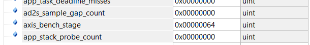
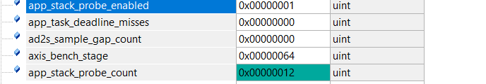
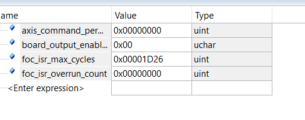

# 005 — 纯 C 整组命令交接

**一句话：** 在禁功率输出的测试目标中验证整组命令交接，并消除遥测格式化与栈统计对采样任务的已观察干扰。

**当前状态（2026-11-10）：** 基线`5bae072`＋未提交差异；实现已完成，SRC/BUILD/HOST分项PASS，HW为用户截图支持的有限PASS。本轮可结束并提交，不再重复切换统计开关。日常入口：[README](../README.md)，现状：[架构](../ARCHITECTURE.md)，原始证据：[同一验证记录的2026-11-10追加](../validation/005-command-bench-20261109.txt)。

| 改哪里 | 改前 → 改后 | 目的 / 谁执行 | 验证 |
| --- | --- | --- | --- |
| Keil目标 | 单目标 → 独立FOC_T_CommandBench | 同一源码、不同宏/产物，测试编译时禁输出 | 两目标BUILD PASS；历史9项配置检查 |
| 输出隔离 | 补齐EN低、六路GPIO低、CH4不带开MOE | board_safety与TIM1启动保持测试隔离 | SRC/HOST；物理引脚不由软件读回代验 |
| 一致结果 | 零散变量 → 72 B一致快照 | appTask读取TIM1同一活动帧/结果 | 实际port HOST PASS |
| 命令演练 | START/UPDATE/STOP/旧代拒绝/到期/无复活 | appTask单轮生产，TIM1消费；异常锁FAIL | HOST及用户stage=100有限观察 |
| 遥测格式化 | snprintf浮点格式化 → 有界整数转换CSV | 降低appTask负担，保留UART缓冲所有权 | 独立格式化HOST；随后关闭旧栈扫描时无超时 |
| 栈统计 | appTask每秒全扫描 → 可抢占Idle Hook | 清点工作不占用1 ms业务任务；完成次数/时戳可观测 | 两配置HOST；开启后18次扫描、两项异常计数0 |

| 验收层级 | 当前结果 | 证据边界 |
| --- | --- | --- |
| SRC | PASS | 实际调用链、显式appTask句柄、Idle非阻塞扫描；代码与最新构建输入指纹核对 |
| BUILD | PASS | 2026-11-10两目标增量0错误0警告；测试实际ROM61216 B / 静态RAM25760 B；普通实际ROM58944 B / 静态RAM25552 B |
| 编译期配置 | PASS（已有证据） | 9种目标配置含5种预期拒绝；相关配置/安全源按指纹复核，不称为本轮重跑 |
| HOST | PASS（分模块） | 原命令/安全623项历史证据；新增格式化200005组独立比较；Idle normal134/bench139项。不是完整固件或真实调度仿真 |
| HW：本轮禁输出观察 | PASS（有限） | 用户0→1对照：probe_count 0→18，deadline/gap均0，stage均100；截图未给精确时长、未回读固件指纹，不作长期或最坏情况结论 |
| HW：功率/闭环/最坏资源 | NOT_RUN / 未闭合 | 最终截图没有fail_code、fault、输出同帧证据；不据旧截图补成新版本完整安全验收；物理保护/运行态另验 |

**接下来：** 1. 用户审阅并提交本检查点；2. 下一功能先写Axis运行状态管理spec，明确请求与实际状态、启动前提、停止/故障转移；3. 真实通信接口、采样对时及带输出保护按各自合同推进，不把本次PASS当上电许可。

## 本轮结束条件与复测入口

2026-11-10用户两张图如下；图一是用户关闭统计时，图二是开启后。`0x12`是18次完整扫描，不直接换算为精确运行秒数。用户本轮手动0→1不改变代码默认开启的事实。

| 本轮关键量 | 截图结果 | 结论 |
| --- | --- | --- |
| app_stack_probe_count | 0 → 0x12（18） | 统计确实执行，并非一直关闭 |
| app_task_deadline_misses | 两图均0 | 截至截图未记录任务期限超时 |
| ad2s_sample_gap_count | 两图均0 | 截至截图未记录驱动采样超间隔 |
| axis_bench_stage | 两图均0x64（100） | 单轮命令演练PASS保持 |

该组已满足本次排查的停止条件，不再要求重复等候或增加Watch。后续代码/负载变化才按影响复测。需要复现时选`FOC_T_CommandBench`、F7增量构建、用户下载复位，母线断开且仅控制/传感器供电，连续运行观察上表4项；新版栈统计默认开启，不必手改开关。测试失败锁存后不能通过清Watch或关闭统计把旧结果判PASS。

旧演练的安全复核项仍是stage、fail_code、board_fault_mask和board_output_enabled；它们属于后续完整安全检查，不能用阶段值或本次统计计数单独代替物理输出/故障验证。本轮没有要求再加一组参数来延长调试。

## 本次调试结论和取舍

- 旧版本冻结事件中后台总耗时1247 us，遥测区段908 us（含抢占）；改有界CSV格式化后，关闭旧栈扫描的观察中deadline/gap为0且演练PASS。不能把908 us全部当printf独占CPU时间。
- 恢复旧appTask栈扫描后，用户报告deadline约每秒+1，截图为33、gap=0、stage=200。扫描每秒一次，与该现象吻合；没有展示失败码，不能仅凭stage断言具体失败原因。gap与ready/任务期限是不同判据。
- 最终把扫描移到内核已有Idle Hook；不是永久关闭监测，也不放宽2 ms反馈预算、不改appTask调度或关闭栈溢出保护。空闲统计可能延后，不能代替即时保护或最坏栈证明；当前执行与数据所有权统一见[架构](../ARCHITECTURE.md)。
- `telemetry_format.c`曾被漏出Keil清单，导致L6218E；已补入两个目标。当前工程每个目标含57个C源、1个汇编源，无C++。普通目标也应用这两项时序修复，因此不能沿用初次“普通HEX与基线相同”的结论。
- 新增Idle Hook使FreeRTOS配置头和`.ioc`的`configUSE_IDLE_HOOK`均为1；没有运行CubeMX生成。原“未改CubeMX配置”仅属于下方初始设计快照。

## 保留的命令演练约束

- 测试必须BENCH=1且POWER_STAGE=DISABLED；合成1000 rpm/4 A等仅为命令夹具，不是硬件运行范围。测试帧不进入FOC；普通目标仍因未确认配置拒绝START/UPDATE。
- 单轮依次验证START A、整组UPDATE B、STOP、旧epoch拒绝、新START到期及100 ms无自动恢复。通过后仍检查ready、输出隔离、故障、ISR预算、控制序号推进和无自动恢复；FAIL锁存且只请求一次STOP。
- 快照是任务在短PRIMASK区读取的72 B一致副本；实际关中断时长、最坏IRQ和物理关断另验。HAL自身停止时，不能靠同一HAL时钟证明超时保护有效。
- 失败码备查：1输出隔离，2故障，3ISR超预算，4等待ready超时，5ready丢失，6快照，7发布，8确认超时，9帧/结果，10停止，11旧代拒绝，12到期，13自动恢复，14 TIM1停滞，15命令拒绝。

复现工具：`tests/run-command-host.ps1`（原基础），`tests/run_command_bench_host.py`（port/bench/safety及配置），`tests/run_telemetry_format_host.py`（独立格式化），`tests/run_idle_hook_host.py`（提取实际钩子、模拟时钟/API）。编译/主机结果不能代替硬件调度测试；本次文档收尾未重跑未变代码的测试或构建，也未暂存、提交、下载或操作电源。

## 基础版设计与2026-11-07历史记录

以下保留基础版设计、对象链接和待机测试的当时记录；其中“当前/下一步”以该阶段为语境，本轮状态以文档前部和架构页为准。

**一句话：** 后台一次提交完整的速度目标和 Iq 上限，由 TIM1 在控制边界接收；STOP、故障和到期撤销旧许可。

**基础版历史状态：** 命令基础版已实现，后来提交到`5bae072`。下方2026-11-07结果仅属基础版；2026-11-09演练增量的最终状态查本文前部。基线 `9650972`，分支 `Xiao_ODrive`，开始时工作区干净。先写本 spec，再实现；用户已要求继续，无默认审批等待。

| 改哪里 | 改前 → 改后 | 目的 / 执行者 | 验证 |
| --- | --- | --- | --- |
| 命令核心及目标适配 | 独立全局量 → 32 B 请求、单槽、代次和确认 | appTask 校验发布，TIM1 消费 | 已实现；见下方分层验收 |
| 运行入口 | 调试变量可启动 → 只有有效活动命令可申请运行 | 隔离旁路，最终 board_safety 仍否决 | 已实现；见下方分层验收 |
| 停止/期限 | 请求可长期保留 → STOP 独立票据、活动命令到期 | 撤输出、作废旧代次，必须新 START | 已实现；见下方分层验收 |
| Iq 限制 | 仅慢环更新 → 每个快环限制最终 Iq 指令 | 新上限本拍生效 | 已实现；见下方分层验收 |
| 文档与测试 | 拟议合同 → 可执行 C 行为测试与目标构建证据 | 同一核心代码，不用模型代替实现 | 已实现；见下方分层验收 |

| 验收 | 结果 | 边界 |
| --- | --- | --- |
| SRC | PASS | 两路独立复核；目标对象反汇编确认PRIMASK保存/CPSID、发布调用、DMB、恢复；不能证明实际耗时 |
| BUILD | PASS | ARMCC5全量：0错误0警告，3分23秒；ROM61688 B，静态RAM25544 B；[原始证据](../validation/005-command-handoff.txt) |
| HOST | PASS | 同一核心8组203断言＋实际FOC/Xmath接入55断言；记录见[005证据](../validation/005-command-handoff.txt) |
| HW待机观察 | PASS（限定） | 本轮截图：许可0、输出标志0、ISR最大7462 cycles、超时0；时间未精确报告，见[追加记录](../validation/005-command-handoff.txt) |
| HW命令/输出/闭环 | NOT_RUN | 未实际发布命令；物理EN/PWM、STOP/到期、最坏IRQ/临界区仍待验证 |

**下一步：** 本组待机观察收尾，不再追加Watch；审阅并手动提交当前检查点 → 在本005内准备编译时强制禁功率输出的板上命令演练 → 后续明确真实配置/通信来源。测试模式尚未实现，不能通过写Watch启动当前固件。

## 范围与取舍

沿用 [003 第6节](003-c-port-architecture.md#6-纯-c-整组命令交接合同-v0拟议尚未实现) 的速度模式合同，独立 C 实现，不复制 ODrive C++。保留单业务任务、TIM1 IRQ0、ADC/旋变采集、现有 PI、DMA/时钟/CubeMX 配置。

工单载荷是八个 32 位字段（32 B），不是线路报文：`command_seq/run_epoch/opcode/control_mode/speed_target_rpm/iq_limit_a/received_tick_ms/expires_tick_ms`。仅速度模式 1，START/UPDATE；其他模式明确拒绝。板端分配接受序号；拒绝不消耗序号。槽满返回 BUSY，不覆盖。接收时间和原代次由调用方在请求进入时固定，不允许排队后换代/续期。没有接入真实 RX、会话握手或跨复位防重放。

实际速度、电流、命令有效期范围尚未确认。目标固件配置保持未确认，因此 START/UPDATE 返回 CONFIG_UNSET；主机正向测试的范围只是测试夹具。STOP 不受缺配置/满槽影响。旧 Watch 中 `foc_run_request`、模式、速度、电流限制及 step 不再是有效命令入口。此阶段不能通过旧调试路径启动电机。

## 同步与生效

- appTask 是唯一普通发布者。在局部副本上做有限数、模式、范围和期限校验；临界区内复核 fault、epoch、STOP/满槽，固定复制整组并发布。
- 目标适配保存 PRIMASK、关中断、DMB、恢复原值；不用 RTOS BASEPRI，不自旋，不分配，不在临界区解析/SPI/格式化。
- TIM1 优先级 0，独占 active 和运行代次。入口先取得反馈有效性（此时尚无控制计算），再处理 fault/STOP/活动到期，再消费至多一个请求，先于慢环/FOC；任务不能抢占。最终开输出前再检查许可与故障。
- 现有 board_safety 仍先撤 EN/MOE、锁存故障。命令状态在 TIM1 下一次边界/最终复核时失效；Fatal/NMI 不返回且不接触可能半写的邮箱。这是对 003 异步修改 epoch 方案的简化：避免两个上下文写 active，硬件关断不等代次更新。
- STOP 独立票据；pending 时重复请求返回相同票据。先撤输出再更新软件代次/确认；普通槽满不能挡 STOP。STOP 是撤使能，不是受控减速。
- 命令到期以 HAL/TIM7 毫秒为准，跨度小于 2^31 ms；pending 和 active 均检查。活动到期先撤输出、清 pending/active、推进代次一次，新 UPDATE 不得延长已经过期的运行。
- 命令序号和运行代次不静默回绕，耗尽后保持禁止；`control_seq`只是观测计数，允许uint32模回绕，不参与授权或期限；应用确认只代表软件接受，不代表电机已到目标或 PWM 已更新。
- 同一快环始终使用同一活动版本。速度斜坡仍在慢环；Iq 上限降低在本快环约束 Iq 指令及速度 PI 积分器，不是实际电流过流保护。

## 验证要求与风险

执行 A/B 整组、满槽、重复/乱序、START/UPDATE 状态、STOP 满槽优先/重复、故障晚于发布/先于输出、旧代次、pending/active 到期、HAL tick 回绕、半范围歧义、NaN/Inf、模式 0/2 拒绝、配置缺失、序号耗尽、非慢环拍降限流等测试。目标端固定复制实际屏蔽 IRQ 的时间、完整 IRQ 最坏耗时和物理输出仍须板测；主机不能证明 Cortex-M7 时序。

保护阈值/极对数/最高转速/物理采样对时未定，Break 仍关闭，原硬件验证缺项继续保留。新功能不新增清错或自动重启。RAM 使用静态 AXI 对象，不使用新 heap、DMA 或缓存维护。

## 实际文件与接口

- `Core/Inc/axis_command_core.h` / `Core/Src/axis_command_core.c`：平台无关C核心。`Validate`区外检查，`PublishValidated`在调用者锁内固定交接；`Tick/Guard/Revoke`只由TIM1执行。静态配置在Init固定，不提供运行中改限额接口。
- `Core/Inc/axis_command.h` / `Core/Src/axis_command.c`：目标适配；`Submit/Stop`检查当前确为appTask，`GetEpoch`读代次。`command_limits={0,0,0,0}`表示未确认且拒绝，不表示无限制；沒有调用这些发布入口的真实RX或自动任务。
- `Core/Src/app_runtime.c`：初始化命令模块；`BeginCycle`先于慢环和FOC，`FinalPermit`在既有最终许可临界区复核。运行条件丢失立即撤许可，恢复条件不会自动重启；采样故障仍先锁存关断。
- `Core/Src/open_foc.c`：`ApplyCommand`安装私有目标，旧镜像不再授权；移除原速度step和有隐藏±1000限幅的旧setter。`Stop`立即重置PI和启动沿、允许未来明确START；`EnforceCommandLimit`在慢环之后、电流PI之前限制三个Iq量。其他PI/方向/零位调试参数未纳入本合同，不允许并发调参。
- `Core/Inc/axis_status.h`：新增COMMAND_CONFIG=0x200、NO_COMMAND=0x400两项观测原因，状态字仍无运行权。准备好且无故障时预计`axis_status_word=0x00060002`，不再是002旧版本的0x2。
- `MDK-ARM/FOC_T.uvprojx`：增加两个C源；不改CubeMX、FreeRTOS、DMA、时钟或链接区域。
- `tests/run-command-host.ps1`：可复现HOST脚本；使用本机既有Quartus捆绑GCC4.5.3。`tests/host_stubs`只替代ARR/CCR和头文件，实际FOC/Xmath参加测试，未加入Keil目标。

接受与确认：Submit返回的seq是接受号，不是应用确认；核心保留`applied_seq/applied_control_seq`与`result_seq/result`。发生撤销时`cancelled_seq`标识被丢弃的已接受pending（若同时有active，result_seq指active）；`stop_applied_ticket`单独确认STOP。这些Watch镜像并非多字段原子快照/可靠ACK队列，真实协议接入前需补一致状态读取、事务映射和会话。请求首次进入时固定epoch和HAL时间，调用方不能给旧队列换代或续期。

## 本版本待机4项观察（已返回截图）

前提：仍是功率母线断开、仅控制与传感器供电；用户自行下载本次构建并运行约30秒。不要写入run、step或其他控制量。

| Watch | 预期 | 能说明什么 |
| --- | --- | --- |
| `axis_command_permit` | 0 | 未确认配置没有授予运行许可 |
| `board_output_enabled` | 0 | 软件输出标志关闭；不代替物理EN/MOE测量 |
| `foc_isr_max_cycles` | 大于0且小于9996 | 已执行的停止路径函数内最大耗时低于当前周期预算；不代表完整IRQ/WCET |
| `foc_isr_overrun_count` | 0 | 本观察内未记到该函数超预算 |

本组够用于判断是否可继续下一软件步骤，不追加旧002整套参数。发布尚无真实调用，`axis_command_critical_max_cycles=0`不能作为发布耗时验收。真实STOP/命令跨中断发布、完整屏蔽时长、实际PWM/EN和闭环仍未板测。

## 验证边界

HOST只有顺序API和寄存器替身，不证明真实抢占、D-cache、DMA或物理电流。Iq限制是指令限幅，对齐电压/Id和实际相电流保护不在它的保证中。配置未确认、会话机制未实现、采样物理对应及保护链未验证等限制保留；不把旧板测移作新固件验收。

目标构建结果：ROM比上一阶段增加1876 B，静态RAM增加200 B；RTOS堆/任务栈不变。链接器会移除无调用的Submit/Stop/GetEpoch及对应发布/校验段，它们已编译并作对象反汇编核对；真正协议调用接入时会进入最终映像并需重新测时，当前固件不执行这些发布路径。

## 2026-11-07 待机观察结果与下一步

用户返回单张截图：`axis_command_permit=0`、`board_output_enabled=0`、`foc_isr_max_cycles=0x1D26=7462`、`foc_isr_overrun_count=0`。按配置200 MHz折算37.31 μs，小于9996 cycles/49.98 μs。只代表这次已观察的停止路径，不能称为闭环最坏耗时或物理保护验证；具体运行时长未报告。

原29项指纹中27项相同。`board_safety.c`只新增空行；用户增量编译0错误0警告，AXF变化，但HEX和MAP与原记录完全相同。原构建记录保留，最新指纹与截图追加到[同一证据文件](../validation/005-command-handoff.txt)，板端产物未回读。当前代码未在本次答复中修改。

本组足够结束待机观察并保存提交。下一段仍属于005命令交接的验证：准备一个编译时强制禁功率输出的测试模式，让appTask真正发布完整命令，TIM1消费，再验证STOP和到期撤销。它需要把测试许可与物理输出禁止明确分开，并在编译期约束，不能只凭Watch中的输出0就认为隔离成立。测试范围/参数仅供演练，生产配置继续保持未确认；本次只记方案，不启用测试模式。板测安排仍每轮3–4个关键量。

## 2026-11-09 先行设计记录（实施前快照）

用户已提交基础版，HEAD `5bae072`，开始时工作区干净。本次仍属005，不新建功能spec。

- 同一个Keil工程新增`FOC_T_CommandBench`目标，独立小型产物目录；普通`FOC_T`默认BENCH=0，未确认运行范围继续拒绝START/UPDATE。测试目标必须同时`AXIS_COMMAND_BENCH_ENABLE=1`、`BOARD_POWER_STAGE_MODE=0`，混配编译报错，不能靠Watch开关切模式。
- 合成测试范围只在测试目标编译：最大绝对速度1000 rpm、Iq 4 A、最长有效期1000 ms。这些是数据交接夹具，不是电机参数；测试active不会交给FOC，FOC始终ApplyCommand(NULL)，不做对齐/运行。
- appTask用正式Submit/Stop接口发布，TIM1正常调用同一BeginCycle/FinalPermit消费；仅测试目标的“软件ready”不要求功率PWM已准备，其余校准/反馈/fault/lockout继续有效。实际输出许可始终为0，六路PWM不启动、不接AF，EN持续拉低，MOE/功率CCER保持清除。
- 新增任务侧GetSnapshot：在保存/恢复PRIMASK保护下复制完整活动帧和结果元数据；不把多项Watch标量当一致ACK。任务局部副本用于验收，不直接读写私有core。
- 非阻塞、单轮状态机：等待稳定ready后START A→整组UPDATE B→STOP→旧epoch拒绝→新START并自然到期→观察无自动恢复。每步有超时，故障/输出隔离异常/ISR超预算锁FAIL并请求STOP，不自动循环、不清故障。
- 新增只读硬件寄存器隔离检查，检查EN输出锁存、MOE、功率CCER与六个GPIO模式/输出；它不代替示波器或外部驱动状态测量。CH4采样触发继续工作，使用无需置MOE的启动路径。
- 本次不下载、不运行硬件、不改CubeMX/时钟/中断优先级/任务栈/堆/DMA，不提交Git。脚本与主机测试先验证状态机/快照/配置防混配，再分别构建普通目标和测试目标；真实执行由用户在母线隔离条件下完成。

**本增量验收：** SRC / BUILD / HOST = NOT_RUN，HW = NOT_RUN。正式结果写回本节；不继承旧版板测PASS。后续Watch保持4项：阶段、通过位图、失败码、输出标志，精确值待实现后登记。
