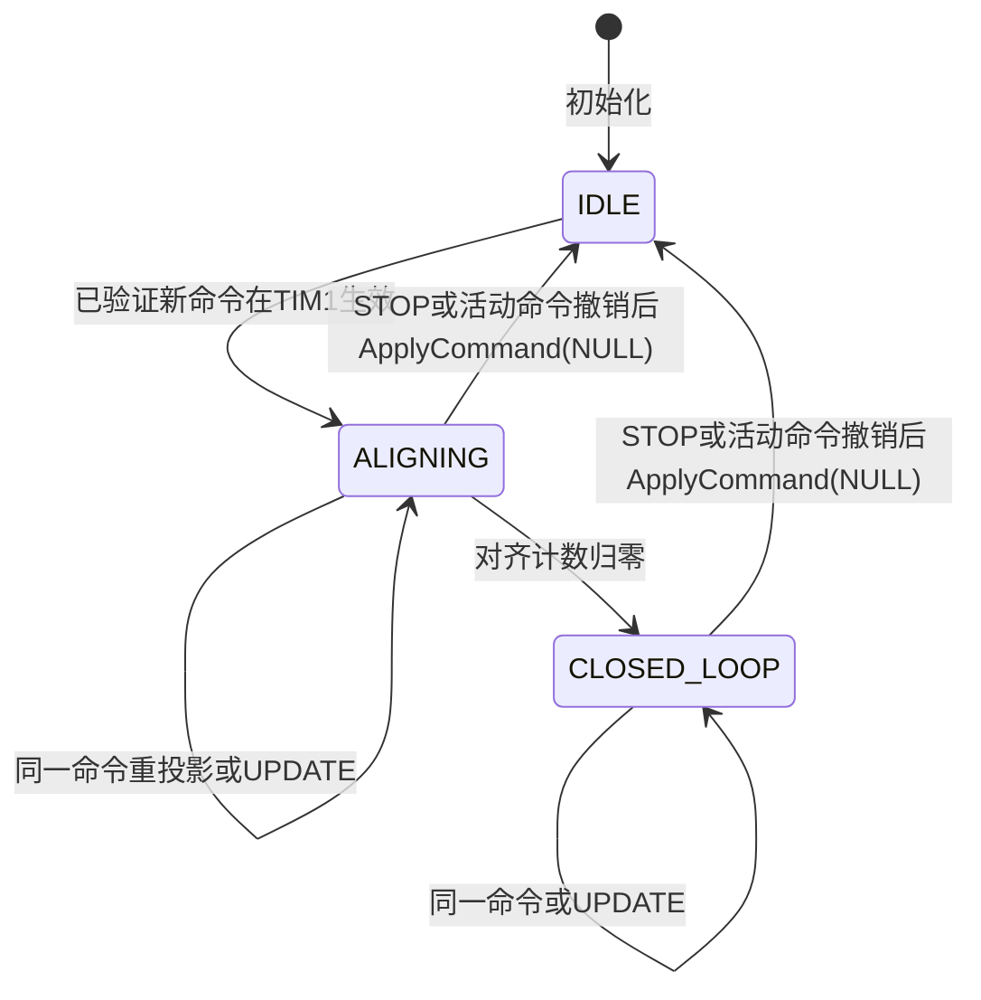

# 006 — Axis运行阶段契约：先明确FOC执行阶段

**一句话：** 复用现有命令/输出权威，为FOC提供准确的只读“待机／对齐／闭环计算”阶段，消除无命令却显示对齐的歧义。

**实施状态（2026-11-10）：** 第一段已实现；基线`1d3f101`＋本轮差异，分支`Xiao_ODrive`，开始工作区干净。SRC/BUILD/HOST PASS；HW本轮四项禁输出观察PASS（用户截图），物理对齐/闭环与最坏耗时仍未验证；[本轮原始记录与指纹](../validation/006-axis-run-phase-20261110.txt)。本006为Axis生命周期的第一段，不宣称完整Axis管理或带输出验收完成。

| 部位 | 改前 → 已实现 | 目的 |
| --- | --- | --- |
| FOC阶段接口 | 依赖多个内部量和诊断镜像 → 从私有量派生只读枚举 | 清楚区分请求已生效与FOC当前计算阶段 |
| 待机镜像 | Init/无命令慢拍可能aligning=1 → 始终0 | 避免“没开工却挂牌正在对齐” |
| Axis状态发布 | 读取可被Watch改写的aligning镜像 → 读取私有阶段Getter | 保留轴状态原有输出门控，不引入第二权威 |
| 验证 | 原命令/FOC覆盖 → 增加阶段边界与取消/重启测试 | 编译和HOST先行，板测不继承旧版本结论 |

| 验收 | 当前状态 | 要求 |
| --- | --- | --- |
| SRC | PASS | 两路复核；只派生私有阶段，无第二权威，取消清理和输出顺序保留 |
| BUILD | PASS | 两目标增量0错误0警告，13/14秒；输入及产物绑定原始记录 |
| HOST | PASS | 实际Core203＋FOC407＝610断言；新增352项FOC检查，旧55项保留；仅CPU桩，不模拟真实IRQ/硬件 |
| HW（本轮四项） | PASS（有限观察） | [用户截图](../validation/006-axis-run-phase-20261110-watch.png)：stage=0x64、aligning=0、fault=0、output=0；不含时长证明、板端固件指纹回读、物理对齐/闭环或最坏耗时 |

**下一步：** 本轮四项截图符合预期，006第一段可作为独立检查点由用户提交；不再重复栈开关A/B。后续功能先明确真实通信入口及Axis编排缺口，继续复用现有命令/输出权威。截图沿用此前母线断开、控制/传感器供电的测试安排；未据此开放功率输出。

## 1. 现状审查：已有职责与本次缺口

| 已有职责 | 文件 / 函数依据 | 本次处理 |
| --- | --- | --- |
| 完整请求/seq/期限/epoch/START/UPDATE/STOP | [axis_command_core.c](../../Core/Src/axis_command_core.c) `PublishValidated/RequestStop/Tick/Guard/Revoke` | 继续复用，不建立另一邮箱/许可或重放规则 |
| 任务交接与硬件先关、软件再撤销 | [axis_command.c](../../Core/Src/axis_command.c) `Submit/Stop/BeginCycle/FinalPermit/RejectActive` | 保持appTask唯一普通发布者，TIM1拥有active/epoch |
| 反馈/ADC验证与最终输出 | [app_runtime.c](../../Core/Src/app_runtime.c) `AppRuntime_FastISR`；[board_safety.c](../../Core/Src/board_safety.c) | 最终许可、fault和输出寄存器权威不变 |
| 命令安装、对齐倒计时、PI复位 | [open_foc.c](../../Core/Src/open_foc.c) `ApplyCommand/Ramp_1ms/Stop/Run_20kHz` | 这些行为已存在，本次只建立准确阶段接口 |
| BOOT/CALIBRATING/IDLE/ALIGNING/RUNNING/FAULT观察 | [axis_status.h](../../Core/Inc/axis_status.h) `AXIS_STATUS_NEXT`；`AxisStatus_Publish/LatchFault` | 保持只读观察职责，不升级成新控制权威 |

发现：`OpenFOC_Init`及`OpenFOC_Ramp_1ms`无command分支把`foc_aligning`写1，但`OpenFOC_Stop`写0。原AxisStatus还受`board_output_enabled`门控，故此问题没有证明会误开输出；它会混淆后续状态接口。控制实际使用私有`command_run/align_ms_left`，所以新阶段应从它们派生，不能再新增一份可写状态决定运行。

上游参考固定为[ODrive fw-v0.5.6 / axis.cpp run_state_machine_loop](https://github.com/odriverobotics/ODrive/blob/a308314ed2ca613164b81e7bbdfacc53cd1859ff/Firmware/MotorControl/axis.cpp#L455)及[axis.hpp requested_state/current_state](https://github.com/odriverobotics/ODrive/blob/a308314ed2ca613164b81e7bbdfacc53cd1859ff/Firmware/MotorControl/axis.hpp#L202)。本轮重新读取固定版本；只采纳“请求与执行阶段分开表达”的组织方式，不复制其C++对象、独立轴线程、任务链或自动清错路径。现有命令边界已经提供了请求交接，不直接暴露一个可写requested_state绕过它。

## 2. 阶段和转换合同

已新增`FOC_RunPhase OpenFOC_GetRunPhase(void)`；当前实现与数据所有权见[架构](../ARCHITECTURE.md)：

| 枚举 | 私有量判定顺序 | 含义 / 不代表什么 |
| --- | --- | --- |
| `FOC_PHASE_IDLE=0` | 首先判断command_run==0 | 无活动FOC命令；对齐计数可预置1200但不表示正在对齐；不代表轴无fault |
| `FOC_PHASE_ALIGNING=1` | 有命令且align_ms_left>0 | 当前选择对齐计算阶段；不证明物理转子对齐有效 |
| `FOC_PHASE_CLOSED_LOOP=2` | 有命令且align_ms_left==0 | 当前选择闭环计算阶段；不代表EN开启、反馈有效、转动或速度达标 |

这个枚举与`FOC_ControlState`控制模式不同。后者描述电流/速度环等模式；本次仍只接受现有速度模式，不开放旋变开环调试模式。

- 首次非空命令在快拍立即进入ALIGNING，不等下一慢拍。保持既有1200次`Ramp_1ms`调用边界，不能把它说成精确1200 ms的物理对齐验收。
- 重复安装同一active和UPDATE不重启对齐、不恢复已撤销命令；新START是否合法仍由命令核心决定。
- STOP、到期、失去ready、故障由现有边界撤销。`OpenFOC_ApplyCommand(NULL)`立即回IDLE，保持现有PI/参考归零和中性占空比写入；随后再多次慢拍也不能把镜像改回ALIGNING。
- 快拍中STOP后下次有效START，即使之间没有慢拍，也必须重新对齐。故障仍由board_safety锁存到复位，新增Getter没有清错或启动接口。
- `foc_aligning`保留为兼容Watch镜像；Init、Stop、无命令慢拍一致为0，每次ApplyCommand尾部从Getter刷新；真实对齐为1。Watch伪造镜像不能改变Getter或授权输出。

## 3. 谁能读写、何时生效

- 私有`command_run/align_ms_left`继续由启动前初始化及运行中的TIM1代码写入；Getter不写数据、不分配、不阻塞、不调用RTOS、不操作PWM。
- Getter只允许启动前或TIM1同一控制调用上下文读取；它连续读取两个私有字段，**不是跨任务原子快照**。appTask以后要获取阶段，必须通过明确的已发布快照接口；本次不新增该共享接口或更改72 B命令快照。
- `AppRuntime_FastISR`在既有短PRIMASK区、`BoardSafety_SetOutputsEnabled`后，使用Getter的ALIGNING判断调用现有AxisStatus。轴FAULT仍优先，输出未使能仍不会报告轴RUNNING。
- `FinalPermit`撤销时先撤硬件，FOC清理仍在短临界区之外完成；状态发布此时受输出0门控。Getter不能在取消清理前被用来代替硬件状态判断。
- `foc_enable`、反馈有效性、输出门禁可使计算返回中性占空比；阶段只是私有命令及对齐进度的解释，绝不能替代这些条件。

## 4. 实施范围与验收

产品文件限定`open_foc.h/.c`、`app_runtime.c`；扩展现有`tests/open_foc_command_host.c`，复用`tests/run-command-host.ps1`。不新增需要手动加入Keil的源文件。

HOST使用实际FOC/Core/Xmath：初始化/无命令多次慢拍保持IDLE；首命令即时ALIGNING；第1199/1200拍边界；对齐中UPDATE不重置；闭环UPDATE不回对齐；STOP/NULL立即IDLE和PI归零；无慢拍间隔重新START；伪造诊断镜像不改变Getter。结合实际命令核心检查STOP/到期/ready丢失/故障撤销投影到IDLE且旧命令不自动恢复。

板测只在`FOC_T_CommandBench`、母线断开且控制/传感器供电条件下进行：`axis_bench_stage=0x64`、`foc_aligning=0`、`board_fault_mask=0`、`board_output_enabled=0`。测试目标的active命令仍不传FOC，因此FOC保持IDLE正是预期；不能用该结果声称已在硬件验证ALIGNING→CLOSED_LOOP。

没有调整命令范围、对齐时长/电压、PI、ADC/SPI/PWM、RTOS、2 ms预算、堆栈、CubeMX或DMA；不自动下载/提交。最高速度/极对数/物理对时/保护验收仍是带输出推进前的独立事项。

## 5. 实际结果与未关闭范围

修改3个产品文件及1个既有测试文件，未新增产品源文件或更改Keil/CubeMX配置。两目标map确认运行时及Apply确实链接Getter；代码24 B、函数静态栈0 B。实际ROM：测试61268 B、普通58996 B；静态RAM保持25760/25552 B。用户随后提供四项Watch截图，stage=100、aligning/fault/output均0，本轮禁输出待机/演练有限观察通过。截图本身不显示连续运行时长或板端版本；当前本地源码/HEX与初次记录一致，AXF全文件指纹变化但fromelf导出的61268 B加载内容及入口与原HEX完全一致，详情追加在原验证记录。未重新构建或操作硬件。

本次不实现完整校准任务链、受控减速、在线清错、自动重启、真实通信协议、输入队列/可靠ACK或跨复位会话。若后续需要更完整Axis协调器，必须先列出它独占的新职责，并复用现有命令核心、FOC算法和board_safety；不能有两个模块同时拥有active、epoch或PWM使能。
