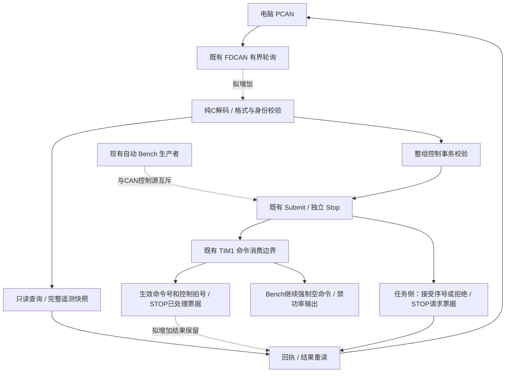

# 008 — CAN命令：ODrive对照与接入方案

008.17 将 Bench 的速度遥测格式化与串口发送移至可抢占的空闲任务，采样任务只交接到期的成对数据。优化目标是缩短 008.16 实测的 1150.985 µs 采样后工作段。

**已实现。软件验证通过。008.17 禁输出板测已收尾，反馈采样时序阻塞，完整 START/UPDATE 演练未通过（2026-11-19）。** 基线 Xiao_ODrive / 0489733 加 008.16 工作区。008.17 实测见 13.13，最后一次配对记录、停止条件和收尾决定见 13.14。[原始证据](../validation/008-can-query-20261116.txt)

| 范围 | 验收目标 |
| --- | --- |
| 采样任务 | 保留每 5 ms 的速度对，移出 CSV 格式化及串口发送 |
| 空闲任务 | 有待发速度对时尝试发送，忙、丢帧可观察，已有栈诊断继续运行 |
| 控制与保护 | 沿用 2 ms 年龄门槛、原始命令有效期及禁输出 Bench |
| 验证 | 主机交接测试、两目标构建、普通 HEX 对照、同条件板上演练 |

008.17 SRC / HOST / BUILD 为 PASS，独立编译期断言项 N/A。HW 首段及其明细捕获有限 PASS，完整命令演练 FAIL。008.16 板上首段基线及完整三段读数见 13.12。

## 1. 参考版本与协议含义

仅比较 **ODrive fw-v0.5.6，commit `a308314ed2ca613164b81e7bbdfacc53cd1859ff`**，不混用新版Pro/S1的寻址、SDO或固件更新命令。

- [命令枚举](https://github.com/odriverobotics/ODrive/blob/a308314ed2ca613164b81e7bbdfacc53cd1859ff/Firmware/communication/can/can_simple.hpp)
- [分发与处理源码](https://github.com/odriverobotics/ODrive/blob/a308314ed2ca613164b81e7bbdfacc53cd1859ff/Firmware/communication/can/can_simple.cpp)
- [该版本协议说明](https://github.com/odriverobotics/ODrive/blob/a308314ed2ca613164b81e7bbdfacc53cd1859ff/docs/can-protocol.rst)与[命令字段CSV](https://github.com/odriverobotics/ODrive/blob/a308314ed2ca613164b81e7bbdfacc53cd1859ff/docs/figures/can-protocol.csv)
- [接口单位定义](https://github.com/odriverobotics/ODrive/blob/a308314ed2ca613164b81e7bbdfacc53cd1859ff/Firmware/odrive-interface.yaml)

表中`0x001`等是**命令号**。标准帧完整ID为`(node_id << 5) | command_id`，该版本节点0～63，多字节小端。现有PCAN中的`0x321/0x322`则是本项目完整测试ID；按CANSimple解释会变成节点25的Heartbeat/Estop，因此它们不兼容ODrive，不应混用于真实ODrive总线。若选择兼容方案，测试ID须迁移或隔离。

纯C与CANSimple兼容不冲突：一个是实现语言，一个是外部协议。兼容必须逐项匹配ID、DLC、字段、单位、状态与响应规则；不能因为函数名称接近就宣称兼容。本轮已选择自定义只读诊断协议v1；后续是否增加CANSimple兼容层仍独立讨论，不默认兼容。

## 2. ODrive命令与本项目取舍

本表覆盖该版本头文件命令目录，保留整体功能取舍。PING/PONG、四个查询、第8节STOP及第9节整组参数预检已实现；其它控制、反馈和配置相关项目仍是后续建议。

| ODrive命令号 / 名称 | 原版用途 / 实现差异 | 本项目对应与建议 |
| --- | --- | --- |
| 0x001 Heartbeat | 主动发送轴状态、故障与轨迹完成等 | 先GET_STATUS；低频主动状态后续加入，不能给运行命令续期 |
| 0x002 Estop | 设置轴ESTOP错误；回调本身不直接写PWM关断 | 先STOP撤许可；锁存急停另定，不宣称等价 |
| 0x003 Get Motor Error | 读电机故障uint64 | GET_STATUS包含board_fault_mask；不伪装为ODrive位定义 |
| 0x004 Get Encoder Error | 读编码器故障uint32 | 后续细分旋变诊断，不能直接复用故障位 |
| 0x005 Get Sensorless Error | 读无感估计器故障 | 暂不做，本轮使用AD2S1210 |
| 0x006 Set Axis Node ID | 设置轴节点号 | 首版固定身份；多节点/持久化另立功能 |
| 0x007 Set Axis Requested State | 请求IDLE=1、闭环=8等状态 | START_SPEED/STOP表达最小启停；当前没有完整Axis生命周期 |
| 0x008 Set Axis Startup Config | 函数体Not Implemented | 不移植空入口，不默认上电运行 |
| 0x009 Get Encoder Estimates | 位置turn、速度turn/s | GET_FEEDBACK先速度rpm/角度有效性；位置坐标未定不冒充多圈机械位置 |
| 0x00A Get Encoder Count | 线性累计/CPR内计数 | 暂不做，旋变原始码不等于编码器多圈计数 |
| 0x00B Set Controller Modes | 控制模式与输入模式 | 首版固定速度模式；其它模式明确拒绝 |
| 0x00C Set Input Pos | 位置+速度/力矩前馈 | 位置环和位置模式暂不做 |
| 0x00D Set Input Vel | 速度目标+力矩前馈 | START_SPEED/UPDATE_SPEED整组速度rpm+Iq上限A，不直接照搬载荷 |
| 0x00E Set Input Torque | 力矩目标N·m | 暂不做；缺Kt等参数不能把N·m当A |
| 0x00F Set Limits | 速度上限+电机电流上限 | 本地确认的硬上限＋每组命令Iq约束；不是原版“速度目标”命令 |
| 0x010 Start Anticogging | 已调用抗齿槽标定入口，不是空实现 | 暂不做，不影响首版速度命令链 |
| 0x011 Set Traj Vel Limit | 轨迹速度限制 | 暂不做轨迹规划 |
| 0x012 Set Traj Accel Limits | 轨迹加/减速度限制 | 暂不做，现有速度斜坡不等于完整轨迹规划器 |
| 0x013 Set Traj Inertia | 轨迹惯量前馈系数 | 暂不做 |
| 0x014 Get Iq | Iq给定与实测 | GET_FEEDBACK的后续字段；需同一快照及有效性 |
| 0x015 Get Sensorless Estimates | 无感位置rad、速度turn/s | 暂不做；这里的位置单位例外，不能统一写turn |
| 0x016 Reboot ODrive | 直接NVIC_SystemReset，整MCU重启 | 暂不开放；重启不是正常停车命令 |
| 0x017 Get Bus Voltage and Current | 母线电压/电流 | 先提供已有母线电压；无母线电流测量/估计合同，不以Iq代替 |
| 0x018 Clear Errors | 调odrv.clear_errors，整板清错 | 暂不开放；本工程无运行时清故障API |
| 0x019 Set Linear Count | 修改编码器坐标计数 | 暂不开放；坐标/校准单独设计 |
| 0x01A Set Position Gain | 位置环增益 | 暂不做位置环配置 |
| 0x01B Set Vel Gains | 速度PI增益 | 后续独立配置事务；不在运行中直接写共享PI |
| 0x01C Get ADC Voltage | 请求带GPIO号，回复电压 | 不照搬通用GPIO查询；需要时只暴露明确测量通道 |
| 0x01D Get Controller Error | 读控制器故障uint32 | GET_STATUS汇总本地故障与拒绝原因，位定义分开 |
| 0x000 CANopen NMT | 保留，分发跳过/回调未实现 | 不实现CANopen |
| 0x700 CANopen Heartbeat | CANopen保留项，不是低5位普通命令 | 不实现CANopen |

`0x01E/0x01F`未分配；该版本没有独立Save Configuration CANSimple命令，也没有名为START/UPDATE/STOP的三条业务命令。

几个必须保留的差别：

1. **单位：** ODrive普通位置turn、速度turn/s；我们的速度rpm需要×/÷60。力矩N·m与Iq电流A必须经明确电机参数换算。轨迹惯量单位N·m/(turn/s²)，也不能直接套kg·m²数值。
2. **回执：** 多数Getter接受RTR或DLC=0请求、用相同ID回复；Get ADC Voltage要携带GPIO号，Get Controller Error分发检查不同。原版写命令没有统一的接受/生效回执。我们的结果合同是额外设计，不是已移植功能。
3. **续期：** 原版do_command在switch前watchdog_feed；不照搬“查询也喂狗”。建议只有新鲜且合法、按合同接受的控制更新影响运行期限；PING、状态查询、重复/非法帧都不能延长授权。
4. **原子性：** 原版Set Input Vel与Set Limits分别写字段，不能据此认为两帧构成一笔事务；本工程继续要求整组目标/限制一次交给TIM1。
5. **安全：** 软件STOP、锁存故障、硬件急停是不同职责。现有STOP是撤EN/MOE后的停机，不是受控减速；Break仍未启用，物理停机延迟未验收。

## 3. 拟议的最小命令集与当前基础

像送一张工单：CAN负责递单，命令层检查内容，TIM1在固定工作节拍接单。收到工单、开始照工单执行、电机已经达到目标，是三件事。

| 建议逻辑命令 | 读写内容 / 预期结果 | 已有基础与缺口 |
| --- | --- | --- |
| PING/PONG | 原样回显测试数据 | 已完成007；若选CANSimple需处理ID冲突 |
| GET_INFO / GET_BUILD | 能力/结构版本、手动软件接口修订号 | 已实现；不是固件hash。模式/核心配置有效位见STATUS，真实运行上限未开放 |
| GET_STATUS / GET_FAULT | 观测阶段、许可镜像、输出软件标志、禁止原因/故障mask | 已实现第6节独立查询；不是同拍快照。具体命令拒绝结果仍待后续 |
| GET_FEEDBACK | 先速度、母线电压及有效性/数据年龄，Iq等按需分组 | 有测量基础；需新快照/单位/分帧合同，数据读取不额外做SPI |
| STOP | 不受未确认运行配置或普通邮箱满限制地请求撤许可；返回停止票据和处理结果 | 已有AxisCommandPort_Stop；不是普通START/UPDATE槽，也不是即时总线硬急停 |
| START_SPEED | 明确开始新一轮速度运行：目标rpm、Iq上限A、期限/身份 | 内部START已有；CAN解码、会话/序号关联未实现 |
| UPDATE_SPEED | 在当前有效运行内整组更新目标/限制 | 内部UPDATE已有；不能从停机、到期或旧epoch恢复运行 |
| GET_COMMAND_RESULT / 回执 | 关联请求：拒绝、接受、应用、取消、停止处理 | 008.05已有内部单条处理回执；CAN事务映射、缓存与重读仍待实施 |

GET_INFO可报告已确认的运行上限；暂不另增一个运行时写限值命令。第一阶段只读，第二阶段先STOP再START/UPDATE，全部在禁输出目标验收。板上Watch按轮选3～4项，字段确定后再给测试清单。

当前源码定位：

| 内容 | 文件与函数 |
| --- | --- |
| 启动/任务创建 | [main.c](../../Core/Src/main.c) main；[freertos.c](../../Core/Src/freertos.c) MX_FREERTOS_Init / StartAppTask |
| 后台实际顺序 | [app_runtime.c](../../Core/Src/app_runtime.c) AppRuntime_BackgroundStep：AD2S → CanLink_Poll（含STOP）→ 遥测/堆统计；不再调自动Bench |
| 当前线路协议 | [can_link_protocol.c](../../Core/Src/can_link_protocol.c) CanLinkProtocol_MakeReply；[can_link.c](../../Core/Src/can_link.c) CanLink_Init/Poll |
| 内部命令与STOP | [axis_command.c](../../Core/Src/axis_command.c) AxisCommandPort_Submit / Stop / BeginCycle / FinalPermit / GetSnapshot |
| 纯C规则 | [axis_command_core.c](../../Core/Src/axis_command_core.c) AxisCommand_Validate / PublishValidated / Tick / Guard；[数据类型](../../Core/Inc/axis_command_core.h) |
| 历史自动请求源（已停用） | [axis_command_bench.c](../../Core/Src/axis_command_bench.c) AxisCommandBench_Init/Step；保留源/HOST，不再调度 |
| FOC/最终输出 | [app_runtime.c](../../Core/Src/app_runtime.c) AppRuntime_FastISR；[open_foc.c](../../Core/Src/open_foc.c) OpenFOC_ApplyCommand/Run_20kHz；[board_safety.c](../../Core/Src/board_safety.c) SetOutputsEnabled/LatchFault |

普通目标command_limits仍未确认，拒绝START/UPDATE；Bench的1000rpm、4A、1000ms只是合成夹具，不能作为电机参数。Bench始终ApplyCommand(NULL)，输出禁止。CAN目前只在Bench启动；仅STOP可发控制请求，整组参数预检不会发控制请求，不等于普通目标已有通信命令。

## 4. 拟议接入图与必须先定的合同

本图保留完整控制阶段方案，STOP最小子集已按第8节落地；现有完整结构图只维护在[架构页](../ARCHITECTURE.md#启动与执行上下文)。

### 4.1 一次命令怎样完整交接

- 经典CAN一帧最多8B，内部AxisCommandFrame为32B，不能直接memcpy当线路协议；字节序、浮点表示、单位、非法值和范围要逐字段定义。
- **方案A：紧凑单帧。** 两个float32恰好8B，但序号/会话/期限不再有空间，必须说明哪些来自ID、哪些由板端配置/会话补齐；不能只凑下数值就宣称防重放已解决。
- **方案B：多帧事务。** 静态有界暂存、事务号、齐包标志、首帧接收时间与超时、重复/乱序规则全部明确；未齐不得发布，新旧片段不得混合。STOP使在组装的启动事务失效。
- appTask持有稳定局部副本，校验后经现有Submit的短PRIMASK整组发布；TIM1在下一次符合条件的控制边界消费，输出前再复核。不能用volatile或只屏蔽低优先级IRQ的RTOS临界区替代。
- 若接收队列产生滞留，必须定义“接收时间”是硬件入队还是软件出队，并给排队年龄上限；不能给排队很久的启动帧重盖一个新时间戳。跨复位身份/旧命令清理也要单列，当前epoch只解决一次启动内的旧代次。

### 4.2 谁能发、何时续期、何时停止

- 应用层只有appTask一个普通发布者；选择CAN控制源时关闭自动Bench脚本的发单行为，保留独立回归测试入口。两者碰巧在同一任务也不代表业务上可以同时控制。
- 查询不授予permit，心跳不续运行期限。没有有效更新时现有到期逻辑撤许可，不自动恢复；恢复需要新一轮合法START。
- STOP独立于普通命令邮箱，但**仍受CAN仲裁、硬件FIFO、后台调度影响**。当前FIFO0每轮最多处理1帧，不能声称STOP已绕过队列。实现前选定保留接收资源/优先服务或其它有界策略，并验证最坏延迟及Bus-Off处理；不凭设计数字承诺安全急停时间。
- 满队列、失联/Bus-Off、非法帧的处理要有界。协议故障是否主动请求STOP与控制命令超时的关系需写明；目前007只锁停CAN服务，不负责电机许可。
- 同一任务还有阻塞SPI，故障时超时可影响通信响应；当前低速正常测试不证明所有故障条件下任务互不影响。

### 4.3 回执和遥测的可信度

- `ACCEPTED`仅代表完整工单进入邮箱；`APPLIED`表示指定command_seq已在某个control_seq被控制端接收；Bench中也不代表FOC带输出运行，更不代表实际速度达到目标。
- 现有72B GetSnapshot是当前状态快照，不是事件队列。新协议需固定容量结果保留/重读规则、请求号与内部seq/STOP票据映射，明确覆盖/忙/重试行为。发送入队不等于电脑收到。
- 重复请求不能重复启动或续期；请求已处理时怎样返回同一结果、会话失效后怎样拒绝，要与报文一起定稿。
- 状态/反馈每组有快照号、时间/有效性；跨多帧只拼同一快照。没有可证明的母线电流或多圈位置不提供假值，缺测要标无效/不支持。

## 5. 设计选择与验收顺序

| 选择 | 适用场景 | 代价 |
| --- | --- | --- |
| 自定义最小协议（本次建议，未定稿） | 先用PCAN建立可解释的命令/回执，满足整组更新与禁输出演练 | 不直接兼容ODrive工具，后续需自有上位机或明确适配层 |
| CANSimple兼容子集 | 已确定要复用支持该旧版本的上位机 | 精确遵守ID/单位/查询方式；原版多条设置命令与本项目原子事务的关系必须另设计，不可悄悄改变语义 |

“参考ODrive机制”和“对外CANSimple兼容”分别决定。第6节已固定自定义查询、第8节已固定STOP；本表保留后续速度控制协议的取舍，完整运行事务和CANSimple兼容层仍未实现。

1. 固定协议选择、版本、能力位、字段、非法输入规则；源码静态检查不得出现通信直接写PWM/EN/FOC活动变量。
2. 只读查询：HOST覆盖DLC/ID/单位/边界，两个目标增量Build，禁输出板上核版本和状态；新接口先少量低频发送。
3. 控制接入：先验证STOP，再整组START/UPDATE、忙/重复/过期/旧会话、取消结果；保持Bench强制禁输出，接入后重测调度与内存。
4. 再做有界负载、接收拥塞/回执丢失/失联故障测试。真实电机参数、采样对时、物理保护与带输出闭环另验收，本功能通过不自动开放功率。

后续控制接入风险：不要把只读查询通过误当作电机命令已就绪，也不直接照搬ODrive单位、回执或watchdog语义。控制事务需先定稿，再实现。

## 6. 第一步只读查询合同（008.01历史版本，2026-11-16）

本节保留已提交`488d481`的第一步合同与证据；008.02变更及当前操作看第8节。首轮采用自定义诊断协议v1，保留007的321/322及PING/PONG；不宣称CANSimple兼容。只做INFO/STATUS/FAULT/BUILD查询，反馈与START/UPDATE/STOP线路命令仍未开放。自动Bench仍是唯一控制请求来源，尚不切换生产者。

### 6.1 帧与返回值

全部标准数据帧、经典CAN、DLC=8、500 kbit/s；请求ID=0x321，响应ID=0x322。

| 字节 | 请求 | 响应 |
| --- | --- | --- |
| Byte0 | 0x51（Q） | 0x52（R） |
| Byte1 | 协议版本0x01 | 0x01 |
| Byte2 | 查询操作码 | 原样操作码 |
| Byte3 | 电脑请求标记，任意8位值 | 原样回显，仅用于配对，不是控制授权序号 |
| Byte4..7 | 必须全0 | uint32结果，小端，Byte4为最低字节 |

| 操作码 | 名称 | 返回值 |
| --- | --- | --- |
| 0x01 | GET_INFO | 0x0001001F：高16位查询结构版本1；低16位能力bit0 PING、bit1 INFO、bit2 STATUS、bit3 FAULT、bit4 BUILD |
| 0x02 | GET_STATUS | bit0..7状态；bit8..15标志；bit16..31禁止原因位，见下文 |
| 0x03 | GET_FAULT | board_fault_mask原始32位锁存故障，不清除故障 |
| 0x04 | GET_BUILD | 0x00000801：本次人工维护的软件接口修订号008.01，不是Git提交号或固件hash |

GET_STATUS低8位沿用axis_status：0 BOOT、1 ADC零偏标定、2 IDLE、3 ALIGNING、4软件输出运行、5 FAULT。中间标志字节bit0=命令核心配置有效（Bench合成配置也为1，不代表真实电机参数已确认），bit1=最近发布的软件命令许可镜像，bit2=软件输出使能标志，bit3=Bench，bit4=编译期禁功率输出；其余位0。高16位沿用AXIS_INHIBIT_*，不另建第二套控制判断。

状态查询表示诊断观察，不授予运行许可；运行状态不证明电机旋转，软件output标志不是电压测量。许可镜像可能尚未反映刚发生的故障/到期，以实时安全链为准。BUILD只区分本次协议修订，不能证明下载镜像与文件逐字节一致；产物hash在validation记录，源代码改变不会自动更新这个人工编号。

严格拒绝错误ID/DLC、扩展帧、远程帧、FD/BRS、未知版本/操作码、非零保留字节且不回复。硬件过滤的帧可能不进入软件、不会保证计数；进入FIFO后被DLC前护或协议校验拒绝的请求才增加rejected_count。此拒绝不会撤销已有命令或续期。未知查询无回包，电脑超时判断；还没有通用错误回执。重复查询允许，读取新的观察值，不构成控制重试。

### 6.2 有界服务与快照

- 保持原硬件过滤器和8B DLC前置保护；每轮最多1接收、1次发送入队；无重试、堆分配、队列积压软件副本或新任务/DMA。
- 原can_link_rx_count只数PING；新增can_query_rx_count只数合法查询；TX忙时仍计已接收查询并计错误，丢当前回复，电脑需重新查询。tx_enqueued_count不证明实际送达。
- CanLink_Init一次绑定只读状态provider，空provider为配置错误。INFO/BUILD只返回常量；STATUS/FAULT才调用一次provider。
- app_runtime静态ReadCanStatus在保存/恢复PRIMASK的短区内复制status_word、fault_mask、configured、permit、output_enabled五个诊断量，区外编码。副本在appTask栈，发送时HAL复制进FDCAN专用RAM。
- 该快照保证复制期间不被普通中断打断，**不保证五个镜像来自同一个控制拍或物理采样时刻**。故障可能先更新fault/output，permit下一次TIM1才刷新；NMI/Fatal不返回、不发送半份结果。每个查询独立取值，多个响应不能拼成一份同拍快照。
- 新短临界区纳入app_critical_max_cycles既有统计；本轮HOST不能证明实际屏蔽时长，需板测观察任务/FOC节拍。服务不调用Submit/Stop、FOC、故障清除或输出写接口。

### 6.3 已完成验证与用户操作

SRC独立复核通过；协议24507断言、服务32场景882断言通过。两目标增量Build均0错误0警告，仅重编app_runtime/can_link/can_link_protocol；原有Cygwin FAST_CWD环境警告不等于固件编译诊断。原始日志/源和产物指纹见[008记录](../validation/008-can-query-20261116.txt)。

Bench map：ROM 65764 B，静态RW+ZI 25984 B；相比007分别增加492 B、8 B。普通目标仍ROM60684 B、静态RW+ZI25712 B。新provider自身静态栈16 B，QueryValue自身32 B；函数指针调用和中断嵌套使这些数值不能证明任务最坏栈。无堆分配/新任务，appTask仍4096 B，完整最坏栈与临界区延迟未板测。

用户执行：

1. 保持功率母线断开、仅控制/传感器供电；退出旧调试，选`FOC_T_CommandBench`。本轮已编译成功；若本地又改了源码，用F7/Build，不用Rebuild All。手动Download，再进入调试Run，连续运行约5秒。
2. PCAN维持500 kbit/s、标准数据帧、DLC8；先取消旧PING的周期发送。新查询ID仍为321，下面三条逐条发送（Cycle Time=0，选中发送行按空格）。
3. 所有响应都用ID322，PCAN接收列表通常会覆盖同ID旧内容；看Byte2操作码和Byte3标记确认当前对应查询。不要同时给几条查询开周期发送。

| 顺序 | 发到321的数据（hex） | 应在322看到的数据 |
| --- | --- | --- |
| 版本BUILD | `51 01 04 01 00 00 00 00` | `52 01 04 01 01 08 00 00` |
| 状态STATUS | `51 01 02 02 00 00 00 00` | `52 01 02 02 SS FF LL HH`（后三类是占位说明，不可输入为hex） |
| 故障FAULT | `51 01 03 03 00 00 00 00` | 无故障时`52 01 03 03 00 00 00 00` |

STATUS稳定待机通常SS=02、FF=19：IDLE、Bench合成配置有效、许可镜像0、软件输出0、Bench/禁输出位1。自动演练期间许可镜像可能短暂为1而FF=1B，仍不允许功率输出。LL/HH为禁止原因位（常见01 05），不得一概要求全0：禁功率输出、PWM未准备、无命令在Bench待机是正常条件。若SS=05、FAULT非0或FF的输出位bit2为1，保留完整数据再排查，不转入启动测试。

4. 三条核对后，只把STATUS设成1000 ms周期，连续观察约30秒。Watch仅四项：`can_link_error_count`、`app_task_deadline_misses`、`foc_isr_overrun_count`、`ad2s_sample_gap_count`，预期均保持0。这些只支持本轮低速有限调度观察，不证明满负载或精确零丢包。
5. 本轮已提供STATUS与四项Watch截图，结果见第7节；BUILD/FAULT仅发送行及用户整体反馈保留。没有回包先核是否下载Bench及BUILD修订，不重复更改CubeMX或线路。

可选INFO请求`51 01 01 04 00 00 00 00`，回复`52 01 01 04 1F 00 01 00`。旧PING/PONG保持不变；`can_link_rx_count`不会因新查询增加，看查询需用`can_query_rx_count`（本轮不要求再加Watch）。

**本轮未关闭风险：** 新只读查询已获得有限正常观察，但短临界区最坏时长及负载时序尚待验证；状态镜像不是实时授权；BUILD不是镜像hash；TX满/Bus-Off无可靠回复或自动恢复。控制命令仍未开放，实际速度/电流范围与物理保护仍未验收。

## 7. 只读查询检查点（2026-11-16，用户反馈）

用户原话：“没问题我测试了几次发现都是正常没有error的计数增加”。

| 证据 | 可确认结果 | 边界 |
| --- | --- | --- |
| [STATUS截图](../validation/008-can-query-20261116-status.png) | 322回复`52 01 02 02 02 19 01 05`；操作码/标记对应STATUS请求 | 接收区仅当前STATUS，不能补写BUILD/FAULT回包数值 |
| STATUS解码 | IDLE；许可镜像0、软件输出0、Bench/编译禁功率位1；0x0501为PWM未准备/禁功率/无命令 | 核心配置有效仅指Bench夹具；不是物理输出测量或完整故障mask |
| [Watch截图](../validation/008-can-query-20261116-health.png) | ad2s_sample_gap_count、foc_isr_overrun_count、app_task_deadline_misses、can_link_error_count均0 | 用户报告多次正常，不据截图推断具体持续时间 |
| 其它查询 | BUILD/FAULT发送行可见；用户整体反馈正常 | 对应回包未留图；INFO无本轮可见结果 |
| 版本绑定 | 本地187项固件输入及Bench AXF/HEX与008记录一致 | 没有板端镜像hash回读；uvoptx用户调试变更保留 |

**结论：HW PASS（有限），第一步可形成提交检查点。** 当前图是Manual查询；1000 ms周期框未勾选，2378.6 ms是接收间隔显示，不是响应延迟或固定查询周期。所有业务共用322，累计105与发送各行次数没有统一统计窗口，不能计算丢包率。原始证据按追加方式保留在[008验证记录](../validation/008-can-query-20261116.txt)。

本轮收尾只更新文档并原样保存两张截图，没有修改固件、重复构建、提交或操作硬件。后续控制协议/STOP仍需实现；不得把只读查询通过扩展为运行许可、物理保护或电机闭环验收。

## 8. STOP 接入（008.02历史检查点，已提交98f736d）

**目标/已实现，正常低频禁输出检查点通过（有限）：** 以已提交的 `488d481` 为基线，复用现有 CAN 两模块和 app_runtime；不新增源/头文件，不修改 CubeMX。STOP 接入既有独立票据通道，关闭自动 Bench 发单，仍只在禁输出目标开放；START/UPDATE、故障清除和功率运行不开放。SRC/HOST/两目标增量BUILD通过，原始日志和187项生产输入/产物指纹已追加到既有008记录；用户2026-11-17两次反馈及截图见第8.6–8.7节；新编号接续已反馈正常。

### 8.1 字节合同和结果保留

标准数据帧、500 kbit/s、DLC=8、无 FD/BRS/RTR；请求仍 `0x321`，响应仍 `0x322`。旧 PING 和四个查询不变。INFO 改为 `0x0001003F`（新增 bit5=STOP）；BUILD 改为 `0x00000802`，仍是手工接口修订号，不是镜像指纹。

| 报文 | 8 字节内容 | 解释 |
| --- | --- | --- |
| STOP / 重读结果 | `43 01 10 00 id0 id1 id2 id3` | 非0 uint32 小端请求号，同次启动递增、不回绕；byte3 必须0 |
| STOP 回包 | `41 01 10 result id0 id1 id2 id3` | 回显完整请求号，不使用查询的8位token |

result：`01`=已接受，`02`=TIM1已处理，`03`=旧请求号，`04`=前一STOP待处理，`05`=交接入口拒绝。格式/ID/DLC/保留字非法、请求号0直接计拒绝而不回复；未实现的控制opcode同样拒绝，不猜测为STOP。

静态保留最近一次成功接受的 `request_id/stop_ticket` 两个uint32，只由appTask读写。同号重发不再调用Stop，只返回01/02；小于最近成功ID返回03；较大ID在旧STOP未处理时返回04且不覆盖，处理后可接入；入口拒绝返回05且不推进最近ID。成功后的第一次回复固定01，下一次同号重发才能得到02；请求号及内部票据只在本次启动有效，重启清空。没有跨复位session或通用命令回执队列，旧请求结果在更新ID成功后不再保留。未来允许START前必须重新审查会话/重放/取消及故障通信策略。

TX满或发送失败也先请求STOP，再保留结果；电脑可以重发同号补查。只在CanLink仍可服务时补查，不保证总线故障时收到结果。相同请求号完成后重发仅读历史结果，不是一次新的停止命令；新的停止意图必须使用更大的请求号。

### 8.2 谁执行、何时生效

appTask 的 `CanLink_Poll` 解码后调用注入的 StopRequester，由 app_runtime 转到 `AxisCommandPort_Stop`；通信代码不直接碰PWM、EN、FOC参数或故障。该入口以保存/恢复PRIMASK的短临界区挂独立STOP票据；TIM1的 `BeginCycle` 先经board_safety撤输出，再由core消费STOP、清除活动及待处理命令，最终 `FinalPermit/PublishDiagnostics` 发布已处理票据。

只读provider从20B扩展为24B，加入 `axis_command_stop_applied`：它是消费后才发布的单调完成标记，读取可能滞后，不能提前；只有与保留的ticket相等才返回02。其它五个诊断镜像仍不保证同一控制拍，也不是运行许可。结果02表示软件停止路径已处理，不表示电机物理停转或故障已清除。

自动 `AxisCommandBench_Init/Step` 从任务调度移除，原演练源与HOST回归保留；CAN是本目标唯一命令生产者。结合非0递增请求号、成功同号不重执行，保证一次启动内STOP调用次数不超过uint32票据容量；未来新增生产者必须重审，不能默许票据饱和复用。普通FOC_T仍无CAN服务或运行请求源。

### 8.3 时序边界与验收

仍每轮最多1接收、1回复入队，无等待/堆分配/DMA。STOP不绕过CAN仲裁、8槽FIFO和appTask的前置SPI；正常每轮消费一帧限制了单轮工作，不能保证满负载或SPI超时时的停车期限。Bus-Off仍锁停服务，未新增故障自动停机策略。本轮只验证禁输出软件链，受控减速、硬急停、运行中失联保护须在START开放前处理。

| 层级 | 状态 | 验收内容 |
| --- | --- | --- |
| SRC | PASS | 独立复核：唯一生产者、独立STOP、完成标记与复位边界 |
| HOST | PASS | 协议35533断言；服务47场景1830断言，含真实core消费/取消/未配置STOP/故障保持；基础回归610＋365断言及9配置组合通过 |
| BUILD | PASS | ARMCC5.06u7，两个目标均增量0错误0警告；各只重编3个.c |
| HW | PASS（有限） | 编号1的02回复有图；三项Watch及编号2接续/重复行为正常为用户反馈；非物理停车、满负载或最坏延迟验收 |

### 8.4 板测操作（本轮已反馈通过，保留复测说明）

像挂号和办结：首次回01只是拿到号码，重发同号回02才表示控制中断办完。无需改CubeMX。保持功率母线断开、仅控制/传感器供电；选 `FOC_T_CommandBench`，本轮已增量编译，退出旧调试后Download/复位/Run。若自行改了源码，F7 Build即可，不用Rebuild All。禁用所有旧周期发送，PCAN维持500 kbit/s、标准数据帧、DLC8、Cycle Time=0，以下全发321、看322。

| 步骤 | 发送（hex） | 预期回复 |
| --- | --- | --- |
| 1 核对新版本 | `51 01 04 01 00 00 00 00` | `52 01 04 01 02 08 00 00` |
| 2 请求STOP，编号1 | `43 01 10 00 01 00 00 00` | `41 01 10 01 01 00 00 00`（首次接受） |
| 3 等约1秒，再发原样编号1 | `43 01 10 00 01 00 00 00` | `41 01 10 02 01 00 00 00`（已处理） |
| 4 重复与新号 | 同号1再发，随后把Byte4改02，新号2发两次 | 同号一直回02且票据不加；新号先01再02、票据只再加1 |

从本轮固件复位开始、没有其它控制源时，Watch仅三项：
- `axis_command_stop_applied`：初始0；编号1处理后1，重复编号1仍1；编号2处理后2。它是内部已处理票据，并不等于任意填写的请求号（例如首个请求填100，票据仍从1开始）。
- `board_output_enabled`：始终0。
- `app_task_deadline_misses`：正常测试保持0。

若只做到前三步，可先反馈回包与三项Watch；第4步用于关闭“重复不重复执行/新请求可继续”的验收项。首次01不保证相机拍到票据仍0，TIM1可能已在回包到电脑前办完，下一次同号查询应回02。如果持续01、回03/04/05或看不到新版BUILD，保留回包与Watch排查，不直接进入START测试。旧axis_bench_stage不再运行；can_link_rx_count仅PING、can_query_rx_count仅查询，STOP不靠这两个数判断。

通过本轮只代表禁输出STOP交接与低频正常观察；不是带电机停车、故障清除、最坏延迟或满负载认证。板测后记录实际结果再由用户提交，本轮不代操作Git。

### 8.5 资源与本轮交付

链接map：Bench实际压缩ROM 63784 B，静态RW+ZI 25872 B；普通目标60684 B/25712 B。DTCM仍0、RW/ZI仍在AXI SRAM；RTOS堆16384 B、appTask栈4096 B不变。移除自动演练运行引用后，链接剔除其入口；不是新增动态分配。自身静态栈帧ReadCanStatus=16 B、RequestCanStop=8 B、HandleStop=40 B、CanLink_Poll=144 B；不能用这些数值代替函数指针、IRQ嵌套下的最坏任务栈验收。

008.02累计修改已有：固件5项、测试3项、文档/证据4项；本次仅新增1张原始回包截图，无新增源/头文件。编号2补测已反馈正常，由用户暂存这13项；`MDK-ARM/FOC_T.uvoptx`是已有的用户Watch设置改动，本轮未碰，可不随功能提交。构建产物与临时日志在已忽略的build/目标输出目录，不暂存。HW按具体用例分别记录，不能把正常低频用例通过写成全部异常边界或物理停车验收通过。

仍未关闭：真实STOP端到端/关中断最坏延迟、物理EN/MOE及实际停车；满流量/Bus-Off与运行授权的联动；跨复位session及START/UPDATE事务。本轮已完成的是禁输出软件停止链和结果保留。

### 8.6 编号1板测反馈与当时补测安排（2026-11-17；后续结果见8.7）

用户原话：“没问题watch也是跟你显示的一样这里测试没问题下一步”。

| 证据 | 可确认 | 边界 |
| --- | --- | --- |
| [STOP截图](../validation/008-can-stop-20261117.png) | 322/DLC8：`41 01 10 02 01 00 00 00`，编号1已处理；STOP发送行同号Manual Count8 | 当前仅02回包；首次01、BUILD具体返回值没有留图 |
| Watch反馈 | 用户报告与三项预期一致：stop_applied到1且同号不增加；output_enabled=0、deadline_misses=0 | 用户自述，无独立Watch截图，不扩大到其它计数或精确持续时间 |
| 本地版本 | 187项生产输入及Bench HEX与008.02记录一致 | AXF容器hash不同，原因未查明；原/现hash已追加证据，不宣称板端镜像已回读 |
| 当时待确认（已关闭） | 编号2接续 | 本图只含编号1；后续用户正常反馈及收尾结论见8.7 |

结论：**编号1处理/同号重读 HW PASS（有限）**。Cycle12712.0不是STOP响应延迟，Count109与发送8没有统一统计窗口，不计算丢包率。本次仅更新既有文档并保存1张原始截图，固件未改，不重复编译/测试。

当时补测安排（已获正常反馈，见8.7）：只补既定第4项，不重跑编号1：**继续当前Run，不复位、不重新下载**；仍发321、看322、手动/DLC8，发送 `43 01 10 00 02 00 00 00`，等约1秒再发原样一次。预期先 `41 01 10 01 02 00 00 00`，后 `41 01 10 02 02 00 00 00`。继续原三项Watch：若当前票据1，应变2且重发不再涨；输出和任务超时仍0。若已复位，票据会重置，按“新请求只加一次、同号不再加”验收，不机械要求票据等于请求号。

补测通过即可形成STOP提交检查点，建议提交消息 `feat: 接入 CAN STOP 与结果重读，完成禁输出台架检查`。随后继续008中的整组速度/Iq命令与会话/超时设计，保持禁输出；本轮不开放电机启动。

### 8.7 编号2补测与STOP检查点收尾（2026-11-17）

用户在收到编号2两次发送及原三项Watch要求后回复：“可以没问题显示正常”。据此记录编号2新请求接续、同号重读不重复执行、输出和任务超时观察正常，均属于用户反馈；本次无新截图/原始总线记录，不补造精确票据值、是否复位或运行时长。

**结论：008.02正常低频禁输出STOP检查点 HW PASS（有限），可以提交。** 编号1已处理回复有截图，编号2及Watch结果有用户确认；接受与处理分离、结果重读和连续接新请求的正常流程已覆盖。真实故障/拥塞、跨复位session、物理停车/EN/MOE、最坏延迟/栈及完整运行保护仍按原边界保留，不能据此开放功率。

本次只更新4个已有文档/证据文件，新增0项，187项生产输入与既有构建一致，不重复编译。累计待提交仍为13项：固件5、测试3、既有文档/证据4、原始STOP截图1；另1项uvoptx为用户本地Watch设置，可不随功能提交。建议消息：`feat: 接入 CAN STOP 与结果重读，完成禁输出台架检查`。

下一开发阶段是整组速度目标/Iq上限的纯C线路事务：先明确字段/单位、请求与会话身份、齐包/超时及重放规则，再接入既有AxisCommandPort，继续保持Bench禁功率。沿用本spec与现有模块，不新建一套源/头文件；本节只说明下一步，未实现START/UPDATE。

## 9. 整组速度/Iq参数预检（008.03，2026-11-17）

**本轮目标/已实现，正常低频禁输出板测通过（有限，9.7）：** 基线`98f736d`（STOP已提交）。先固定单位、单帧配对和共用限值校验，复用现有模块/测试；不新增源/头文件。原拟直接接控制中断，但审查发现跨复位身份、FIFO年龄与运行回执未闭合，因此本轮只交付完整接收/参数校验，**不调用Submit，不开放CAN START/UPDATE，不宣称TIM1已接单**。待机和STOP路径保留。

### 9.1 线路合同

经典标准数据帧500 kbit/s，DLC8，请求321、响应322；原PING、四查询和STOP兼容。INFO修订为`0x0001007F`（bit6=整组预检），BUILD=`0x00000803`，仍不是镜像hash。

| 字节 | 请求 | 响应 |
| --- | --- | --- |
| 0..3 | `43 01 20 token` | `56 01 result token`，56是预检回包，不是运行ACK |
| 4..5 | signed int16速度目标，rpm，小端 | 原样回显 |
| 6..7 | unsigned uint16 Iq上限，mA，小端 | 原样回显 |

token只用于回复配对，0..255均可，不是会话/授权/去重序号。result固定为1=参数范围通过、2=参数越界、3=核心配置未确认、4=内部拒绝；不透传core枚举的数值布局。单帧即含整组，不分多帧组装；负数显式转int32，避免实现相关的窄类型转换。格式/元数据非法直接拒绝不回；格式合法但越界仍回显原参数和result2，不悄悄限幅。

实际检查复用axis_command.c私有command_limits：Bench±1000 rpm、Iq 0..4000 mA仅是合成夹具，不能作为真实电机参数；普通配置未确认时返回3。RANGE通过不校验实时ready、反馈年龄、fault、epoch、运行期限，也不授予启动许可。Iq为0沿用原核心合法规则。

### 9.2 所有权与调用边界

FDCAN FIFO→appTask私有报文副本（8B载荷）→codec完整解码一对整数→app_runtime回调转换rpm/安培→只读`AxisCommandPort_CheckTargets`→共享纯函数`AxisCommand_ValidateTargets`。原完整帧Validate也调用同一参数校验函数；只维护一份限值/规则，无合成epoch/租期。预检不读写控制邮箱、active、seq、epoch或许可，不缓存可供稍后START提交的“已批准参数”。返回后HAL复制完整回复到TX RAM；仍每轮最多1收/1次回包入队，无等待/堆/DMA/新增任务。

Port入口保持appTask准入；核心纯函数不读运行状态，const限值在启动前固定。CAN Init一次绑定第三个只读checker，任一provider缺失即失败；checker异常返回映射result4并锁存CONFIG通信错误。重复请求重新检查/回显；丢回包可原样重试，既不执行控制也不续期，TX满不积压软件回复。

本轮没有控制命令的“生效时刻”：仅出队后对本地完整帧做参数预检，不能把出队时间当接收时刻。滞留或复位前请求也只会重复预检，没有运行副作用；因此本轮不使用DWT/UID假称唯一启动身份，也不引入临时弱session。

### 9.3 START/UPDATE前的必需合同

以下仍是方案/待实施，不能以本轮通过代替：
- 会话身份与跨复位旧帧：当前未启用RNG/RTC，也无持久启动代号；必须定可验证的会话建立/失效规则，不能仅靠归零seq或DWT。
- 排队年龄：本地HAL已有SOF捕获`RxTimestamp`及Config/EnableTimestampCounter接口。500k、PRESC16的16bit计数约2.097152s回绕；单纯模差不能识别整圈滞留，需服务停顿上界/过期丢弃与授权失效规则。本轮未启用时间戳或改CubeMX。
- 结果保留：GetSnapshot不是事件日志；后续按applied_seq记录应用事实、cancelled_seq识别被取消pending，保留请求到内部seq映射；普通失败可能覆盖result_seq，不能只盯最后一个result。
- 完整速度/Iq帧必须带确定的授权身份和新鲜度，当前预检token不能升级为运行授权。只允许新鲜合法更新续期；查询/重复不续期；STOP、到期、Bus-Off和恢复边界需联合验收。

### 9.4 验收计划

| 层级 | 状态 | 内容 |
| --- | --- | --- |
| SRC | PASS | 独立审查：单帧完整、共享规则、无控制副作用、保留原STOP；上下文拒绝映射已修正 |
| HOST | PASS | 协议70347断言，服务58场景2475断言，端口/演练/安全431断言＋9配置；原core203＋FOC407回归通过 |
| BUILD | PASS | ARMCC5.06u7，普通/Bench两个目标增量0错误0警告；最终指纹见证据追加 |
| HW | PASS（有限） | 用户确认BUILD008.03、100rpm/500mA结果01、4001mA结果02；applied_seq/output/deadline_misses均0，见9.7；无满负载或物理输出验收 |

### 9.5 本轮最少板测步骤（已获用户结果，见9.7）

保持功率母线断开、仅控制/传感器供电，选`FOC_T_CommandBench`，本轮已完成增量编译。退出旧调试后Download、复位、Run；如自行改了源码用F7 Build，不用Rebuild All。先取消旧周期发送；PCAN500 kbit/s、标准数据帧、DLC8、手动，以下发321、看322。

| 用例 | 发送hex | 预期回包hex |
| --- | --- | --- |
| 确认BUILD008.03 | `51 01 04 01 00 00 00 00` | `52 01 04 01 03 08 00 00` |
| 100rpm＋500mA | `43 01 20 01 64 00 F4 01` | `56 01 01 01 64 00 F4 01` |
| 100rpm＋4001mA越界 | `43 01 20 02 64 00 A1 0F` | `56 01 02 02 64 00 A1 0F` |

`64 00`是100rpm，`F4 01`是500mA＝0.5A，`A1 0F`是4001mA＝4.001A。回复第3字节01表示范围通过、02表示越界；第4字节回显token，最后4字节原样回显，不能把01理解为命令已应用。越界是预期结果，不是通信故障，不应因此增加can_link_error_count。

Watch只保留三项：`axis_command_applied_seq`、`board_output_enabled`、`app_task_deadline_misses`，本轮从复位后都应保持0。第一项0表示没有把预检当运行命令应用；即使参数检查通过也不应变成1。若有非0或回包不符，保留结果排查，不转入启动测试。

可选独立补充（不必第一轮全部发送）：负速度-100rpm/500mA请求`43 01 20 03 9C FF F4 01`，应回`56 01 01 03 9C FF F4 01`；旧STOP编号1两次仍按第8节先01后02，不影响axis_command_applied_seq。现有计数can_link_rx_count只计PING、can_query_rx_count只计四个旧查询，预检不靠这两项判断。

本轮边界：正常参数通过不检查实时ready、故障或角度年龄，不代表电机运行范围已确认；Bench限值仍为合成测试范围。重复预检/旧帧不产生运行副作用，但会话和队列年龄尚未解决。无新DMA/IRQ/任务；完整最坏耗时、栈、物理功率和运行失联保护仍待后续。

### 9.6 资源、实现差异与交付范围

最终链接map：Bench压缩ROM64332 B、静态RW+ZI25880 B，较008.02增加548 B/8 B；普通目标保持60684 B/25712 B。DTCM使用0，RW/ZI仍在AXI SRAM；既有16KiB RTOS堆、appTask4KiB栈不变，无新堆分配、任务或DMA。自身函数栈帧见原始证据；函数指针和IRQ嵌套使它们不能代表最坏任务栈。

原完整Validate保持配置→空帧→序号→模式→opcode/epoch/参数→时间的拒绝顺序；共享ValidateTargets会再次检查配置，因此行为等价不代表cycle开销相同。预检不进PRIMASK，不访问command_core；错误任务/ISR/内核状态返回新增INVALID_CONTEXT（在旧枚举末尾），线路映射内部拒绝4，避免误报越界2。

本轮修改已有文件：固件9、测试5、文档/证据4；新增0。所有源/头文件延续现有模块，只增加共享范围函数及只读包装，避免通信层复制阈值。用户的uvoptx修改保留，不随本轮功能暂存；板测后再由用户提交其它18项。旧证据追加保留，构建/临时日志不入Git。当前正常低频禁输出HW PASS（有限，见9.7），不沿用STOP旧板测补充新镜像证据。

### 9.7 通信恢复及预检检查点收尾（2026-11-17）

用户原话：“恢复了确实重启了PCAN就没问题了，然后测了你发的三组数据都能发送回复”。随后明确确认：版本为008.03，100 rpm/500 mA返回结果01，100 rpm/4001 mA返回结果02；保持当前Run、不复位查看三项Watch，回答“三项都是0”。

| 验收项 | 本轮结果与证据 | 边界 |
| --- | --- | --- |
| 电脑端通信恢复 | 用户报告重启PCAN后恢复；排查未修改固件、未重新构建 | 具体原因未确认；未明确是否USB断电，不补记该操作，不认定为PCAN/驱动/适配器某一层缺陷 |
| BUILD / 合法 / 越界 | 用户确认008.03、01、02与本轮三项要求一致 | 用户反馈，无本轮成功回包截图或原始Trace文件，不补造逐帧时序/次数 |
| 预检无运行副作用 | 用户确认axis_command_applied_seq=0、board_output_enabled=0 | 软件观测；不是实际EN/MOE电平、物理保护或电机运行验收 |
| 调度观察 | 用户确认app_task_deadline_misses=0 | 有限测试窗口；未提供精确持续时间，不能证明满负载或最坏实时性 |
| 本地版本绑定 | 187项固件输入与008.03构建清单一致，Bench HEX保持一致；具体指纹追加008原始记录 | BUILD为手工接口修订号；未回读板端Flash hash，AXF容器差异仍须区分装载内容 |

排查时旧PING已使板端接收/回复入队计数同步增加，TXBTO随手动发送从3变7，TXBRP为0；PCAN过滤已确认Standard、000～7FF，但Trace仅记录Tx321。它们支持沿电脑端接收链继续排查，不能单凭入队或TXBTO证明PCAN应用已收到。后来重启PCAN后恢复，故仅记录操作与结果的相关性；早期error_flags=2和后续0不构成根因证明。

**结论：008.03正常低频禁输出参数预检检查点HW PASS（有限），可提交。** 三项回包及原清单三项Watch均已由用户确认；没有新增测试门槛。合法参数返回01只表示范围通过，不代表控制中断应用或运行许可；Bench合成范围不作为实际电机规格。

本次只更新4个已有文档/证据文件，新增0，未修改固件、重新编译、代提交或操作硬件。累计功能变更18项（固件9、测试5、文档/证据4），另有用户本地MDK-ARM/FOC_T.uvoptx设置改动，建议单独处理。建议提交消息：`feat: 接入 CAN 速度与 Iq 参数预检并完成禁输出台架检查`。

下一阶段按9.3完成运行命令会话、排队年龄与过期、结果保留/重读合同，再在禁输出目标接入START/UPDATE；不把本轮预检token或PCAN重新连接直接作为运行授权。

## 10. 启动身份与运行命令前置合同（008.04已实现身份查询，运行会话仍拟议）

### 10.1 为什么先做启动身份

复位会清空RAM序号和epoch，单独递增本次启动的序号不能区分上次启动留下的报文。UID是固定设备身份；DWT、HAL tick、RTOS tick会从头开始；仅清FIFO也不能清掉电脑稍后重发的旧请求。需要把“这次启动”与“上次启动”分开，再将该身份绑定到每笔完整运行事务。

选择片内RNG产生四个uint32组成128位boot_id。同次启动固定，复位后重新生成；查询不更换身份，PCAN重新连接不自动获得运行许可。它针对意外重放/错配，属于依赖RNG正常工作的概率性区分，不能宣称绝对不重复、用户认证或防恶意控制。不采用固定值、UID/DWT混合或主机任意提供的session作为失效后备。

掉电安全的持久启动计数也是备选，但需Flash原子日志、掉电恢复、磨损和不可回退规则，本阶段不引入。boot_id只是后续会话的一个组成部分；同次启动的停止/过期/故障等还需独立运行代次，不能让boot_id单独代表持续运行授权。

### 10.2 生成前核查快照（历史，不代表008.04当前实现）

下表保留用户启用RNG之前的审查依据；生成与集成结果见10.8，当前事实见架构页。

| 已核对事实 | 文件/函数依据 | 对方案的影响 |
| --- | --- | --- |
| IOC未启用RNG，仅有RCC.RNGFreq_Value=48000000的计算值 | FOC_T.ioc的Mcu.IP列表、RCC项 | 48MHz文字不等于已开振荡器/外设 |
| HAL_RNG_MODULE_ENABLED被注释，项目无hal_rng源/头及rng.c/h | Core/Inc/stm32h7xx_hal_conf.h；Drivers源清单 | 先补CubeMX生成配置，再接业务 |
| 当前启动未打开HSI48、未调用MX_RNG_Init | Core/Src/main.c SystemClock_Config/main | RNG身份必须在启动时初始化完成后才可发布 |
| 芯片支持RNG使用HSI48、共享HASH_RNG_IRQn | 本地stm32h7xx_hal_rcc_ex.h、stm32h750xx.h | 选独立HSI48，无需改控制PLL，不启RNG中断 |
| 同版本HAL包已有RNG驱动 | STM32Cube_FW_H7_V1.12.1/Drivers/STM32H7xx_HAL_Driver/Src/stm32h7xx_hal_rng.c | 采用匹配版本；Init/GenerateRandomNumber超时依赖HAL tick |
| H750无RNG_CR_CONDRST分支，HAL取数并非完整健康证明 | 同版本HAL_RNG_GenerateRandomNumber；本地H750设备头 | 包装层还须在取数前后检查时钟/种子错误，不能只看HAL_OK |

该次生成前只读审查以当时工作区为准，用户MDK-ARM/FOC_T.uvoptx设置单独保留；后续生成与本轮实现的差异不混为当时现状。参考依据为[ST RM0433的RCC/RNG章节](https://www.st.com/resource/en/reference_manual/rm0433-stm32h742-stm32h743753-and-stm32h750-value-line-advanced-armbased-32bit-mcus-stmicroelectronics.pdf)及本地同版本HAL；写取数代码前继续核对芯片修订适用的错误处理要求。

### 10.3 用户的CubeMX配置清单（已生成并核对）

用户已完成本表配置和生成。CubeMX 6.16数据库默认RNG时钟为HSI48、CED为Enable，并按RNG使用关系自动生成HSI48开启；缺少显式IOC默认字段不等于漏配。本轮main.c/rng.c已验证实际生成结果。

| 页面/项目 | 本轮目标 | 生成后核对点 |
| --- | --- | --- |
| RNG / Mode | Activated | Mcu.IP列表包含RNG，出现MX_RNG_Init |
| RCC / HSI48 | 开启内部48MHz振荡器 | SystemClock_Config的HSI48State为ON；不是只修改显示频率 |
| Clock Configuration / RNG Clock Mux | HSI48，RNG kernel为48MHz | RCC_RNGCLKSOURCE_HSI48；RNG外设时钟使能 |
| RNG / Clock Error Detection（若界面有此项） | Enable | hrng.Init.ClockErrorDetection使用RNG_CED_ENABLE |
| NVIC / HASH and RNG global interrupt | 不勾选 | 不新增NVIC使能/优先级，本阶段采用启动期轮询 |
| DMA / 外部GPIO | 不配置 | RNG生成数据不需要外部接线、DMA池或Cache维护 |

保持现有SYSCLK/CPU/HCLK 200MHz、FDCAN源HSE25MHz与500k位时序、SPI123源HSI64MHz、USART16源PCLK2 100MHz，以及TIM1/TIM7/ADC/FreeRTOS配置。RNG HSI48时钟选择由RM0433和本地RCC HAL支持；RNG时钟错误检测要求也要满足，不能用LSE/LSI等低频源直接替换。

操作：打开当前FOC_T.ioc，按表配置、保存并Generate Code。当前30aa8d1是回退基线，不需复制整个工程。生成后先核对差异并接入业务代码，暂不将仅生成的工程下载为008.04。检查CubeMX是否保留USER CODE、自定义源文件、FOC_T与FOC_T_CommandBench两目标及Bench禁输出宏。该流程是配置/集成步骤，不是额外spec审批关口。

文件组织：允许CubeMX按现有风格生成单一外设rng.c/h及必要HAL库文件；启动身份业务仍放app_runtime，字节格式放can_link_protocol，查询服务放can_link，不新增“每条命令一套源/头文件”。不手写替换生成器管理的RNG配置，不为这个阶段新增任务。

### 10.4 身份生命周期、所有权与失败行为（已实现）

- 在外设初始化后、启动调度器/TIM1控制中断前，app_runtime的InitBootIdentity最多调用HAL取数五次：首字仅作比较参考，后四字是候选身份。每次前后检查CECS/CEIS/SECS/SEIS、HAL返回/状态/错误码；按RM0433建议拒绝每个零字，另保守拒绝相邻重复。全部成功才发布私有boot_identity_words和VALID；失败不暴露部分候选、不重试。
- 查询只能看到完整有效身份或明确无效状态，不对每个查询重新取随机数；四字发布发生在调度启动前，此后身份不可变，不用volatile冒充同步。
- 状态为0=NOT_READY、1=VALID、2=FAILED；无效时Getter和CAN四字查询都返回0。app_boot_identity_state/app_boot_error_flags是Watch镜像，查询以私有状态为准，修改镜像不能制造有效身份。保留错误类别，不清除board_fault_mask。
- 最多五次HAL取数、无重试。HAL超时判据为tick差大于2 ms，依赖TIM7/HAL tick正常运行，不是独立硬截止时间；调用前核PRIMASK/IPSR和RNG配置。正常启动链在BASEPRI/FAULTMASK默认0且TIM7运行的条件下使用，不能扩展为任意中断屏蔽/停时钟下的保证。失败不退回固定身份，不建立未来运行会话，不提交命令。
- RNG取数失败时，若系统其余初始化可完成，保留旧PING/查询/STOP诊断能力；但CubeMX生成的MX_RNG_Init或系统时钟初始化可能调用Error_Handler进入Fatal。实现时明确区分这两条路径，不能无条件承诺所有RNG/振荡器故障下CAN仍可用。
- 不在TIM1 ISR、1ms周期业务或查询处理里阻塞等待RNG；数据放静态CPU RAM，由app_runtime提供只读接口。新增16B身份及少量状态，不需要DMA。
- 本步没有运行会话或接受START/UPDATE；所谓“身份失败拒绝”是后续会话必须遵守的前置条件，不宣称本步已实现完整防重放。

### 10.5 只读线路合同（008.04已实现）

沿用标准321请求/322回复、DLC8、500 kbit/s。沿既有查询格式：请求`51 01 opcode token 00 00 00 00`，回复`52 01 opcode token value_u32_LE`。

| 新增opcode | 值 |
| --- | --- |
| 0x05 BOOT_STATE | 0=NOT_READY，1=VALID，2=FAILED |
| 0x06 BOOT_WORD0 | boot_id[0]，四字组成的编号按明确顺序保存 |
| 0x07 BOOT_WORD1 | boot_id[1] |
| 0x08 BOOT_WORD2 | boot_id[2] |
| 0x09 BOOT_WORD3 | boot_id[3] |

008.04时BUILD=0x00000804、INFO=0x000100FF（本节为历史008.04合同；当前008.06新增0A/0B，见第12节），新增bit7表示启动身份查询能力；能力位不表示身份当前有效。版本是手工接口版本，不是固件指纹。

boot_id是完整128位；查询四次只是传输分页，不能拿某个32位字当完整会话身份。若查询中板子复位，电脑可能得到跨启动混合页，不能据这些页直接授权；后续握手/提交必须回到板端验证完整身份并绑定参数。token只配对查询，仍不续期。

### 10.6 最少验收合同（008.04 HOST/BUILD通过，两轮HW有限通过，见10.8）

1. HOST：四字成功才VALID；参考字或候选字任一步失败/时钟或种子错误/超时/零字/相邻重复时无有效身份；查询不会取新数、Submit、Stop或更改许可；旧PING/查询/STOP/预检回归。
2. BUILD：两个Keil目标增量0错误0警告；新增RNG源/头和HAL启用项均可达，核对时钟、初始化顺序、RAM/栈和编译禁输出约束。普通目标仍无运行生产者，不把测试身份当作电机配置。
3. 分轮板测：查状态及四字，同次启动重复查询应一致；用户复位后重新查询完整四字，应观察到新身份。少量复位变化不能证明随机质量或绝对不重复。
4. 只看三项Watch：app_boot_identity_state、axis_command_applied_seq、board_output_enabled；应为有效、0、0。异常计数/时序有迹象时再分轮查看，不一口气加参数。
5. 身份基础通过后再推进下节，仍不允许功率输出。

### 10.7 START/UPDATE之前仍必须闭合的合同

| 问题 | 已选设计约束 / 尚需实施 | 现有复用位置 |
| --- | --- | --- |
| 完整事务 | 会话必须绑定完整boot_id、运行代次、外部请求号、操作类型、完整速度/Iq与期限；当前8字节预检帧不够，不能把身份截短硬塞。具体多帧格式/绑定算法留到下一检查点固定 | can_link_protocol与can_link中的单个静态事务槽 |
| 半更新和重放 | 同一请求内容不可变；同号同内容只重读，不重新发单/续期；同号异内容拒绝。未齐、过期或身份不符都不Submit。外部请求号与内部command_seq分开映射 | AxisCommandPort_Submit / AxisCommand_PublishValidated |
| 排队年龄 | 008.06已实现RxTimestamp＋CONTINUOUS Timeout粘滞与有界队列进展的年龄观察，见第12节。SOF到达时刻不能用出队/最后分片替代；下一步还须把首分片时刻/期限贯穿控制交接 | CanLink_Init/Poll/ObserveRxAge；后续事务槽 |
| 发布后的长停 | 出队检查后可能再次被抢占/调试暂停；原始时间与截止条件须贯穿发布、TIM1消费及最终许可。HAL tick由TIM7 IRQ推动，暂停丢失的周期不能靠恢复后重新计时补救 | AxisCommandPort_Submit/BeginCycle/FinalPermit；app_runtime |
| 超时守卫 | 008.06已解除FDCAN调试冻结并保留TOO，失信后只使年龄无效；运行会话/事务撤销和TIM1门禁尚未接入，不能称失联停车已完成 | CanLink时间状态；后续BeginCycle/FinalPermit；时钟停摆/调试器任意改寄存器不属已保证边界 |
| 可靠结果 | 008.05已实现core单条处理回执与独立12 B GetReceipt（第11节），旧Snapshot保持72 B。CAN仍须至多一条尚未确认终态的普通请求，读取并缓存前单结果后再接下一笔；结果重读线路尚未实现 | AxisCommand_Tick/Revoke；AxisCommandPort_GetReceipt；后续can_link结果缓存 |
| 执行含义 | ACCEPTED=进入pending；APPLIED=指定seq曾被TIM1安装；当前是否仍运行要另看active_valid/permit/到期。取消和故障不能伪装成APPLIED，参数通过更不是APPLIED | applied_seq/applied_control_seq/cancelled_seq |
| 停止与失效 | STOP/到期/故障使旧UPDATE失效；恢复通信不能自动续期或启动。新增自动STOP来源会破坏现有票据次数上界假设，须改合同或走TIM1撤许可路径，不能悄悄复用 | BeginCycle/RejectActive/Revoke；HandleStop |

除第11节内部回执及第12节时间观察外，本节仍是方案，不写入当前架构图当作已实现。后续HOST必须覆盖：旧启动/旧代次、缺片/交错/同号异参、重复不续期、过期同拍UPDATE、pending取消、结果被STOP覆盖、TX满丢回执后重读、时间戳多圈长停以及序号耗尽。保持现有“唯一appTask生产者→短PRIMASK发布→TIM1消费”交接方式；普通RTOS临界区不能屏蔽TIM1优先级0。

### 10.8 008.04实施结果与分轮板测（2026-11-17）

**实际改动与位置：**
- 用户生成main.c的HSI48/MX_RNG_Init、rng.c/h、HAL RNG启用与配套库；原PLL/ADC/TIM/SPI/USART/FDCAN/RTOS配置保持。CubeMX只自动补普通目标，已为CommandBench同组补rng.c、hal_rng.c、hal_rng_ex.c；两目标均64个C＋1个汇编，原编译宏/内存布局保留。
- 身份生成和Getter均在既有app_runtime.c/h；CAN新增05–09及provider参数在既有can_link.c/h与can_link_protocol.c/h。新增业务任务/业务源头文件=0。
- 扩展原CAN协议/服务HOST及原runner；只新增一个`tests/run_runtime_boot_host.py`，原因是CAN provider桩不能证明真实启动身份组装/失败逻辑。该脚本直接抽取生产代码块、注入RNG结果，并校验main启动顺序；生成C桩留在忽略的build目录，不复制一份算法。
- 修改已有固件/工程与配置11项、已有测试3项、本功能文档/证据4项；新增7个CubeMX/HAL RNG文件＋1个HOST脚本。此前存储规则/003文档仍是独立文档改动；uvoptx保留用户/工具本地配置，暂存时单独判断。

**已验证：** 两目标增量0错误0警告；HOST身份3576、协议84080、服务70场景4868断言通过。旧Cygwin工具的FAST_CWD/Windows路径警告保留在日志，不能误写成环境完全无警告。HOST不模拟真实随机质量、HAL耗时、NVIC抢占或引脚输出；硬件两轮有限结果见下；008.04不证明后续008.05镜像。

**风险与依据：** 随机身份是概率性区分，不是安全认证/绝对唯一。每字错误/零值检查依据[RM0433 第34.3.5–34.3.7节](https://www.st.com/resource/en/reference_manual/rm0433-stm32h742-stm32h743753-and-stm32h750-value-line-advanced-armbased-32bit-mcus-stmicroelectronics.pdf)；相邻重复属于额外保守检查，不是原厂要求首字无效。CED下48 MHz大于AHB/32（200/32＝6.25 MHz）。[ES0392 Rev16](https://www.st.com/resource/en/errata_sheet/dm00368411.pdf)未列RNG/HSI48专项勘误；实板硅修订号未读，不能声称完成所有硅版本验收。MX_RNG_Init/时钟初始化失败仍进Error_Handler，可能尚无CAN可用；只有其后取数包装层失败才可继续诊断FAILED。

**第一轮：确认新镜像和状态，先不做运行命令。** 保持功率母线断开、仅控制/传感器供电，选择FOC_T_CommandBench下载并Run。PCAN保持500 kbit/s，标准数据帧、长度8、手动发送，ID321；回复ID322。先发：

| 用途 | 321请求 | 322期望 |
| --- | --- | --- |
| 版本 | `51 01 04 01 00 00 00 00` | `52 01 04 01 04 08 00 00` |
| 身份状态 | `51 01 05 02 00 00 00 00` | `52 01 05 02 01 00 00 00` |

只看三项Watch：`app_boot_identity_state=1`、`axis_command_applied_seq=0`、`board_output_enabled=0`。若身份不是1，再换看app_boot_error_flags（bit0配置，1时钟，2种子，3超时，4HAL，5重复，6零值），不通过手工改状态掩盖失败。若连版本都无回复，先区分初始化Fatal和通信问题。

**第一轮结果（2026-11-17，用户确认）：** 用户答复“没问题这个预期是一样的，进行下一步”，对应前一条明确列出的版本008.04回包、BOOT_STATE=VALID回包，以及app_boot_identity_state=1、axis_command_applied_seq=0、board_output_enabled=0。记为正常低频禁输出观察PASS（有限），证据类型是用户文字确认，未提供新的截图/原始Trace；不是完整身份、熵质量或保护路径验收。板端未回读AXF指纹，固件版本仅接口版本804。

**第二轮：完整身份在同次启动固定、复位后重新生成。** 第一轮通过后，依次发送下表、记录四个回复的末4字节，并在同次Run再发一遍；完整四字应一致，查询不增applied_seq、不开放输出。

| 字编号 | 请求 | 回复头，末4字节为小端word |
| --- | --- | --- |
| word0 | `51 01 06 03 00 00 00 00` | `52 01 06 03` |
| word1 | `51 01 07 04 00 00 00 00` | `52 01 07 04` |
| word2 | `51 01 08 05 00 00 00 00` | `52 01 08 05` |
| word3 | `51 01 09 06 00 00 00 00` | `52 01 09 06` |

PCAN中回复都使用ID322：每发一条就记录其末4字节后再发下一条，防止只留下最后一条显示；也可用Trace保存逐帧结果。先按word0→word3记录一组A，不复位再查一轮，应逐项相同。随后由用户执行MCU复位并Run（仅暂停/继续不算复位），先确认BOOT_STATE仍为1，再重新查询**全部四字**得到B；应观察到A与B整组不同，不要求人为指定任何字的值。不要将查询中途复位得到的混合页当作完整身份，也不能只拿一个word作为未来会话。版本和状态相同本身不证明发生过复位，应确认MCU实际Reset并重新Run；少量复位变化不证明统计质量。仍未接START/UPDATE，不写成运行命令验收。

**第二轮结果（2026-11-17，有限观察）：** 用户提供四张ID322/DLC8回包截图：word0原始末4字节7D 27 63 F4（0xF463277D）、word1 CF B8 A6 3B（0x3BA6B8CF）、word2 E4 04 DE E7（0xE7DE04E4）、word3 EA 48 F3 D6（0xD6F348EA）。随后按“同次重读一致、MCU复位后整组变化、Watch仍1/0/0”清单，用户答复“可以了进行下一步”，按该上下文记录为完成确认。仅第一组有截图，复位后第二组具体字节/原始Trace未提供；不将文字确认写成已独立观察全部波形/熵质量。

**验证边界：** 008.04两轮HW PASS（有限；首组截图＋用户按清单确认），该检查点可收尾。之后才处理10.7的完整事务、年龄守卫和可靠结果；不因身份有效就开放功率输出。

## 11. 最近普通命令处理回执（008.05，已实现）

**目标：** 保留最近一条已受理普通命令的处理记录，避免后来的空STOP/未受理拒绝覆盖它。它像一张签收单：核心曾安装、拒绝或取消哪条命令可以复查；它不是当前运行许可，也不证明FOC执行或物理输出。

| 改动 | 合同 | 实施范围 |
| --- | --- | --- |
| core持久观察 | 新增AxisCommandReceipt：command_seq/result/control_seq，共12 B；seq=0表示暂无记录 | 既有axis_command_core.c/h |
| 写入条件 | 只在Tick处理pending、或Revoke取消pending时写；采用可信last_accepted_seq归属唯一邮箱，序号非0且比旧记录新 | 不改旧result/result_seq/cancelled等语义 |
| 不覆盖条件 | 受理/未受理拒绝、空STOP、查询、仅active后续停止/到期/故障不改回执 | APPLIED保留“曾被核心安装”的事实 |
| task读取 | 新增appTask限定GetReceipt，原PRIMASK方案一次拷贝12 B；不清空、不ACK；旧72 B Snapshot不扩大 | 既有axis_command.c/h；不增每拍Watch镜像 |
| 协议版本 | BUILD改为008.05，INFO/已有线路合同不变 | 不加未绑定序号的多页回执，不接CAN START/UPDATE |

**具体取舍：**

- result沿用AXIS_CMD_APPLIED或具体拒绝/取消原因，无需另一个outcome枚举。seq在本次启动跨epoch单调增加且耗尽不回绕，因此本条回执不另存epoch；跨复位身份仍由008.04与后续会话处理。
- pending的command_seq被测试破坏成0/旧号时，不用该伪编号覆盖记录；以last_accepted_seq记录这条实际受理工单的BAD_SEQUENCE。保证依赖核心元数据正常，不宣称抵抗任意内存破坏。
- active A和pending B同时撤销时，回执记录B的取消原因；A的已安装历史仍由原applied_seq表示。故障与STOP同拍优先记录B的FAULT，不被之后STOP诊断覆盖。
- 新命令只受理还未处理时，上一回执仍可读；下一条处理后才覆盖。此处只保留一条记录，不是事件日志/完整ACK队列、不跨复位保存。后续CAN必须先读取并缓存前单终态，再允许下一普通事务覆盖。
- control_seq是处理时的控制拍观察值，可回绕，不是重放防护编号。APPLIED不等于仍运行，更不证明电机实际转动；查看当下状态仍用原active_valid/permit/故障链。
- 新Getter只作有界读取，不增加当前循环的定时调用。当前还没有CAN普通命令生产者，因此本轮以实际core/port HOST、两目标构建为证；不要求用户重复观察一堆零值来假称硬件回执验收。

**验收（实施前）：** 旧core/FOC与端口/Bench/安全配置回归；新测试覆盖受理≠处理、APPLIED后active失效、拒绝/取消保留、active+pending撤销、故障+STOP同拍、坏pending序号、读者上下文/原PRIMASK恢复、抢占不撕裂与读取无副作用。两个Keil目标增量构建并核实际内存。真实TIM1开销和未来CAN结果重读待对应运行场景测量；HOST假时钟不证明板上耗时。

### 11.1 实际实现与审查

- `axis_command_core.h/.c`：新增12 B三字段结构和大小/偏移编译期检查；私有RetainPendingReceipt只由Tick处理pending或Revoke取消pending时调用。旧result/result_seq/cancelled_seq等行为保留；损坏帧下旧cancelled_seq不是可信回执。
- `axis_command.h/.c`：新增appTask限定GetReceipt，12 B拷贝在PRIMASK临界区内；NULL/错误上下文返回AXIS_CMD_INVALID且不写输出，退出恢复原mask。原72 B Snapshot和逐拍Watch镜像不增加。
- `can_link_protocol.h`：BUILD=0x805，INFO=0x100FF。扩展原core/port测试和两个CAN测试的版本预期；本检查点修改已有固件5项、测试4项、文档/证据4项，**新增文件0**。008.04未提交的RNG生成文件仍保留，不能误算为本轮拆出的模块。
- 独立只读审查未发现新增逻辑缺陷。回执依赖核心元数据完整；不是内存损坏恢复机制。APPLIED只表示核心安装历史，不表示当前仍获许可或FOC/物理输出成功。

### 11.2 验证结果

| 项目 | 结果 / 边界 |
| --- | --- |
| 实际core与FOC HOST | 13场景612断言＋FOC407通过；覆盖取消/拒绝、坏序号、FAULT优先、回绕/耗尽与历史保留 |
| 实际port/Bench/board_safety HOST | 普通端口77、Bench端口399、演练139、安全102，共717断言＋9配置通过；验证复制不撕裂、原mask恢复与无副作用 |
| CAN回归 | 协议84080断言、服务70场景4868断言通过；线路除BUILD版本不变 |
| Keil增量 | FOC_T_CommandBench 29秒、FOC_T 31秒，均0错误0警告；ARMCC5.06u7/960，无Rebuild All |
| 板测 | 008.05 NOT_RUN；HOST假时钟/寄存器桩不证明实际IRQ时长、栈峰值、线路或输出 |

原Cygwin编译器仍打印FAST_CWD/路径环境警告，原日志保留；不要把Keil的0警告扩写成整个HOST环境无警告。真实GetReceipt在两目标均因尚无调用而被链接剔除；生产源码经编译与HOST测试，但本镜像尚无实板读取路径。后续接入时再测完整临界区和控制耗时。

### 11.3 链接资源

| 目标 | ROM | 静态RW＋ZI | 对比008.04 |
| --- | --- | --- | --- |
| FOC_T | 61556 B | 25776 B | ROM＋48 B，静态RAM净＋8 B |
| FOC_T_CommandBench | 65336 B | 25944 B | ROM＋48 B，静态RAM净＋8 B |

command_core现为160 B，新增成员自身12 B；镜像总静态增量受链接对齐等影响，以实际map净值为准。仍使用内部128 KiB Flash，DTCM使用0 B、RW/ZI在0x24000000的AXI SRAM；heap16384 B、MSP4096 B、appTask栈从heap分配4096 B。未改链接脚本/外Flash/任务数；静态余量不等于已证明运行栈安全。

### 11.4 008.05版本冒烟与验收界线（历史步骤）

本次内部回执检查点已完成SRC/HOST/BUILD，不为它重复添加零值Watch，也不重新测全部RNG四字。若现在要核对下载的新镜像：

1. 保持功率母线断开，Keil选`FOC_T_CommandBench`，下载当前已编译产物并Run；同一工作区未再改源码无需Rebuild All。
2. PCAN：500 kbit/s，标准数据帧ID`321`、长度8、手动发`51 01 04 01 00 00 00 00`。
3. 期望ID`322`回复`52 01 04 01 05 08 00 00`，只证明本版接口可响应；不据此给内部回执或运行许可记HW PASS。

**2026-11-18结果：** 用户回复“没问题进行下一步”，按前述明确回包记录为版本响应冒烟PASS（有限，用户文字确认，无新截图/Trace/板端产物指纹）。内部回执/临界区耗时仍HW NOT_RUN。代码与测试结果由用户手动Git；接续步骤见第12节，不替用户操作硬件。

## 12. CAN硬件时间与接收年龄（008.06，已实现，2026-11-18）

**目标：** 为后续控制事务保留真正的硬件接收时刻，防止CPU暂停/长期排队后的旧帧被当成新帧。像记录快递到达而非拆包时间。本轮先完成可独立测试的计时基础，不再增加一种参数预检；完整事务和最终运行门禁接入仍是下一检查点。

| 位置 | 本轮改动 / 合同 |
| --- | --- |
| 既有can_link.c/h | Init在HAL_Start前配置内部Timestamp PRESC16、CONTINUOUS Timeout TOP6250；解除FDCAN调试冻结；appTask唯一使用者 |
| 服务进展 | Poll先处理旧链路事件，再检查计时状态，健康时重装Timeout并复查；每次非空必须消费/丢弃1帧，否则锁存失信；接收后读硬件RxTimestamp与TSCV，前后复核 |
| 计时状态 | 私有状态0未就绪、1可观测、2失信锁存；与可写Watch镜像分离。TOO服务从不清；超时、配置/冻结变化、旧FIFO、接收丢失/取帧失败/链路致命错误失信；不自动恢复。reason为TIMEOUT1/CONFIG2/RX_LOST4/HAL8/LINK16；纯时间失信不追加旧can_link_error_count |
| 诊断 | can_link_time_diag仅state/reason_flags/last_rx_age_us三个标量镜像；无新帧保留上次观测，不是不断增长的当前年龄。age未知或坏DLC直接丢弃为UINT32_MAX；协议无效但完整出队仍可有年龄，不能当有效命令；不增加任务/ISR/heap |
| 线路 | BUILD008.06、INFO0x101FF增加bit8为时间观察能力；只读0A查状态、0B查最近出队帧年龄（包括本次查询自己）。时间配置HAL失败仍尝试Start供诊断；健康链路PING/STOP/原查询/预检保留，旧Bus-Off/RAM等致命锁停不保证可回复 |
| 验证 | 扩展原CAN服务/协议HOST和原桩/runner；两个Keil目标增量构建及map；新文件0 |

### 12.1 时间单位与不跨多圈的条件

现有HSE25MHz、NBTP prescaler5/seg1=7/seg2=2/SJW1，500 kbit/s。TCP=16对应标称32µs/计数，16位65536计数约2.097152秒；6250计数约200ms。这个200ms只是检测appTask服务长期停止的预算，**不是电机命令有效期或失联停车阈值**。CAN采样点同步/重同步会影响时间刻度，不将其包装成精密墙钟或晶振实测证明。

FIFO0固定8槽、blocking、唯一消费者，健康Poll在非空时必须消费/丢弃1帧；HAL取帧失败、索引/几何异常、溢出等立刻使时间失信。每次间隔受TOO粘滞约束，因此从SOF到当前采样的保守上界为(8+1)×6250计数加一个成功Classic帧接收时间，小于65536；这才允许16位模差，不是只凭TOO=0就假设帧新鲜。消费者提前退出但没有消费时必须失信；不能日后扩大FIFO/服务预算而不重审此证明。普通单次时间戳回绕不是故障，TOO不能被TSW清除/混淆。

初始化检查HSE来源/25MHz配置、实际NBTP，设置TSCC/TOCC并在Start后复核正常模式、IE/ILE=0和调试未冻结。轮询复核关键配置及TOO；重装TOCV不清IR.TOO，重装前后均检查，暂停发生在检查与重装之间也不能抹掉超时。运行期不清TOO、不运行HAL FDCAN IRQ、不用HAL tick给旧帧重新盖章。硬件时钟实际停摆、调试器任意改寄存器后恢复等不在本轮可证明边界内。检查CCU的BCC=1/CDIV=0/SWR=0，但不写CCU；原厂CCFG复位数值与旁路默认描述存在矛盾，不靠假定默认值放行；本次用户截图CCFG=0x444符合要求，具体证据边界见12.6。初始化先检查FIFO为空，再重置TSCV，避免把遗留帧放到新时间原点。

依据：[本地HAL](../../Drivers/STM32H7xx_HAL_Driver/Src/stm32h7xx_hal_fdcan.c) Config/EnableTimestamp、Config/EnableTimeout、ResetTimeout、GetRxMessage；[本地CMSIS定义](../../Drivers/CMSIS/Device/ST/STM32H7xx/Include/stm32h750xx.h)；[RM0433 FDCAN/CCU章节](https://www.st.com/resource/en/reference_manual/rm0433-stm32h742-stm32h743753-and-stm32h750-value-line-advanced-armbased-32bit-mcus-stmicroelectronics.pdf)、[Bosch M_CAN计时章节](https://www.bosch-semiconductors.com/media/ip_modules/pdf_2/m_can/mcan_users_manual_v331.pdf)。本地RCCEx的HSE频率查询包含HSERDY检查，返回配置值而非测量晶振。

### 12.2 本轮边界及后续接入

状态1只表示满足本轮时间观察条件，不能授予控制许可。本轮不调用Submit，不修改TIM1/FOC输出；停止计时可信性也不等于实现了运行失联停车。后续完整事务还须将首分片原始时刻/截止条件贯穿发布、TIM1消费和最终许可，并在时间不可信时撤销会话与旧事务；不能只在出队时检查一次。

多帧事务拟采用完整128位boot身份＋外部请求号＋run_epoch＋整组速度/Iq＋opcode/期限绑定；严格顺序、重复同内容不续期、冲突不拼单、保留结果。CRC若用于整组检错，不是鉴权或绝对无碰撞证明；具体线序与执行接入下一检查点固定。需要批量发送工具，不能因PCAN手填慢而把期限起点改成最后COMMIT出队时间。

### 12.3 实施前验收

HOST覆盖正常计时、单次回绕、初始化/重装HAL失败、重装前后及读取期间TOO、FIFO溢出/坏索引/取帧失败、配置/冻结变化、失信后诊断继续、Watch篡改不改变权威状态、旧STOP/预检无新增控制副作用；旧协议回归。实板仅分两轮：先看健康状态与报文年龄，再在禁输出条件下主动暂停超过200ms，观察恢复后失信锁存。两轮各不超过3个Watch，详细步骤见12.5。

### 12.4 实际结果（2026-11-18）

- 固件只修改原can_link.c/h、can_link_protocol.c/h；测试只修改原service/protocol HOST、fdcan桩和service runner；文档仍README/ARCHITECTURE/本spec/原validation四处。**本轮新增文件0**，不修改IOC、Axis/FOC、RTOS、链接布局或CCU配置。
- SRC独立只读审查未发现必须修正的问题。HAL时间配置均在Start前，运行不重置TSCV、不清TOO；旧RAM/Bus-Off锁停保留。新增编译期约束9×6250＋16<65536；成功Classic帧保守预留16计数。
- HOST：协议89573断言，服务147场景12116断言通过。覆盖正常回绕、粘滞超时、重装/出队各边界、配置/冻结/RX丢失、8槽进展、坏DLC、私有状态、旧STOP/预检/真实core无副作用。真实硬件事件由桩模拟；原Cygwin FAST_CWD环境提示保留。
- Keil：Bench增量17秒、普通目标2秒，均0错误0警告。Bench ROM66420 B、RW+ZI25968 B，较008.05＋1084/＋24；普通目标61556/25776 B不变（CAN服务仍只在Bench编译）。
- 两目标仍内部Flash128 KiB、DTCM0 B、RW/ZI在AXI SRAM；heap16384 B、MSP4096 B、appTask4096 B从heap分配，未重复计数。Bench CanLink_Poll自身静态栈帧160 B、CheckTime16 B、TimeConfigurationValid16 B、ObserveRxAge16 B；这些不等于含间接调用/IRQ的最坏任务栈验收。
- 完成构建时HW为NOT_RUN；随后用户提供截图及按清单确认，本轮HW PASS（有限），详见12.6。构建时的历史状态保留在原始validation，假时钟/旧板测不作为本轮硬件证据。

### 12.5 最少板测步骤（结果见12.6）

保持功率母线断开、仅控制/传感器供电。选择FOC_T_CommandBench下载已构建产物并Run；本轮无需CubeMX再生成，也无需Rebuild All。

**第一轮：配置与正常通信。**

1. PCAN仍500 kbit/s、标准帧、长度8、ID321手动发`51 01 04 01 00 00 00 00`；ID322期望`52 01 04 01 06 08 00 00`。
2. 先只看三项：`FDCAN_CCU->CCFG`（记录原值，不写寄存器）、`can_link_time_diag.state`（应为1）、`can_link_time_diag.last_rx_age_us`（收帧后为有限值而非0xFFFFFFFF）。CCFG宏若不能解析，可在Memory窗口读32位地址`0x4000A804`，勿修改。
3. 年龄是最近出队观测，单位标称µs，随每次报文/调度变化正常，不要求持续增加或等于1秒发包间隔。未收帧时FFFFFFFF正常。若state=2，先换看reason_flags并连同CCFG反馈；不要改Watch/清旗强行恢复。
4. CCFG记录后可移除该项，换成`app_task_deadline_misses`，连续Run约20秒、PING每1000ms一次；正常期应无新增超时。此轮只观察轻负载，不当满负载/最坏栈证明。

**第二轮：第一轮正常后验证暂停证据。**

停止周期发送，保证无功率输出。只看state、reason_flags、last_rx_age_us三项；Keil暂停约3秒后Run，再发一次版本查询。预期state=2、reason_flags含0x01、年龄FFFFFFFF，CAN版本仍可回复。继续Run不会恢复1；MCU Reset+Run后重新建立计时，正常收帧再得到有限年龄。本次人为暂停不拿其它任务/采样异常计数作正常负载判据。若reason仅0x02，应先核调试器是否改变冻结/CCU等配置，不把它写成TOO暂停测试通过。

可选CAN只读观察（不必与Watch同时增加）：`51 01 0A 02 00 00 00 00`查state；`51 01 0B 03 00 00 00 00`查年龄，回复仍52/01/原opcode/token＋小端uint32。新查询也不提交/续期运行命令。

两轮结果确认后再关闭本检查点、由用户手动提交；下一开发步骤实现完整事务及贯穿控制边界的时间门禁。本功能单独通过不证明失联停车或物理输出安全。

### 12.6 有限板测收尾（会话日期2026-11-18）

条件沿用禁输出FOC_T_CommandBench、功率母线断开、控制/传感器供电；PCAN 500 kbit/s、标准帧、8字节、请求321/回复322。用户执行操作，助手没有下载/复位/操作电源。本次只更新既有文档与证据，不改源码、不重复构建。

| 项目 | 已收到证据 | 结论与边界 |
| --- | --- | --- |
| CCU与首次年龄 | Watch截图CCFG=0x00000444、state=1、age=0x00000320 | BCC=1/CDIV=0/SWR=0符合当前检查；年龄800标称µs，只证明该次观察 |
| 正常低频轮 | 针对约20秒连续Run、PING每1000ms、state=1/年龄有限/任务超时不增加的清单，用户答“没问题，下一步吧” | 正常轻负载观察通过（文字确认），未提供起止计数或原始Trace |
| 暂停与复位状态 | 用户答“前两个参数都如预期一样”，并报告age一直FFFFFFFF | 按上下文记录state/reason的暂停锁存及复位恢复获文字确认；没有逐阶段寄存器截图，不声称独立重放完整操作 |
| 恢复后的私有年龄 | 在“MCU Reset→Run、不再暂停、手发51 01 0B 21 00 00 00 00”的指引后，截图回复322/长度8：52 01 0B 21 E0 02 00 00 | 新token21匹配，末4字节小端0x000002E0=736标称µs（23计数）；该次查询已得到可信有限年龄 |

回包直接来自私有年龄，不依赖Watch镜像。先前Watch显示FFFFFFFF的具体原因未确认，不能断言是刷新问题、漏发新帧或固件缺陷。当前回包消除了“恢复后仍无可信年龄”的阻塞；它不证明之前每一时刻的Watch状态。PCAN截图的Cycle Time/Count不用于推导响应延时、丢包率或本轮运行时长。

**验收：** 本轮配置、低频正常观察及暂停/恢复的有限检查点可收尾。独立的008.06版本回包和板端AXF指纹未提供；记录关联当前008.06工作区与既有构建清单，不能当作板端产物身份的独立证明。硬件计时精度、约200ms阈值精确测量、满负载/最坏耗时和栈、实际失联停车与物理输出安全仍未验收；本轮尚无CAN START/UPDATE生产者。

下一步按10.7接入完整事务、首帧时间贯穿Submit/BeginCycle/FinalPermit、外部请求号到内部序号的结果缓存；继续复用现有CAN/Axis模块，不按命令拆新文件。用户手动Git，不自动暂存/提交。

## 13. 完整CAN事务与控制期限（008.07，已实现，2026-11-18）

**目标与基线：** 基于已提交0489733（008.04–06）在禁功率输出Bench接入START/UPDATE整组命令，复用原CAN/Axis模块，保持普通目标无CAN运行生产者。不新增业务.c/.h、任务、IRQ、DMA或存储配置。本轮固件实现和软件验证已完成，008.07已有下述有限板测；旧检查点证据不自动支持新镜像或未测路径。

**交接规则：** appTask单写组装槽，收到完整且一致的身份/运行代次/参数后，经短PRIMASK把命令及对应时间元数据一次交给TIM1。TIM1先核旧active和pending时限，消费后在最终许可处再核一次；硬件时间失信或到期先禁输出再撤销。volatile只用于必要的跨上下文标量可见性，不替代完整交接。

| 事务页 | 标准321、8字节：43 02 page token payload32LE |
| --- | --- |
| 30 | BEGIN，非0单调外部请求号 |
| 31–34 | 同次启动的完整boot_id四字 |
| 35 | run_epoch运行代次 |
| 36 | speed_i16（rpm）＋iq_limit_u16（mA） |
| 37 | opcode_u8（1 START/2 UPDATE）＋保留0＋TTL_u16（ms） |
| 38 | COMMIT，前8页payload共32字节的CRC32；IEEE反射CRC32（EDB88320，初/终异或FFFFFFFF），金向量见13.1 |
| 39 | 只读结果查询，payload为外部请求号 |

- 原321/322、Classic500k、8字节不变；自定义协议非ODrive CANSimple。事务响应41 02 phase detail request_id32，phase=1组装/2入pending/3核心处理完成/4协议拒绝/5忙/6旧号/7未知，detail随phase解释。
- 顺序组装；同页同内容重发不推进、不续期；异内容/错序拒绝；独立token不拼单。完整boot比较，CRC只做误混检错，不是鉴权。
- 最多一进行中槽（组装或等待核心结果）加一最近完成缓存。接受BEGIN即推进请求号高水位，已失败/过期ID不能重开；缓存淘汰后旧号返回旧号。新事务终结前保留上一完成结果；重复请求/查询不再次Submit。
- 期限来自BEGIN的原始硬件SOF，未收到TTL页前按1000ms上限，之后按实际TTL缩短。Bench仅1..1000ms，换算floor(ms*1000/32)计数；边界等于到期即拒绝。每次Poll维护期限，不能让未完成组包跨计数圈后变新。
- AxisCommandFrame/Core/Snapshot布局保持；pending/active各用带command_seq的私有时间元数据，成功发布时同锁绑定，TIM1消费/撤销时迁移/清除。原HAL窗口只保留core兼容的辅助上限，原始硬件锚点始终约束真实期限，不能因发布/重试重新起算。
- 有限只读CanLink_LeaseValid供task/ISR使用，不喂狗、不调用阻塞HAL、不修改task私有时间状态；配置、TOO、接收丢失及致命错误均失效。TIM1独立于appTask推进，不靠task先发现超时；暂停整个CPU期间软件不能执行关断。
- 旧active到期优先于新UPDATE；pending独立到期也保守撤销active+pending。FAULT/STOP已有原因优先。GetReceipt缓存指定内部seq的处理结果；APPLIED只表示核心安装，不代表当前仍运行或物理输出。
- 查询run_epoch供工具组包；STOP/故障/代次变化/时间失信使旧组包失效，不自动重启。原STOP票据来源仍只由显式STOP产生，时间撤销不悄悄增加STOP来源。

**计划验收：** HOST覆盖顺序/CRC/身份/代次、缺片交错、重复与高水位、到期同拍UPDATE、发布前后/最终许可失信、STOP取消pending、TX满后的结果重读。两目标Keil增量Build及map，核对RAM/Flash/静态栈变化。新增一个离线可验证的PCAN批量发送辅助工具（非业务模块），只由用户明确运行才访问适配器；默认不自动重试START、不自动重复续期。板测分轮最多3–4项Watch，保持功率母线断开，步骤在构建完成后固定。

**当前状态：** 已实现；SRC/HOST/BUILD PASS（范围见下），HW部分通过；UPDATE已执行并因NOT_READY失败，修复见13.4；STOP打断及异常事务仍NOT_RUN。

- 复核补强：后台每轮在CanLink_Poll前调用AxisCommandPort_ObserveTime，以短PRIMASK检查pending/active的原始硬件期限；任务单写“已失效内部seq上限”，TIM1只读且从不恢复旧seq。即使TIM1长期不进入而task仍运行，也会在16位计数绕回前锁住过期命令；task本身长停由不清除的TOO覆盖。此观察不改Core、不直接写输出，最终撤许可仍由TIM1负责。
- CAN错误处理先发布私有时间失信，再W1C清接收丢失/致命错误标志，防止TIM1在清旗与发布之间抢占而漏看故障。

### 13.1 最终接口与结果语义

- BUILD=0x00000807，INFO=0x000103FF；新增只读EPOCH查询：51 01 0C token 00 00 00 00，回复52 01 0C token epoch32LE。原PING/STOP/查询/预检保留。
- CanLink_Init内部复制CanLinkProviders（6个必要回调）；app_runtime的SubmitCanCommand只将rpm/mA转换为core单位，并调用SubmitTimed(frame, begin_timestamp, floor(ttl_ms*1000/32), seq)。CAN不写PWM/EN、不清故障。
- phase3表示端口或核心的处理结果，detail沿用AXIS_CMD_*；0E=APPLIED。phase4/detail01顺序、02冲突、03boot、04epoch、05CRC、06期限、07时间失信、08STOP、09故障、0A内部合同异常、0B操作/保留字段错误。INTERNAL可能发生在受理之后，表示执行结果无法确认，不保证“从未安装”；此时同时锁时间失信。
- phase1的detail为下一页，phase2/5/6/7的detail为0。进行中组包token固定，同号换token不重开；旧数据页不可在新token复用后当可靠结果查询，历史结果应使用39显式ID，39无需旧token。同号异内容不改已经缓存的结果。
- 完整8页在首COMMIT前已因FAULT/epoch/期限结束时，正确CRC只重读原终态，错误CRC返回CONFLICT；都不重新Submit。BUSY或BEGIN前置拒绝不推进请求高水位，受理后失败的请求号不能重开。
- CRC金向量：八个32位字[1,1,2,3,4,1,0x01F40064,0x03E80001]按小端串行，结果0x80B3BFF2；独立Python crc32与生产C验证一致。它只用于误混检错，不是认证。
- LeaseValid本身只是16位时刻的有界观察；防多圈复活必须同时保留每轮ObserveTime、TOO不清、8槽单消费者进展与原始期限合同。任意更改任务调用、FIFO大小、预算或硬件时钟须重新审查。

### 13.2 实际验证与资源

| 验证 | 本轮结果 |
| --- | --- |
| CAN协议/服务 | 135945断言；215场景26631断言（新增68场景），包括完整组包、重放、缓存、坏provider、TX满和清旗抢占 |
| 命令/FOC | core13场景612断言；FOC407断言 |
| 端口/安全 | 普通84、Bench636、历史演练139、安全102断言；9个配置用例 |
| 启动身份 | 实际runtime代码块3576断言与启动顺序检查 |
| PCAN辅助工具（HOST） | 原ABI/CRC/范围/过滤/无重试/拒绝停止/复位检查通过；新增11个START→UPDATE离线情景通过：正常两笔、任一ID已知时0写、START失败/迟到不发UPDATE、UPDATE受旧期限限制、boot/epoch拒绝、状态检查期间复位、epoch未变化或CAN时间失信不得PASS。正常路径检查两条Final APPLIED、START/UPDATE demo PASS及到期后Retained UPDATE APPLIED；仅HOST，实机下一轮NOT_RUN |
| Keil | ARMCC5.06u7/960，Bench增量15秒、普通目标12秒，均0错误0警告；最终源与产物指纹见validation |

HOST仍使用旧Cygwin工具，FAST_CWD环境警告保留，不把Keil零警告扩写为整个测试环境零警告。HAL/寄存器/调度由桩模拟；软件测试不能证明实际IRQ耗时和物理输出。

两目标map：普通ROM61556 B、RW+ZI25776 B不变；Bench实际ROM69968 B、RW+ZI26136 B，较008.06增加3548/168 B。Bench未压缩Program Size之Code/RO/RW=68924/928/920 B；map压缩RW加载116 B，故以map实际ROM69968 B记预算。均内部128 KiB Flash，DTCM用0 B，静态数据在AXI0x24000000；未改链接/外Flash。事务两个槽各64 B、pending/active时间元数据各12 B、失效seq4 B。heap16384 B、MSP4096 B、appTask4096 B从heap分配，保持不变。

编译期函数自身栈帧：CanLink_Poll168 B、CommitTransaction96 B、RefreshTransaction48 B、SubmitTimed80 B、ObserveTime16 B、LeaseValid16 B；不含完整间接调用/IRQ嵌套，运行最坏栈及临界区时长仍待测。本轮唯一新增文件tests/pcan_command_bench.py；修改原7个业务文件、5个HOST文件及原4份文档。助手未修改IOC/工程文件/uvoptx，不自动Git；当前uvoptx含用户调试设置变更，保留并单独判断是否暂存，不声称工作区该文件无变更。

### 13.3 008.07历史板测步骤（部分PASS，UPDATE失败）

本节保留008.07原测试步骤；008.08必须按13.4下载新镜像后复测。原步骤保持功率母线断开、仅控制与传感器供电，使用FOC_T_CommandBench 008.07；当时只扩展电脑脚本，未改变固件。旧自动axis_bench_stage已停用，本轮不用它判定。

**已完成的有限观察：** 用户先执行`--inspect`，截图显示BUILD008.07、完整boot四字、epoch1和status；首笔`--send --bench-no-power --request-id 1`截图显示ACCEPTED→CORE_RESULT/APPLIED，随后同次脚本运行的到期观察显示epoch2、fault0及关闭许可/输出的status，脚本打印`Bench single-command expiry observation PASS`。只据此记录接口、首单处理和软件到期观察PASS（有限）；没有三项Watch截图、物理EN/MOE测量或带输出测试。

首次`--result 1`得到UNKNOWN时boot已经改变，用户明确说明断电重启；RAM历史不跨复位保存，不能把这一结果当成原启动回执丢失。随后最新截图在另一boot下返回ID1的CORE_RESULT/APPLIED，说明该次启动存在可读历史；该boot的发送截图及三项Watch未提供，不能把三个boot拼成同一轮连续证据。完整原始字段与证据限制追加在[008验证记录](../validation/008-can-query-20261116.txt)。

接口检查和历史重读命令保留：

    python tests/pcan_command_bench.py --inspect
    python tests/pcan_command_bench.py --result 1

`--result`只读，不Submit或续期。每次都对照完整boot；同次启动的普通请求ID单调增加，复位后RAM历史和高水位重新开始。不能靠反复重启替代重复请求或到期验收。APPLIED仅表示核心曾安装，不表示当前许可、FOC使用或电机运动。

**008.07原演练：同次启动START→UPDATE（已执行但失败，诊断见13.4）**

关闭PCAN-View，避免适配器被多个程序同时使用。在工程根目录终端执行：

    python tests/pcan_command_bench.py --demo-update --bench-no-power --request-id 2

本模式固定两笔合成Bench命令：ID2 START（100 rpm、500 mA、TTL1000 ms）成功后，在旧期限内立即发送ID3 UPDATE（200 rpm、750 mA、TTL1000 ms）；同一进程保持完整boot/epoch关联，末尾等待到期，确认完整boot未变、CAN时间仍可信，再重读ID3；这是到期后的软件状态观察，不测量精确到期延迟。它不会自动重试或在到期后补发START恢复运行。若ID2/ID3已使用、旧号或出现拒绝/超时，应停止并保留输出，不能重复这条命令期待产生新执行；先核当前boot与已有结果再决定下一测试ID。

只保留这三项Watch，并先记下applied_seq起值：

| Watch | 本轮应观察到的结果 |
| --- | --- |
| axis_command_applied_seq | 两笔都APPLIED后，相对起值增加2；不能仅凭最后绝对值断定两笔均成功 |
| axis_command_permit | 最终到期后回0；中途许可观察不等于功率许可 |
| board_output_enabled | 整轮保持0 |

提交证据应包括同次boot的START和UPDATE回执、末尾到期/ID3重读输出，以及三项Watch观察；不能将软件status当作物理关断证明。若工具失败，保留报错原文，不通过改Watch绕过。后续STOP打断、缺片/错误身份、时间失信等继续分轮进行，本页未列通过的板测均NOT_RUN。

本次`--demo-update`是现有电脑工具的增量；其新增离线验证结果见13.2，该模式已在008.07执行并因NOT_READY失败，008.08修复尚待复测。工具使用已安装的[PCAN-Basic接口](https://www.peak-system.com/support/software-information/development-kits/pcan-basic/)，原工具已获本次有限实机收发证据，仍不宣称商家适配器全部API或满负载兼容。只有显式`--inspect`/`--send`/`--demo-update`/`--result`/`--stop`才初始化通道；`--self-test`纯离线，`--check-driver`只加载符号。助手未执行任何live模式。

### 13.4 008.08 有效命令期间的快速检查开销（2026-11-18）

**问题与证据：** 用户在同一次启动看到START ID2 APPLIED（电脑侧47 ms），随后UPDATE ID3在page35返回EPOCH04（本批16 ms，旧租期余937 ms）。失败后读取boot未变、epoch从1到2、fault0、time_state1；Watch的axis_command_result=0x0C（NOT_READY）、applied_seq/permit/output为1/0/0。这不是已完成的UPDATE验收。

本次已有诊断：采样gap=1、SPI错误=0、任务deadline miss=1且随后稳定；冻结previous_total_us=2300、between_tasks_us=700、sample_interval_us=2999、previous_acquisition_us=203。foc_isr_max_cycles=10123、overrun_count=2。按本工程200 MHz与源码预算9996周期，测得最大约50.615 us，超过当前49.98 us预算；测量范围是FastISR主体，不含完整中断入口/退出。冻结记录不是与命令序号绑定的轨迹，但与本次反馈/调度失效吻合，不能据此宣称每一微秒都已定位。

**定位依据：** AD2S采样间隔超过2 ms会发布speed_valid=0；AppRuntime_FastISR的一拍feedback_ok=0可使AxisCommand_Tick撤销NOT_READY并推进epoch。恢复反馈不恢复旧命令；旧APPLIED是历史处理结果。采样自身203 us，不等于任务总耗时2300 us。有效timed active才增加的硬件检查是本轮优化对象；尚未测得各子函数的板上占比。

**最小修复合同：**

- 保持20 kHz链、2 ms反馈预算、1000 ms命令上限、原始BEGIN SOF、ObserveTime过期标记、BeginCycle与FinalPermit两道守卫不变。
- 每次CanLink_LeaseValid仍现读一次固定配置：NBTP/TSCC/TOCC/IE/ILE、CCFG、时钟源、调试冻结。不是初始化后缓存，也不把配置检查移到低频任务。
- 对可能变化的private time_state、CCCR完整禁止位、HSERDY、IR的TOO/RF0L/MRAF/WDI/BO、TOCV，在TSCV读取前后均复核。失败仍立即拒绝，不清故障、不重装计时器。
- 本仓库固定配置的合法写者只有启动初始化，运行时只有TOCV重装和IR清旗；任务不能插入TIM1。无合法并发重配置是这次去重的前提，未来加入在线重配/新写者必须重审。异常NMI/Fatal不返回；调试器改控制配置不构成支持的运行方式。
- Task的CheckTime/Init仍做完整配置及HAL时钟频率审计。稳定active路径的源码读取数预计由约50次/拍降至34次/拍；这不是实际节省时间或验收结果。
- 新固件BUILD008.08用于区别修改前镜像；协议字段和电脑演练命令不变。仅改原CAN模块/版本常量、现有测试与辅助脚本，不增业务文件/任务/IRQ/DMA。

寄存器属性参考[ST RM0433（Rev6）](https://community.st.com/ysqtg83639/attachments/ysqtg83639/stm32-mcu-products-forum/58237/1/RM0433.pdf)的FDCAN配置/控制寄存器章节；NBTP及TOCC等含受INIT/CCE限制的写字段。安全依据还包括本仓库合法写者审查，不能只凭寄存器名称把所有位当成常量。

**计划验收：** 直接LeaseValid测试固定配置错误和所有动态失效，保留原始期限/绕回/W1C/STOP/FAULT回归；补START成功→ready短暂失效→旧epoch UPDATE拒绝且不会复活的实际core组合。两个Keil目标仅增量Build，核map和源/产物指纹。用户下载新Bench后按相同脚本复测；确认两笔APPLIED及采样gap/任务超期/ISR超期不再增加，仍禁输出。固件优化的实际收益和板测结果尚未验证，不因为HOST通过关闭问题。

**008.08最终复测状态：** SRC/HOST/两目标增量BUILD PASS；HW FAIL（完整START→UPDATE）。新现场见13.5，尚未解决NOT_READY撤销。

| 008.08验证/资源 | 结果 |
| --- | --- |
| 协议/服务HOST | 135945断言；216场景/27154断言，含直接配置/动态错误和NOT_READY组合 |
| Port/安全HOST | 普通84、Bench636、旧演练139、安全102断言及9配置通过 |
| 电脑工具 | 12离线场景通过，BUILD门槛同步为008.08，保留失败页/耗时/只读诊断 |
| Keil增量 | Bench16秒、普通2秒，均0错误0警告；只读反汇编保留两次动态守卫 |
| 内存 | Bench ROM70008 B（+40）、RAM26136 B不变；普通61556/25776 B不变；链接/堆栈预算不变 |
| HW | FAIL；完整演练再次NOT_READY/epoch失效，见13.5，不等同于本轮也发生采样gap |

**下一轮操作：** 使用已构建的FOC_T_CommandBench 008.08镜像，用户退出旧调试、Download、重新Run；无需Rebuild All或CubeMX。保持母线断开，只给控制/传感器供电，关闭PCAN-View，执行一次：

    python tests/pcan_command_bench.py --demo-update --bench-no-power --request-id 2

脚本自动核新BUILD与boot；预期两笔APPLIED、最终START/UPDATE demo PASS。Watch本轮只看ad2s_sample_gap_count、app_task_deadline_misses、foc_isr_overrun_count，记执行前后，预期无新增（理想均0）。失败时保留完整终端诊断和这三项，不再次发命令或复位；后续再按需取ISR最大周期。软件status/编译禁输出不代替物理输出验收。测试与本地源/产物指纹已追加原validation。

### 13.5 008.09 首次运行条件撤销现场（2026-11-18，已实现/待板测）

**新证据：** 008.08仍在START ID2 APPLIED后、UPDATE ID3 page35出现EPOCH04。同boot 634FFDE4 8833FA68 C04AF594 6235E3B8，epoch1→2，fault0/time_state1。用户只读报告axis_command_result=0C、foc_isr_max_cycles=0x259D（9629周期，200 MHz下48.145 us）、app_gap_trace.previous_total_us=FFFFFFFF。后者表示未捕获，不能解释为实际耗时或所有反馈均有效；008.08完整演练FAIL，尚不能关闭问题。

相邻SAMPLE边沿间隔与控制端已发布快照的年龄是两个量：新一帧边沿及时，但SPI/计算/发布仍未完成时，TIM1可能还在使用上一完整帧。仅凭现有数据不能确定此次是哪一项ready输入失效。48.145 us只覆盖FastISR主体，不含HAL/中断入口退出，不能据此宣称完整IRQ或后台时序已合格。

**实施范围：** 在原app_runtime.c/.h添加Bench-only、TIM1单写、首次锁存的app_ready_loss_trace；记录曾有许可的命令因NOT_READY撤销时的原因位、同帧DWT/HAL年龄、采样/命令序号、epoch及后台阶段和少量累计计数。直接复用当拍输入；冻结在撤许可后，不重复采样，不加HAL/SPI/等待/分配或新的关中断区，captured最后发布。阶段是单字诊断标记，不是精确PC或SPI进展证明：0未标记尾部/等待、1采集及其后置gap观察、2ObserveTime/CAN、3遥测、4堆诊断。记录不参与控制；不改变2 ms门槛、租期、ready判断和输出保护。正常目标不启用记录。BUILD008.09区别诊断镜像，电脑工具同步核版本。

**验收计划：** 复用已有HOST入口测试实际生产诊断代码：启动无许可不捕获、正常ready不捕获、非NOT_READY及epoch未变不捕获、精确2 ms/超界/绕回、多原因、一次锁存和只读数据。特别覆盖无SAMPLE gap但上一帧年龄超限的窗口。两目标增量Build并核资源；独立复核触发/发布/普通目标排除。板测继续一次禁输出演练，只读captured/reason_bits/age_cycles；这是定位版，不能把记录成功当成START/UPDATE通过。

**实际实现与验收：** 在BeginCycle前保存前拍许可/epoch和用于本拍ready的current/lockout/fault输入；最终FinalPermit已发布结果且输出处理完成后，只有前拍permit非零、ready为零、最终NOT_READY、epoch已改变且未捕获才冻结。使用原snapshot/now值，不再读反馈；TIM1单写，DMB后captured=1，此后不改。累计计数仅作同刻观察，不当作因果证明。新增48 B记录及4 B阶段标记（链接RAM增56 B含布局填充）。正常拍仍有少量标量保存/分支开销，失败拍冻结成本计入foc_isr测量；本版不是无扰动探针，更不是性能修复。

| 008.09验收 | 结果与限制 |
| --- | --- |
| SRC | 独立审查PASS；原控制条件保持、最终撤销后冻结、普通目标条件编译排除 |
| HOST | 诊断生产函数提取片段175断言，启动身份3576/启动顺序、协议135945和工具12离线场景通过；不执行完整FastISR或模拟真实抢占耗时 |
| BUILD | ARMCC5.06u7/960，两目标增量0错误0警告；Bench27秒、普通24秒 |
| 资源 | Bench实际ROM70476 B、RW+ZI26192 B（相对008.08 +468/+56）；普通61556/25776 B不变；内部128 KiB Flash/DTCM0/AXI RAM，堆16384、MSP4096、appTask4096从堆分配不变 |
| HW | FAIL（完整演练）：ADC_FRAME=0x200；NOT_READY专用冻结记录未触发，详见13.6。完整IRQ、采样同帧及旧NOT_READY根因仍未验证 |

reason_bits位表：01位置无效、02速度无效、04DWT年龄超过2ms、08HAL年龄超过2ms、10电流标定未就绪、20测试锁定、40板故障；允许组合。具体撤销优先级仍由core控制，部分组合在真实NOT_READY路径通常不会出现。age_cycles是原始CPU周期，当前200 MHz下400000（0x61A80）为2ms；精确等于门槛仍有效。若captured=0，其余字段不代表一次有效现场。

**下一轮（仅禁输出，一次）：**
1. Keil选择FOC_T_CommandBench，退出旧调试后Download新008.09，再进入Run。已增量构建，无需Rebuild All/CubeMX。保持功率母线断开，仅控制/传感器供电，关闭PCAN-View。
2. 新启动下在终端执行一次：

       python tests/pcan_command_bench.py --demo-update --bench-no-power --request-id 2

3. 保留完整终端输出，只读app_ready_loss_trace.captured、app_ready_loss_trace.reason_bits、app_ready_loss_trace.age_cycles。发生失败后保持Run，不复位、不重发；记录会保留首次现场，不需要追踪瞬间变化。不要手改记录或ready值绕过保护。
4. captured=1表示抓到真实运行条件撤销，不能据此判PASS；captured=0也不能独自判PASS，需看两笔回执/终端结果。若仍是无回包或其它拒绝，保留原文，不再次START。所有测试仍不证明物理停机或带输出安全。

本轮修改已有3个固件文件、3个测试/工具文件及原4份文档，新增文件0。此前尚未提交的辅助脚本继续保留其未跟踪状态；用户uvoptx设置未由助手改写。未自动暂存/提交、下载或操作板端。

### 13.6 008.10 CAN单文件优化对比（2026-11-18，已板测FAIL）

**008.09新现场：** 用户截图显示START ID2 APPLIED（62ms），UPDATE ID3在BEGIN页30返回FAULT09；同boot 33FE4DC5 29F86000 D59C3E0A 1EF383AE，epoch1→2，status05811905，fault00000200，time_state1、rx_age1024。app_ready_loss_trace三项均0；该记录只针对NOT_READY，不捕获ADC_FRAME。后续用户只读app_adc_missed_count=1、foc_isr_max_cycles=25F9（9721周期，48.605us）、overrun_count=0，未明确提供后续增长情况。此次完整演练FAIL，NOT_READY记录分支仍未实机验收。用户询问后已告知可断电；没有继续要求保存带电现场。

**确定与未确定：** board_safety.h的200是ADC_FRAME；FastISR在已有许可时发现CurrentMonitor没有推进sample_sequence而锁故障，不是过流数值判定。CurrentSense要求三ADC的JEOS齐全，无其它运行期软件清标志写者；现有检查/清旗/四JDR读取不能证明物理同帧。命令守卫后的ADC消费位置随执行路径变化，或IRQ延迟后的连续服务，均可能产生一次缺帧，但本次没有CNT/JEOS相位证据，不能定为唯一根因。不能直接前移整个CurrentMonitor：前面的SetRotorFeedback/Ramp会更新foc_theta。

**唯一性能变量：** 对当前目标文件运行fromelf --text -v证实实际ARMCC命令为-O0（包括CAN和控制模块）。仅FOC_T_CommandBench的can_link.c设文件级-O1，普通目标及其它文件保持-O0；不改CAN源码逻辑、MMIO守卫次数/顺序、HAL/RTOS、采样顺序、时钟、cache、租期或保护阈值。BUILD008.10用于区分该实验镜像，电脑工具同步核版本。属于性能对比，不预先承诺解决ADC相位缺陷。文件级优化可能影响该文件局部变量的单步/Watch可见性，已有volatile全局诊断保留。

**验收计划：** 原CAN协议/服务回归与工具离线检查；两目标增量Build，fromelf核can_link.o仅Bench为-O1、其它关键对象/普通CAN仍-O0；反汇编核LeaseValid的固定配置与动态前后检查、volatile实际读取以及BeginCycle/FinalPermit两处调用，必要时检查W1C fence。核map/指纹/普通HEX不变。板测只执行一次原演练，对比缺帧计数、FastISR最大周期、超时计数及两笔回执；完整IRQ入口/退出及硬件同帧仍为未验证边界。助手不下载或操作硬件。

**实际变化与验证：**
- 只在原uvprojx的CommandBench/can_link.c添加文件级选项；目标级、文件列表、宏及普通目标配置不变。实际对象Input Comments证实该文件-O1，Bench runtime及普通CAN为-O0；未靠XML数字猜测生效。can_link.c及ADC/控制源码未改。
- 生产BUILD与原电脑脚本同步008.10（0x00000810）；原协议和服务夹具同步回包版本。修改已有1个固件头、1个Keil工程、3个测试/工具及原4份文档，新增文件0。
- HOST协议135945、服务216场景/27154、工具12离线场景通过。服务夹具中旧BUILD808期望已同步为810，原行为回归通过；原runner不加-O，属于GCC4.5.3默认O0功能回归，环境FAST_CWD警告保留。
- Keil两目标增量均0错误0警告（Bench16秒、普通2秒）。普通HEX与008.09逐字节一致；Bench实际ROM70004 B（-472）、RW+ZI26192 B不变；普通61556/25776 B。Flash128 KiB、DTCM0、AXI RAM和heap/MSP/appTask预算不变。
- 机器码独立复核PASS：LeaseValid两次动态调用夹一次固定检查与真实TSCV读取，动态private state/CCCR/HSERDY/IR/TOCV未复用；BeginCycle/FinalPermit两道守卫仍在；PollErrors先写私有失信状态再清IR W1C。实际ARMCC产物验证的是这些路径/顺序，不是完整优化语义形式证明或最坏时序证明。
- 008.10复测HW FAIL（ADC_FRAME，详见13.7）。009本次缺帧并未触发冷冻结复制，但正常诊断标量仍有成本；本版不删除该诊断，也不改变其它性能变量。O1可能让can_link局部变量在单步时不可见或与源码顺序不同，已有volatile Watch镜像保留。后续CubeMX重生成工程须复核该文件级选项，不能只看版本号。

**008.10历史操作（已完成；当前步骤见13.7）：** 保持禁输出Bench、功率母线断开；用户在Keil重新打开/重载已修改的uvprojx，避免旧工程设置覆盖文件级优化，选择FOC_T_CommandBench。本地008.10已构建，直接Download并Run，无需Rebuild All；若用户再Build，can_link实际命令应为-O1。关闭PCAN-View，在新启动下只执行一次：

    python tests/pcan_command_bench.py --demo-update --bench-no-power --request-id 2

只看app_adc_missed_count、foc_isr_max_cycles、foc_isr_overrun_count，保留执行前后值和完整终端。预期两笔APPLIED、末尾demo PASS，缺帧/主体超时不新增，最大周期明显降低才支持这次优化有实测收益。即使通过也不补写ADC物理同帧、完整IRQ、带输出或长期稳定性已验收；若失败，保留原文和三项，不继续重试/清故障。先前已用ID不能在同boot重复提交。

### 13.7 008.11 ADC首次故障相位记录（2026-11-18，已板测/演练FAIL）

**008.10复测：** 用户截图START ID2 APPLIED（47ms），UPDATE ID3在BEGIN30返回FAULT09（16ms，旧期限余937ms）。同boot EEA4078E 41C858C4 44B855CB FD2C9373，epoch1→2，status05811905/fault200/time_state1/rx_age320。用户按上一轮顺序报告ADC缺帧1、FastISR最大24F3（9459周期，47.295us）、主体超时0；缺少执行前读数，不能由总数1推出精确增量。完整演练FAIL。观察最大值比009少262周期/1.31us，但每次工作负载/首次事件不同，不是严格WCET或单路径节省证明，单文件优化未消除缺帧。

**计划只抓现场：** 保留can_link O1，不改采样/计算顺序、时钟、阈值/检查次数，不再扩大优化。原current_sense.c/.h在Bench下保留ADC1→2→3的短路检查顺序，保存首次失败处真实读取的ISR值（未检查ADC为未知）；成功仍3读3清，失败仍1/2/3读、不清旗/不读JDR。用DWT记录相邻检查及距上次成功检查的间隔，区分首次无历史；这些不是物理采样间隔。失败分支冷读DIR→CNT→DIR，方向改变则相位标未知；记录的是判定之后的顺序读数，非原子时刻。

FastISR沿原ADC_FRAME路径先LatchFault/RejectActive/输出处理，再显式冻结原驱动记录一次；上电无许可的缺帧、已有故障不占用唯一运行故障记录。复用FastISR.started及前次主体入口/主体耗时作为旁证，不冒称真实IRQ入口/完整IRQ耗时。TIM1是唯一运行写者/读者，完整冻结DMB后发布captured；Watch只读，记录不参与控制。成功路径有少量DWT/历史标量成本，故障拍含记录成本，不能把它当无扰动探针。普通目标不启用诊断。BUILD008.11区分镜像，原工具同步版本。

**计划验收：** 在已有HOST入口测试实际生产片段：ADC1/2/3分别只读1/2/3次、失败无W1C/JDR、成功原清旗顺序、DWT回绕/首次历史、相位跨方向显式不确定、首次冻结/后续不改、runtime仅在原active ADC故障门之后调用。两目标增量构建/普通HEX对照、内存/源及配置指纹核对。板测一次原演练，只读captured、first_missing_adc、check_interval_cycles、tim_phase四项；其它同次现场字段备查，不要求一轮全加。没有实际相位数据前不认定ADC停触发、跨帧或IRQ迟到根因。

**已实现细节与边界：** 原current_sense.h定义11字/44 B的CurrentSenseFaultTrace，符号current_sense_fault_trace；驱动私有scratch28 B＋4字历史16 B，runtime两字主体历史8 B，总RAM增加96 B。每次新检查先使旧scratch失效，失败只记录实际检查到的首缺ADC（1/2/3）及当次ISR值，不把未检查的通道判成失败。成功保留原三次W1C及随后GetRaw顺序。暂存发生在失败判定之后、原故障门之前；完整Watch记录在LatchFault/RejectActive/ApplyNULL之后，以DMB→captured=1发布。诊断不参与许可，普通目标代码排除。

检查间隔与距上次成功检查间隔在驱动保存；runtime传入当前/上次FastISR主体开始和上拍主体耗时，不新增硬件IRQ入口测量。tim_phase低16位为冷读CNT，bit16为后一次DIR，bit31表示DIR前后不一致；0不表示“无相位”，有效性先看captured。tim_sr为更晚的独立读数。phase和DWT并非一个原子时刻，不能据单张记录认定同一转换帧。两次主体/检查历史缺失用UINT32_MAX，valid位避免把合法DWT=0误当无历史；DWT长时间多圈和暂停现场不作为精确时序证据。

| 008.11验证/资源 | 结果 |
| --- | --- |
| SRC | 独立审查PASS，正常路径新增少量DWT/历史标量成本，失败拍包括暂存/冻结成本 |
| HOST | 实际ADC片段232，原启动3576/ready175；协议135945/服务216场景27154/工具12通过；runtime冻结调用位置为源码顺序检查，不是完整IRQ模拟 |
| BUILD | ARMCC5.06u7/960，Bench22秒、普通20秒增量0错误0警告。最终current_sense源早于本轮对象构建，源指纹复核一致 |
| 内存 | Bench ROM70436 B（+432）、RW+ZI26288 B（+96）；普通61556/25776 B且HEX逐字节相同；heap16384、MSP4096、appTask4096从堆分配不变 |
| HW | 诊断捕获有限PASS，完整演练FAIL；不同启动的ADC与NOT_READY现场见13.8，不拼接成同次记录 |

本轮修改已有4个固件文件（current_sense.c/.h、app_runtime.c、原版本头）、4个测试/工具与原4份文档，新增文件0；没有改Keil工程、IOC、ADC时钟、触发相位、RTOS或其它优化等级。继续保持仅Bench can_link.c为-O1。未自动Git、下载或操作硬件。

**008.11历史操作（已执行；当前步骤见13.8）：**
1. 仍保持功率母线断开、仅控制/传感器供电，选择FOC_T_CommandBench。退出旧Debug，下载已构建008.11，重新进入调试、复位一次并Run；连续运行约3秒，不打断点或单步，无需Rebuild All/CubeMX。
2. 关闭PCAN-View，在新启动只执行一次：

       python tests/pcan_command_bench.py --demo-update --bench-no-power --request-id 2

3. 发完整终端输出和以下四项原始值：current_sense_fault_trace.captured、.first_missing_adc、.check_interval_cycles、.tim_phase。预期若再次active ADC_FRAME则captured=1并保留首缺ADC，后续不再覆盖；无需实时追踪。0表示未捕获，不等于演练通过。
4. 错误后不重复START、不清故障；先保存这次结果。若错误类型改变或四项为0，原样报告，不自行改Watch以满足预期。记录的开销会影响故障拍/少量正常路径，先据其定位再另做修复和时序复测。

### 13.8 008.12 后台超期后的有界补跑（2026-11-18，已板测FAIL）

**008.11板测证据：** 第一轮同boot A7B81CFE B7903455 5C40315F CB646853，START2 APPLIED后UPDATE3 BEGIN30返回FAULT09、epoch1→2、fault200。ADC冻结captured1/first_missing_adc1/check_interval2575/tim_phase07AF；按200MHz为47.945us检查间隔，失败后CNT1967/up，无方向变化标志；不能反推原检查瞬间或物理采样帧。随后用户曾复位/断电/重进调试之一，后续全0不与旧现场拼接。第二轮boot D8AA2C2E 657F7456 1883DB22 01C1F09B，START2 APPLIED47ms；UPDATE3 page35拒绝EPOCH04，epoch2、fault0/time1/rx_age736。ready冻结result0C/captured1/reason4/age621E7=401895cycles=2009.475us，直接支持NOT_READY仅DWT年龄超限；冻结phase/gap/deadline用户回复001，按原提问顺序解释0/0/1。完整演练两轮均FAIL；两种现场分属不同启动，不宣称同一根因。诊断分支获有限板测证据，尚未关闭ADC/完整时序问题。

**源码依据与假设：** StartAppTask在工作结束时发现deadline已到，原APP_NEXT_WAKE仍将下次唤醒置now+1并阻塞；这会在已超期后继续增加等待。phase0包括等待/尾部而非精确PC；deadline1是累计快照，不证明本次唯一原因。AD2S采样边沿后SPI、换算和发布都可被TIM1抢占；gap0不等于旧快照在下一份发布前不会超龄。此次只消除一种可识别的额外等待，实际收益需要板测。

**单一修改范围：** 仅FOC_T_CommandBench的freertos.c调度路径。第一次超期最多允许立即执行下一轮BackgroundStep，重新以now+1设置下一期限；连续超期则必须真实阻塞，不能忙循环或只用yield。osDelayUntil检查与调用之间tick越过的参数错误走同一补跑资格，资格只在成功阻塞后恢复；其它RTOS错误仍Fatal。不追赶历史采样/不重复旧CAN命令，补跑仍正常采集新快照、顺序服务一次有界后台；物理采样间隔会有变化，真实差分仍按原SAMPLE时间计算。普通目标原调度保持不变。

**保持边界：** 2ms年龄门槛、SAMPLE时间戳/快照发布、TIM1优先级、ADC触发和计算顺序、20kHz控制、CAN租期/身份/epoch与输出保护不改；仅保留既有Bench can_link.c O1，Guard纯软件简化候选本轮不实施。无新任务、业务源/头文件、DMA或外Flash。不把一次赶上期限当作系统最坏时序合格。

**验收：** 原runtime HOST扩展实际生产调度函数/循环，覆盖正常节拍、首迟到、持续超期有界阻塞、补跑后恢复、tick回绕、DelayUntil参数竞争和其它错误；保留身份/ready/ADC既有回归。协议/服务/工具BUILD同步008.12并离线回归；两目标增量Build、普通HEX对照、map/源配置/产物指纹。原计划板测一次原demo；现已执行且FAIL，原始结果见13.9。出现另一故障保留现场，不自动清错重试。

**实际实现与边界：** 仅freertos.c新增Bench私有AppTaskWaitNext，并在原StartAppTask维护局部catchup_used。用过补跑后的下一次等待优先走osDelay(1)，无论该轮提前/迟到；成功后以实际返回tick+1重建deadline，才清资格。未用补跑的正常路径保留绝对等待，首次到期或Until参数错误才消耗资格并立即执行新一轮。中间件未改。当前CMSIS在内部tick竞争时可能Until返回OK却未进入delayed list，因此本版只保证“连续显式补跑最多1次，补跑后下一轮相对阻塞”，不声称所有正常Until调用都实际阻塞。RTOS延时错误仍Fatal，错误路径不恢复资格。

该修改会改变少数相邻SAMPLE间隔；原速度差分仍使用真实非零DWT间隔，未假装每次固定1ms。其现有计数死区/固定滤波系数与电机速度适用性未重新标定。持续负载过高仍可能越过2ms，保护照常撤销；ADC消费相位与完整ISR时序仍未关闭。

| 008.12验证/资源 | 结果 |
| --- | --- |
| SRC | 独立审查PASS；普通freertos分支去除空行后与HEAD原实现相同 |
| HOST | 实际调度helper＋完整StartAppTask在OS/时钟桩下Bench639/Normal9；原3576/175/232保留；协议135945、服务216场景27154、工具12通过 |
| HOST修正记录 | 服务query-valid首次因固定回包仍写008.11失败；仅同步版本字节12/08后完整回归通过，初始日志保留 |
| BUILD | ARMCC5.06u7/960，Bench21秒、普通10秒增量均0错误0警告；源/Keil配置191项哈希复核一致 |
| 产物/资源 | Bench实际ROM70508 B（+72），RW+ZI26288 B不变；普通ROM61556/RAM25776且HEX逐字节相同。heap16384/MSP4096/appTask4096从堆分配不变；局部补跑状态及函数调用使用现有任务栈，最坏栈待实测 |
| HW | 完整演练FAIL，反馈年龄2013.255us/phase1；新增HOST仍仅行为模型，不代表实际阻塞/最坏占用/物理输出 |

本轮修改已有2个固件文件（freertos.c、版本头）、4个测试/工具及原4份文档；新增文件0。不改IOC、任务数量/优先级、Keil项目或优化等级；不改app_policy门槛、ADC/AD2S代码和CAN控制逻辑。未自动暂存/提交、下载或操作硬件。

**008.12历史操作（已执行；当前步骤见13.9）：**
1. 保持功率母线断开、仅控制/传感器供电。Keil选择FOC_T_CommandBench，退出旧调试，Download已构建008.12，重新调试/复位一次/Run约3秒。无需Rebuild All或CubeMX。
2. 关闭PCAN-View，新启动下只执行一次：

       python tests/pcan_command_bench.py --demo-update --bench-no-power --request-id 2

3. 记录执行前后四项：app_ready_loss_trace.captured、current_sense_fault_trace.captured、board_output_enabled、app_task_deadline_misses。前3项预期均0；deadline_misses诚实保留超期计数，发生补跑不抹掉它，不以非零单独判新调度失败，需同时看前后变化/是否持续增长及原保护。
4. 保留完整终端：目标是START/UPDATE均APPLIED且最终demo PASS。若失败，保持同次Run，不重发/清错/复位；先发终端与四项，不把重启后的0同旧现场拼接。即使通过也仅支持这次禁输出演练，完整时序/ADC同帧/长期运行仍未验收。

### 13.9 008.13 runtime单文件O1性能对照（2026-11-18，已板测FAIL）

**008.12新证据：** 用户两图f37333a4-06db-4a37-aaf8-02c38d053858/2931f8ac-fa21-4bbf-bd1b-c654d054206f：START2 APPLIED47ms，UPDATE3在page35拒绝EPOCH04，耗31ms；同boot1D029600 DDC70AB8 3038393E AE8445A1，epoch2(start1)、status05011902、fault0/time1/rx_age768。Watch ready.captured1、ADC.captured0、output0、live deadline总数2；无执行前基数，不当作本轮增量或补跑次数。随后同次用户读reason4、age624DB=402651cycles=2013.255us、task_phase1，支持仅DWT反馈年龄超限。phase1覆盖AD2S调用以及其后CaptureSampleGap，不精确定位SPI/计算/发布，不证明新快照尚未发布。完整演练FAIL，有界补跑未消除问题。用户已获知可结束调试断控制供电，现场无需继续保留。

**单变量计划：** 仅FOC_T_CommandBench/app_runtime.c添加文件级ARMCC-O1；既有can_link O1保留，其余/普通target O0不变。实际runtime对象Input Comments确认为O0，FastISR section988B（指令代码866B）、局部SP访存多，具有优化局部寄存器存取的空间；静态位点不是热路径/WCET。该文件包含ISR、后台、启动，收益不能归因单一阶段；AD2S的SPI/速度计算/发布仍在未改ad2s1210.c，不直接加速SPI。O1可能改变ADC消费相位/局部Watch可见性，本轮使用的全局volatile诊断保留；未引用符号是否被链接保留需核map。

**保持边界：** 不改runtime源逻辑、2ms门槛、真实SAMPLE时间戳、快照发布、20kHz控制/ADC/Park顺序、任务/有界补跑策略、CAN身份/epoch/原始期限及两道硬件守卫。不做Guard纯RAM去重，不更改其它优化等级/时钟/cache/IOC/链接，不增加源/头/任务。普通HEX须与008.12逐字节相同。

**验收计划：** 同步BUILD008.13/原工具，协议/服务/工具及既有runtime HOST回归；两target增量Build，核实际对象Input Comments及文件级工程diff，核map/指纹。独立审阅实际FastISR/Background/ReadCanStatus机器码，验证volatile时刻/计数、Begin/Final调用、关断在诊断前、PRIMASK/DMB/captured发布、正常ADC相对位置及后台AD2S先于CAN。HOST及静态字节数不当作板测耗时，先不承诺性能改善或根因关闭。板测继续一次原demo、最少关键值，遇错保留同次现场。

**实际变化：** uvprojx中仅CommandBench/app_runtime.c添加与现有can_link.c相同的51行FileOption；去除此唯一块可恢复本轮保存的原工程逐字节内容，两target的65源文件/宏/顺序/目标选项不变。actual fromelf Input Comments确认runtime从-O0到-O1、can_link仍-O1、port/AD2S/普通runtime仍-O0。本轮191输入清单相对008.12仅版本头与uvprojx变化，runtime.c及其它算法/驱动/调度源码指纹不变。

**实际机器码关键项：** FastISR 0x08001522读取AD2S快照，随后HAL tick和DWT；unsigned BHI超龄比较保留，ready冻结仍使用同份局部快照及原判断时刻。BeginCycle0x080015BC、FinalPermit0x08001712及底层两次GuardTimedCommands/LeaseValid保留；Final处在保存PRIMASK/CPSID与恢复窗口内，并读取新的HALtick。RotorFeedback/可选Ramp仍在CurrentMonitor之前，sample_sequence前后两次真实LDR保留。ADC故障仍LatchFault→RejectActive→ApplyNULL→冻结，Latch内部先DisableOutputs；最终SetOutputs位于Final之后，Bench Apply均为NULL。Ready及ADC冻存payload→DMB→captured，ReadCanStatus及遥测快照仍位于各自CPSID/MSR窗口内；后台AD2S→ObserveTime→CAN及phase写入保留，FastISR尾部计时覆盖诊断。实际地址随链接变化，不作为源码接口；核关键顺序不替代完整优化语义/实机时序验收。

| 008.13验证/资源 | 结果 |
| --- | --- |
| HOST | 原runtime3576/175/232/Bench639/Normal9、协议135945、服务216场景27154、工具12全通过；GCC-O2/OS桩不代表ARMCC时序 |
| BUILD | ARMCC5.06u7/960；Bench16秒、普通2秒，增量均0错误0警告；普通HEX逐字节相同 |
| Bench资源 | Code68788/RO928/RW944/ZI25336，压缩RW载入112；实际ROM69828 B（-680）、RW+ZI26280 B（-8）。两份诊断仍48/44 B，heap16384/MSP4096/appTask4096不变；无显式链接/存储布局修改，实际地址以新map为准 |
| 尺寸边界 | FastISR代码866→788 B；大小变化不证明热路径/最坏周期缩短，完整IRQ、关中断时长和最坏栈仍需板验 |
| HW | FAIL：START后ADC_FRAME故障，完整演练未通过；同次冻结值及边界见13.10 |

本轮修改已有1个固件版本头、1个Keil工程、3个测试/工具及原4份文档；新增文件0，未改runtime/ADC/AD2S/freertos源码。用户uvoptx变更保留；未自动Git、下载或操作硬件。文件级选项要求Keil重载工程；后续CubeMX重生成需复核两个O1覆盖项。优化后局部变量单步/Watch可能不再逐行可见，本轮四项volatile全局诊断仍有链接地址。原本无使用者的app_start_rejected_count被链接移除，此版不能再Watch该符号。

**下一轮操作（无需现在上电）：**
1. 保持功率母线断开。重新打开/重载Keil工程以读入新文件选项，选FOC_T_CommandBench；退出旧Debug后Download已构建008.13，再调试/复位一次/Run约3秒。无需Rebuild All或CubeMX。
2. 关闭PCAN-View，在新启动只执行一次：

       python tests/pcan_command_bench.py --demo-update --bench-no-power --request-id 2

3. 只看四项并记录前后：app_ready_loss_trace.captured、current_sense_fault_trace.captured、board_output_enabled、foc_isr_max_cycles。前三项预期0；最大周期用于本轮观察，与旧轮不同负载的最大值不能当精确单路径收益。
4. 两笔APPLIED与最终demo PASS才算本次演练通过；失败保留完整终端和四项，保持同次Run、不重发/清故障/复位。仍不代表ADC物理同帧、完整IRQ、最坏栈、长期运行或带功率输出安全。

**栈与RAM细分补证：** FastISR两版均软件保存36 B，局部SP空间100→84 B，固定软件帧136→120 B；静态真实SP访存位点51→33、BL位点31→30，含冷分支，非热路径周期/完整IRQ栈。RAM减少8 B已查明：O1分离的数据段使未引用的volatile全局app_start_rejected_count被链接剔除4 B（原本无计数写者）；ucHeap从240016AC移动到240016A8，长度4000不变，原MSP前4 B对齐填充消失。MSP仍1000 B，栈顶由240066B0到240066A8；AD2S快照32 B、ready记录48 B、ADC记录44 B不变。不能把局部帧节省当作最坏栈已验收。

### 13.10 008.14 Bench先取ADC原始码、原位置计算

**008.13实测：** 同boot 1BEF4DB1 F0417BED 24A5957D 09E0BBB6，START2 APPLIED、page38耗31ms余969ms；UPDATE3在page30拒绝FAULT09。epoch1→2，status05811905/fault200/time_state1/rx_age288。Watch最大FastISR244A=9290cycles=46.45us、输出0、ADC捕获1、ready捕获0；无前值，不能据最大值差证明优化收益或完整IRQ余量。完整演练FAIL；ready捕获0只表示本次未冻结该事件，不能证明反馈时序已修复。

同次补充冻结记录：first_missing_adc=1、check_interval_cycles=244C=9292（46.460us）、body_entry_interval_cycles=25BF=9663（48.315us）、entry_to_check_cycles=CEE=3310（16.550us）。由相邻入口/检查关系推得上次入口至检查3681cycles（18.405us），当前前缀缩短371cycles/1.855us；入口间隔也比标称9996cycles/49.98us少333cycles/1.665us。只支持检查时点有软件执行/进入间隔变化，未证明跨过JEOS边沿，更不能当作物理采样间隔。ADC1是首个未就绪，ADC2/3因短路未检查。

**范围与取舍：** 仅Bench，在FastISR现有runtime_started和输出安全检查/已有故障撤输出之后，AD2S快照、BeginCycle、RotorFeedback、分频Ramp之前，执行一次原CurrentSense_HasNewSample；只有成功才按原GetRaw顺序复制U/V/W/母线到4个uint16_t栈局部变量，raw_valid只在当拍使用。不新建公共结构体/跨拍缓存/模块，不读JDR失败帧，不等待或晚处补读。CurrentSense检查及清旗策略不变，未宣称四路对应同次硬件触发。

CurrentMonitor新增Bench专用ProcessRaw_20kHz(angle,u,v,w,bus)接口；原Run_20kHz保持普通目标路径。共用原monitor_sample_sequence++之后的处理体，原FastISR处理位置才推进sequence、2000帧等待/4096帧零偏、ready和Clarke/Park。此时使用RotorFeedback/Ramp更新后的foc_theta，不能把整个电流计算搬到早处，也不能用提前取得的旧角度。BeginCycle仍看到上一处理拍的校准状态。缺帧则晚处不处理，原sample_ok与ADC_FRAME故障路径继续生效。

输出保护及BoardSafety_LatchFault→RejectActive→ApplyNULL→CaptureFault顺序不变，首次真实失败scratch由早处唯一检查生成；完整记录仍故障关断后冻结。entry_to_check现在表示早取位置，不与013旧位置作同点性能比较。保持2ms年龄阈值、AD2S时间戳、租期/epoch、PWM禁用、RTOS调度、ADC/TIM/IOC、优化等级；普通目标应保持HEX相同。

**风险及验收：** 提前检查仍可能早于转换完成，IRQ迟到/背靠背执行、ADC寄存器跨触发覆盖等仍未排除；这是可回退的Bench对照，不是硬件时序已合格。实际软件验收需覆盖：唯一检查/成功一次复制、失败不补读/不复用、两阶段之间寄存器变化不改变本拍raw、晚处角度进入Park、校准/sequence计数原样、原故障先关断及正常分支不变；复用已有HOST入口，不新建测试源文件。两目标增量构建、实际机器码关键顺序、normal HEX、map/栈与源/配置/产物指纹均核对；板测由用户执行一次原demo并只看4项，失败先保存现场不重试。

**实际结果：** 按上述范围实现，业务仅修改原runtime.c及current_monitor.c/.h；版本头和3个协议/工具测试同步008.14，原runtime HOST扩展，原4份文档更新；本轮新增tracked文件0。没有改变驱动、ADC/TIM/IOC、RTOS、Keil选项或用户uvoptx，没有自动Git/下载。

| 008.14验收 | 结果与边界 |
| --- | --- |
| SRC/机器码 | 独立复核PASS：唯一早检查/条件复制；晚处foc_theta、sequence及2000/4096校准；缺帧关断后冻结；Begin/Final、PRIMASK/DMB保留。不是完整形式等价证明 |
| HOST | 新早取Bench71243/普通原位读取71243断言通过；测试实际runtime片段、完整monitor生产块、实际GetRaw、真实Xmath；JEOS/硬件变化为桩，真实HasNewSample由原232断言覆盖。原3576/175/Bench639/Normal9、协议135945、服务216场景27154、工具12通过；非完整FastISR/物理采样仿真 |
| HOST夹具修正 | 首次新Bench因角度精确浮点相等断言失败；仅测试改为既有Near容差1e-4后完整通过，生产代码未因该失败修改。具体浮点误差原因未测；原日志被最终运行覆盖，失败原文追加证据 |
| BUILD | ARMCC5.06u7/960，Bench22秒、普通15秒增量0错误0警告；191项源/头/工程指纹与编译前一致。普通HEX与013逐字节相同 |
| 资源 | Bench ROM69840 B（+12）、RW+ZI26280 B（不变），普通61556/25776 B不变。FastISR代码834 B，固定软件栈36+108=144 B（+24）；不含硬件压栈/被调函数/嵌套。heap16384/MSP4096/appTask4096从堆分配保持，最坏栈待验 |
| HW（2026-11-19） | 完整演练 FAIL。冻结 reason_bits=4、age_cycles=0x61EA0、task_phase=1，详见本节末。 |

**本轮已执行的操作（保留供复核）：**
1. 功率母线仍断开；选择FOC_T_CommandBench，退出旧Debug，Download已构建008.14，再进入Debug、复位一次并Run约3秒。需要编译时只Build（F7），无需Rebuild All/CubeMX。
2. 关闭PCAN-View，在PowerShell运行一次：

       python "D:\stm32H750\High_fengshan\FOC_T\tests\pcan_command_bench.py" --demo-update --bench-no-power --request-id 2

3. 只看4项：current_sense_fault_trace.captured、app_ready_loss_trace.captured、board_output_enabled、foc_isr_max_cycles，执行前后留值，并保留完整终端。预期两笔APPLIED及demo PASS，前3项均0；最大周期仅记录，不单凭小于50us认定完整IRQ合格。
4. 若失败，不再发START、不清故障；先保存终端和这4项，保持同次Run供读取现有冻结记录。成功也仅支持此禁输出一次演练；真实输出与长期/最坏时序另验。

**2026-11-19 板测结果。** START 2 已应用。后台仍处于采集阶段时，TIM1 读到的已发布旋变样本年龄为 401056 个周期，按 200 MHz 为 2005.28 µs，超过当前门槛 5.28 µs。冻结记录只置 DWT 年龄位。许可撤销后 epoch 从 1 变成 2，UPDATE 3 在页 0x35 收到 0x04。ADC 故障记录未触发，输出观察值为 0。本次未取得本轮 SAMPLE 边沿与发布时刻的配对记录，采样启动和采样后交付各耗时多久仍待测。

### 13.11 008.15 旋变采样与发布配对计时

**计划（2026-11-19）。** 008.14 的冻结点处于采集粗阶段，已发布反馈的年龄越过 2 ms。为定位时差，本轮在原 Bench 路径中保留原判定所用样本的序号和时刻，检查对应的下一次采样尝试是否已产生 SAMPLE 边沿，并将该尝试的发布时刻与边沿配对。阶段和有效标志须区分“边沿尚未发生”“尚未发布”“已经完成”和不完整记录。输出权限、反馈时间戳语义和 2 ms 门槛沿用现有控制合同。

验收采用真实生产路径的主机测试和 ARMCC 两目标增量构建。检查采样序号关联、失败采样与首次历史、计数回绕、现场单次保留、发布可见性及诊断开销。核对普通目标 HEX、ROM/RAM 和编译输入指纹。仅用户操作板子，完整演练和诊断捕获分别记结果；若演练未发生反馈超龄，本次配对诊断仍待实测。

**接口约定。** 首次 ready 损失的原因包含 DWT 年龄时，TIM1 保留判定使用的已发布快照与该次 DWT 时刻。后台发布下一相邻序号后，利用这次采样已有的 SAMPLE 时间和发布屏障之后的 DWT 读值完成配对。计算两段时间的单位均为 CPU 周期。诊断计算安排在发布临界区之外，SAMPLE 使用原有时间戳。

| ad2s_age_trace.state | 解释 |
| --- | --- |
| 0 | 本次启动尚无配对记录 |
| 1 | 已记录超龄事件，等待相邻序号完成发布 |
| 2 | 相邻样本在判定时或更早已经 SAMPLE，随后才发布 |
| 3 | 相邻样本在判定之后才 SAMPLE |
| 4 | 相邻样本发布了无效位置 |
| 5 | 序号或时间信息无法可靠配对 |

板测读取 ad2s_age_trace.state、edge_interval_cycles、edge_to_publish_cycles。只有 2/3 的时差用于定量分析。主机测试覆盖序号及计数回绕、缺失和同刻边界，以及可以检测到的时间异常。板上需保持连续 Run。状态 2/3 描述实际边沿相对于判定的先后，解释时要同时看两段耗时。

**实现及证据。** 原 app_runtime 的 CaptureReadyLoss 保留首次 ready 损失。只有该冻结记录含 DWT 超龄位时，TIM1 才在输出处理之后用原样本与判定时间调用 AD2S1210_ArmAgeTrace。若首次损失来自别的原因，本启动的配对记录可一直为 0。条件及顺序分别见原 app_runtime.c 和 ad2s1210.c。

发布者复用 AD2S1210_PublishSnapshot 在快照复制和 DMB 之后、PRIMASK 恢复之前已有的 DWT 读数，将其作为此次发布的软件时间标记。恢复中断之后才检查是否有等待中的记录。源序号自身的迟到发布回调会被忽略，下一个相邻序号按 32 位回绕匹配。写者每次先写完整数据，再用 DMB 提交状态。位置事务失效时以 4 结束，只有速度无效但位置样本有效时仍可配对。间隔为 UINT32_MAX 表示无可用结果，读数以状态为先。

状态 2 表示后继 SAMPLE 时间标记早于或等于控制判定时刻，当时新快照尚未交给控制端。状态 3 表示后继 SAMPLE 时间标记晚于判定时刻。两种情况下都要合看两个间隔，前后两段延迟可能共同造成超龄。连续运行是时钟解释的前提，双时钟同时暂停等情形可能无法识别。

| 验收层级 | 008.15 结果 |
| --- | --- |
| SRC / 机器码 | PASS，核实原关断与捕获调用先后、发布端点、恢复 PRIMASK 后检测等待状态、数据先于最终状态可见 |
| HOST | PASS，原 ready 捕获与配对交接 27 条，实际 arm/complete 和 publish 路径 229 条。原启动 3576、ready 175、ADC 232、调度 639/9、电流处理两目标各 71243 条继续通过。原协议 135945、服务 216 场景 27154 条、PCAN 工具 12 场景通过。时间和抢占由夹具模拟 |
| BUILD / 编译期检查 | PASS，ARMCC5.06u7/960。Bench 21 秒，普通 17 秒增量，均 0 错误 0 警告。实际 Bench 编译配置及普通 HEX 对照已核实。本轮无新增编译期断言 |
| 资源 | Bench ROM 70212 B（+372）、RW+ZI 26312 B（+32）。Watch 记录 24 B，私有源时间 8 B。普通 ROM 61556 B、RAM 25776 B。FastISR 固定软件帧 144 B，最坏运行栈待测 |
| HW | 配对记录有限 PASS（state=2）；完整 START→UPDATE 演练 FAIL。原始读数与本次结论见下文。探针对板上实际时间的影响尚待独立测量。 |

本轮扩展原 ad2s1210.c/.h、app_runtime.c、原版本头，复用原 HOST 脚本、PCAN 工具和协议/服务夹具。文档继续使用 008 spec、原验证记录、项目入口及架构页。

**本轮台架操作（已执行）**

1. 功率母线断开，控制板与传感器供电。Keil 选择 FOC_T_CommandBench，下载已构建的 008.15，重新进入 Debug、复位一次，然后连续 Run 约 3 秒。关闭 PCAN-View。
2. 在 PowerShell 对本次启动只执行一次命令。

       python "D:\stm32H750\High_fengshan\FOC_T\tests\pcan_command_bench.py" --demo-update --bench-no-power --request-id 2

3. 保留完整终端。Watch 只读取 ad2s_age_trace.state、ad2s_age_trace.edge_interval_cycles、ad2s_age_trace.edge_to_publish_cycles，发原始十六进制。state=1 时让任务继续运行，若仍为 1 就按原值记录。在 200 MHz 配置下，周期数除以 200 得到微秒。
4. 两笔 APPLIED 且终端 PASS 支持本次禁输出命令演练通过。若此时 state=0，本轮没有配对事件。若终端失败但 state=0，保留现有故障或 ready 现场供分类。出现拒绝后保持同次 Run 并保留截图，勿再次 START 或清故障。

**2026-11-19 板测结果。** START 2 已应用。后继角度采样发生在上一个 SAMPLE 后 1998.79 µs，新角度的发布标记比后继 SAMPLE 晚 248.61 µs。state=2，说明 TIM1 判定反馈超龄时，后继采样已开始，新快照尚未可用；epoch 从 1 变为 2，UPDATE 3 被拒绝。自旧 SAMPLE 到新发布的 2247.40 µs 是两个间隔之和。本次截图没有显示 TIM1 判定瞬间的精确年龄。

当前采样目标为每 1 个 1 ms 的任务 tick 尝试一次。这次到后继 SAMPLE 时，2 ms 年龄预算只剩 1.21 µs。按现有 SPI1 标称 250 kHz 和每次 24 bit 计算，单是移位就约需 96 µs。下一步优先核对上次 SAMPLE 至该轮后台结束、任务等待/再次获得 CPU、本轮后台入口至下一次 SAMPLE 各段的耗时。现阶段尚不能从这组读数区分 CAN 工作量、RTOS 等待和 TIM1 抢占各自贡献。

### 13.12 008.16 相邻采样间隔分段

**计划（2026-11-19）。** 以 008.15 已配对的源样本与相邻后继为依据，用上一轮任务工作结束和本轮任务入口两处时间，计算源 SAMPLE 至上一轮结束、上一轮结束至本轮入口、本轮入口至后继 SAMPLE 三个区间。序号和时间顺序都须匹配；有效结果应加和为原配对间隔。中间区间包含两轮之间的调度代码、等待与抢占，不能从它单独推出操作系统阻塞时长。

优先复用现有 DWT 时间标记。复位、无效结果、缺少历史、计数回绕和任务被 TIM1 打断均纳入测试。只在禁输出 Bench 启用诊断；普通镜像与 008.15 HEX 比对。用户板测只需截取一次原演练终端及对应三项分段读数。

**实现及结果。** 采样任务复用已有的上一轮工作结束和本轮入口时间戳。008.15 的配对产生终态后，在同步采集返回处最多补读一次后继快照。只接受有效快照、匹配的相邻序号及位于同一源边沿间隔内的两个有序端点。单段允许为零，三个有效值之和等于同次 ad2s_age_trace.edge_interval_cycles。该测量不会细分任何一段内的中断抢占时间。

| app_task_interval_trace.state | 三个周期数的含义 |
| --- | --- |
| 0 等待 | 尚未形成最终记录，三项初值均为 0xFFFFFFFF |
| 1 完成 | old_edge_to_end_cycles 为源 SAMPLE 到上轮工作结束，between_steps_cycles 为上轮工作结束到本轮入口，entry_to_edge_cycles 为本轮入口到后继 SAMPLE |
| 2 无可用分段 | 缺少可用的相邻工作记录、采样配对或有序端点，三项均为 0xFFFFFFFF |

HOST 新增分段断言 501 条，既有运行时、协议、CAN 服务及电脑工具回归通过。Keil 增量编译 Bench 和普通目标均为 0 错误、0 警告。Bench 比 008.15 增加 ROM 160 B、静态 RAM 16 B。普通 HEX 与 008.15 的 SHA-256 一致。软件构建与模拟测试证据见[验证记录](../validation/008-can-query-20261116.txt)。

**本轮涉及的现有文件**

| 分组 | 文件 |
| --- | --- |
| 固件 | Core/Inc/app_runtime.h、Core/Src/app_runtime.c、Core/Inc/can_link_protocol.h |
| 主机回归与电脑工具 | tests/run_runtime_boot_host.py、tests/can_link_protocol_host.c、tests/can_link_service_host.c、tests/pcan_command_bench.py |
| 文档与证据 | docs/README.md、docs/ARCHITECTURE.md、docs/specs/008-can-command-protocol.md、docs/validation/008-can-query-20261116.txt |

按上述路径核对暂存，手头尚未跟踪的对应脚本也在本轮范围内。Keil 个人设置（.uvoptx）和 build/ 下的本地构建产物无需暂存。

**008.16 上板步骤**

1. 保持功率母线断开，给控制板和传感器供电，关闭 PCAN-View。Keil 选择 FOC_T_CommandBench，下载已构建的 008.16。进入 Debug、复位一次，连续 Run 约 3 秒。
2. 在 PowerShell 执行一次下列命令。测试工具检查接口版本，先发 START 2，再发 UPDATE 3。

       python "D:\stm32H750\High_fengshan\FOC_T\tests\pcan_command_bench.py" --demo-update --bench-no-power --request-id 2

3. 保留完整终端。两笔 APPLIED 且终端 PASS 表示本轮禁输出演练成功。如果再次拒绝，保持本次 Run，复位前在 Watch 读取下面三项并保留原始十六进制。

       app_task_interval_trace.old_edge_to_end_cycles
       app_task_interval_trace.between_steps_cycles
       app_task_interval_trace.entry_to_edge_cycles

三项全为 0xFFFFFFFF 时，再看 app_task_interval_trace.state 以区分等待和无可用分段。成功演练没有触发超龄事件时，三项也会保持初值。200 MHz 配置下，周期数除以 200 就是微秒。拒绝后保留同次现场，避免重复发 START。

**2026-11-19 禁输出板测结果。** START 2 已应用。同一启动内运行代次由 1 变为 2，UPDATE 3 在 epoch 页 0x35 收到拒绝码 0x04，随后读回 fault=0。三项 Watch 按 200 MHz 换算如下。

| 同一对采样边沿内的区间 | 周期数（十六进制） | 时间（µs） |
| --- | --- | ---: |
| 上一 SAMPLE 到该轮后台收尾 | 0x00038335 | 1150.985 |
| 上一轮收尾到下一轮入口 | 0x0002487D | 748.145 |
| 下一轮入口到后继 SAMPLE | 0x00004E2E | 100.070 |
| 三段之和 | 0x000619E0 | 1999.200 |

后继 SAMPLE 出现时，距旧样本的 2 ms 年龄门槛只余 0.800 µs，之后还须完成读取并发布新快照。本轮未独立读取发布耗时或撤销时的精确年龄。首段占 57.6%，其中包含旋变读取的后半程、后台 CAN 服务、当轮可能触发的周期工作，以及这段时间内的中断抢占。下一步优先检查首段各项对实际经过时间的贡献。中段的 748.145 µs 包含调度、等待及抢占。

### 13.13 008.17 采样后后台耗时优化

**计划（2026-11-19）。** 以 008.16 板上冻结的 1150.985 µs 首段为基线，优先消除上一 SAMPLE 到该轮后台收尾的可避免工作。保留采样顺序、2 ms 反馈门槛、命令有效期和禁输出台架约束。通过源码、已有主机回归和两目标构建检查选定优化，再用同一演练复测。单次任务耗时包含中断抢占，改善幅度及完整 START/UPDATE 演练结果须以本版本板测为准。

**选定改动。** 仅在禁输出 Bench，把每 5 ms 到期的速度遥测分成两步。采样任务成对保留给定速度和反馈速度，既有可抢占的空闲钩子在有空闲时做 CSV 格式化并启动 UART 中断发送。使用一个待发位置，满槽或串口忙时允许丢帧并计数。若处理器持续没有空闲，遥测可能延后或丢失。调度、每秒堆查询、SPI、电流采集和 CAN 保护机制沿用 008.16。

验收涵盖交接时抢占、先后两帧、忙/满/格式化异常、正常目标原有路径及已有协议/运行时回归。核对 ARMCC 的 Bench 与普通镜像、静态内存和代码路径。板上对照首段基线，并使用现有发送/丢帧计数检查遥测能否持续发出。优化先移出可延后工作，不能据此认定上次故障拍恰好执行过遥测。

为分清原首段的内部耗时，Bench 复用上轮的采集结束与遥测时长标记，计划在原分段记录中增加旧 SAMPLE 至采集返回后计时点、旧轮遥测排队耗时两个明细。两个明细都已包含在首段中。采集明细含 SPI、发布及期间抢占，排队明细只覆盖采样任务中的提交或放弃。空闲任务若迟到一个遥测周期（5 ms）将丢弃这一对速度，避免把长期滞留的旧数据作为新帧发送。

**008.17 软件检查。** 已实现上述单槽交接与同拍子项。到期时旧槽尚在使用，生产者丢弃新帧并将占用槽标为过期。Idle 格式化后再次检查年龄与槽状态，调用可抢占的 HAL 启动发送，两者之间仍可能被抢占。发送缓冲区在 UART 忙时保持独占。栈扫描开关对遥测服务独立。旧轮遥测未到期时其排队时长为 0。子项无法配对时保持 0xFFFFFFFF，仍可单独使用有效的原三段。复用已有时间戳，没有为子项增加周期性 DWT 读取。

实际 ARMCC 反汇编证实 Bench 后台到期处只调 QueueTelemetry。CSV 格式化和 HAL_UART_Transmit_IT 都由 Idle 路径在可抢占区域执行。主机检查通过，覆盖 Bench 遥测交接 84 项、普通同步路径 34 项和同拍分段 771 项。Bench 增量构建 26 秒，普通目标 23 秒，均 0 错误、0 警告。Bench ROM 70508 B、RAM 26360 B，较 008.16 分别增加 136 B 和 32 B。普通 HEX 与 008.16 相同。512 B Idle 栈的静态 C 调用深度为 176 B，加计 208 B 可用浮点上下文与对齐后估计还剩 128 B，实际 Idle 最低水位待测。现有 appTask 栈探针仅观察 appTask。

**008.17 禁输出 Bench 板测步骤**

1. 功率母线保持断开，只给控制板和传感器供电。关闭 PCAN-View，Keil 选择 FOC_T_CommandBench，下载 008.17，再进入 Debug，复位一次并连续 Run 约 3 秒。
2. 在 PowerShell 执行一遍原演练，保留终端输出。

       python "D:\stm32H750\High_fengshan\FOC_T\tests\pcan_command_bench.py" --demo-update --bench-no-power --request-id 2

3. 若 UPDATE 再次因运行代次拒绝，保持 Run，复位或断电前只需截取以下三项 Watch，与同一轮的终端截图对应。

       app_task_interval_trace.old_edge_to_end_cycles
       app_task_interval_trace.old_edge_to_acquisition_end_cycles
       app_task_interval_trace.old_telemetry_queue_cycles

   第一项与 008.16 的 0x00038335（1150.985 µs）对照。后两项是第一项内的明细，差额包含 CAN 等未分列的工作和期间抢占。200 MHz 下周期数除以 200 得到微秒；一次故障事件只能给出该次耗时。
4. 若两笔 APPLIED 且终端 PASS，保存结果即可。没有超龄事件时冻结值可为 0xFFFFFFFF。另行观察遥测健康时比较 current_telemetry_tx_count 和 current_telemetry_drop_count 的增量；前者增加表示 HAL 接受发送，具体线端内容须由串口接收验证。过期丢帧、Idle 实际栈余量及最坏时序仍需板测。

本轮扩展既有 4 个固件文件（Core/Src/app_runtime.c、Core/Src/freertos.c、Core/Inc/app_runtime.h、Core/Inc/can_link_protocol.h），6 个既有测试/工具文件（tests/run_idle_hook_host.py、tests/test_idle_hook_host.c、tests/run_runtime_boot_host.py、tests/can_link_protocol_host.c、tests/can_link_service_host.c、tests/pcan_command_bench.py）及原 README、架构、规格和验证记录。没有新建业务源或头文件。暂存时包含本地尚未跟踪的原 PC 工具，排除 build/、编译产物和用户 .uvoptx。

**2026-11-19 板测结果。** START 2 已应用。同一启动内 epoch 从 1 变为 2，UPDATE 3 在 0x35 页收到 0x04 拒绝，随后查询到 fault=0。两张截图中的同拍计时按 200 MHz 换算如下。

| 首段总量与明细 | 周期数 | 耗时 |
| --- | ---: | ---: |
| 上一 SAMPLE 到该轮后台收尾 | 0x00029756 | 849.070 µs |
| 其中，上一 SAMPLE 到采集返回后计时点 | 0x000138A1 | 400.165 µs |
| 其中，采样任务处理遥测排队 | 0x00000000 | 0 µs |
| 采集返回到后台收尾（总量减去采集明细） | 0x00015EB5 | 448.905 µs |

首段较 008.16 的单次记录少 301.915 µs（26.23%）。本拍没有测到遥测排队耗时，无法从两次独立事件量化迁移遥测的收益。400.165 µs 包含读取、发布及期间抢占，448.905 µs 包含命令有效期和 CAN 服务、可能到期的诊断及期间抢占。本次截图未给出两轮之间的耗时、下一次 SAMPLE 或新快照的发布时间，不能从首段单独判断完整 2 ms 反馈预算。后续可从同一次运行的 ad2s_age_trace.edge_interval_cycles 和 edge_to_publish_cycles 核对旧 SAMPLE 到新反馈发布的时间。遥测在板上的发送和丢帧情况仍待验证。

### 13.14 禁输出命令演练的验收边界

2026-11-19。检查对象为功率母线断开的 CommandBench 固件。008.17 已记录 START 2 应用、UPDATE 3 被拒，完整事务的本次结果为 FAIL。首段 849.070 µs 的采集工作已完成；该值只用于定位问题。以下次数是本阶段的工程收尾约定。

**本轮取证上限为一次，已执行。** 如果上一轮仍在同一次 Run，直接在 Watch 展开 `ad2s_age_trace` 读取以下三项，保留截图即可断电。如果现场已丢失，可在同一 008.17 镜像上重新上电，关闭 PCAN-View，保持功率母线断开，以控制板及传感器供电，Keil 连续 Run 约 3 秒，从工程根目录执行一遍既有演练。

    python tests/pcan_command_bench.py --demo-update --bench-no-power --request-id 2

| 冻结字段 | 判读 |
| --- | --- |
| `ad2s_age_trace.state` | 2 或 3 表示相邻有效样本已配对。2 表示后继 SAMPLE 在超龄检查时已经发生，3 表示 SAMPLE 在检查之后才发生。 |
| `ad2s_age_trace.edge_interval_cycles` | 旧 SAMPLE 到后继 SAMPLE 的周期数。 |
| `ad2s_age_trace.edge_to_publish_cycles` | 后继 SAMPLE 到对应新快照发布标记的周期数。 |

有效配对时，两项周期数之和除以 200 得到微秒。若边沿间隔达到 400000 个周期（2000 µs），到下一次 SAMPLE 时旧样本的时间预算已经用尽。若边沿间隔较短、但加上发布时间后超过 400000 个周期，则预算在新反馈可用前用尽。随后按证据选择一处可验证的改动。这两项无法单独分离 SPI 和中断抢占。若记录未配对、出现其他故障或本次恰好通过，就保存实际结果并结束此次取证。单次偶发通过仍与之前的失败一并保留。

**一次修正机会，固定次数验收。** 只有查到可说明原因、预期现象和验证方法的改动，才进入一次针对性修正。在同一修正版、同一台架配置下，最多进行三次独立上电，每次只执行一次上述演练，使用与该修正版匹配的脚本。每次都以脚本的最终结论为准。

| 观测结果 | 本阶段处理 |
| --- | --- |
| 三次均以 `START/UPDATE demo PASS` 结束 | 关闭禁输出命令演练。脚本要求同次启动内 START、UPDATE 的最终回执均为 APPLIED，在租期过后观察到许可及输出标志为 0、运行代次变化、fault=0 和时间可信，且 UPDATE 的结果可重读。 |
| 任一次明确拒绝、板端故障或演练中复位 | 立即结束该版验收，保留首个失败现场，登记阻塞。 |
| 任一次缺少回包、结果不确定 | 停止发送，记为未判定；同一启动保留时可只读查询对应请求结果。此次验收停在这里。 |

按本轮约定，现版额外演练至多一次，候选修正版至多三次。若证据不足以支持修正，或修正后仍未通过，结束本轮板测，将问题保留为反馈时序专项，转入可离线推进的 ODrive Axis 状态转换与故障处理验证。当前 2 ms 保护门槛继续有效。三次通过仅支持此禁输出功能检查；脚本在租期过后读取一次状态，实际运行全程、精确撤销时刻、带载保护和长期可靠性各自另行验收。

**2026-11-19 收尾结果。** 最后一次禁输出演练中，START 2 已应用。同一启动内运行代次由 1 变为 2，UPDATE 3 在页 0x35 收到拒绝码 0x04，故障字读回为 0。完整演练结果为 FAIL。

| 本次冻结记录（200 MHz） | 原始值 | 含义 |
| --- | --- | --- |
| `ad2s_age_trace.state` | `0x00000003` | TIM1 检查到旧反馈超龄之后，下一次 SAMPLE 才发生 |
| `edge_interval_cycles` | `0x00065F8B` | 相邻 SAMPLE 间隔 2088.375 µs，超过 2 ms 门槛 88.375 µs |
| `edge_to_publish_cycles` | `0x00007BE3` | 后继 SAMPLE 到对应快照发布标记用时 158.575 µs |

旧 SAMPLE 到新快照发布标记合计 2246.950 µs。该总量描述发布时刻，截图未给出 TIM1 实际检查时的精确年龄。13.13 的 849.070 µs 来自另一启动。本次数据可将超时定位在下一次边沿之前，仍无法区分上轮任务收尾、调度等待和中断抢占各自的耗时。

**收尾决定。** 登记反馈采样时序阻塞，保留 2 ms 门槛。现有证据不足以指定一处可验证的固件修正，本轮台架测试在此结束，修正版的三次上电验收未启动。

**ODrive Axis 离线验证。** 当前代码已在电脑上复跑既有命令核心和 FOC 集成测试。命令核心 13 个场景、612 条断言及 FOC 集成 407 条断言通过，涵盖软件运行阶段转换，以及 STOP、租期到期和故障撤销。实板反馈时序仍单独登记。
