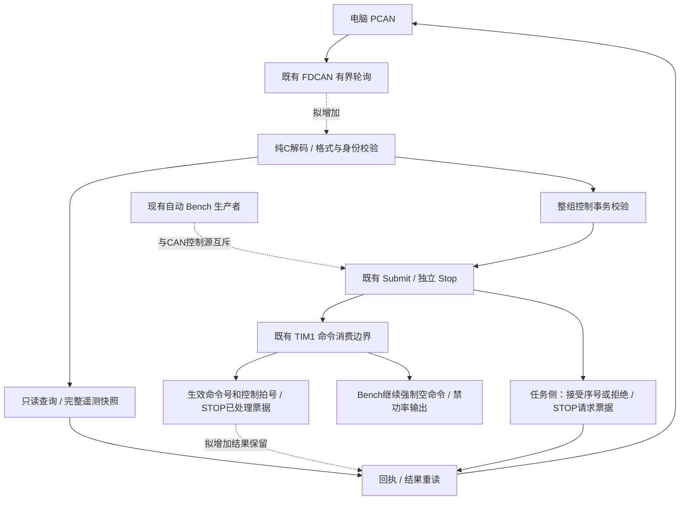

# 008 — CAN命令：ODrive对照与接入方案

**一句话：** 已在禁输出目标加入版本、状态、故障查询，先让电脑读懂板子，再单独接入控制命令。

**实施状态（2026-11-16）：第一步只读查询已实现，有限板测检查点已达到，待用户提交；后续控制命令仍拟议。** 固件基线`Xiao_ODrive / 350ef94`＋本轮008工作区差异。自定义诊断协议v1保留321/322与PING/PONG；新增INFO/STATUS/FAULT/BUILD。START/UPDATE/STOP线路命令、反馈查询、可靠控制回执仍拟议。没有更改CubeMX或输出权限；用户手动下载、测试和Git提交。

| 部位 | 本轮实际变化 | 边界 |
| --- | --- | --- |
| CAN业务 | PING/PONG → 增加四个只读查询 | 不含电机控制命令 |
| 状态读取 | 无CAN读取 → 查询时固定复制五项诊断镜像 | 不等于同一控制拍，也不授予许可 |
| 请求来源 | 自动Bench控制脚本保持 | 无第二个控制发布者 |
| 返回结果 | 单帧携带操作码、标记和32位结果 | 无可靠控制ACK队列，TX满丢回复 |
| 验证 | HOST/BUILD通过；STATUS及四项健康计数取得有限板测证据 | BUILD/FAULT回包未留图，非固定周期/负载验收 |

| 验收层级 | 当前状态 | 依据/限制 |
| --- | --- | --- |
| SRC现状、参考对照与只读实现 | PASS | 独立复核：无控制副作用、DLC前护、provider边界与计数语义保留 |
| BUILD | PASS | ARMCC5.06u7，两目标增量`-b`均0错误0警告；[原始记录](../validation/008-can-query-20261116.txt) |
| 编译期负向配置检查 | NOT_RUN | 本轮无配置约束变更，未重复非法宏组合检查 |
| HOST | PASS | 协议24507断言；服务32场景882断言；真实产品源＋模拟HAL/provider，不证明硬件时序 |
| HW STATUS/有限调度观察 | PASS（有限） | 第7节：用户多次查询正常，STATUS回包正确、四项计数全0；不证明精确周期/时长或满负载 |
| HW BUILD/FAULT/INFO | 有限/未留存 | BUILD/FAULT发送记录可见、用户整体反馈正常，但回包数值未留图；INFO无本轮证据 |
| SRC/HW控制命令接入 | NOT_RUN | 尚未实现CAN START/UPDATE/STOP，不以只读查询替代 |
| 文档与版本 | PASS | 原始日志、187项构建输入指纹和产物指纹已留存；链接/EOL检查按仓库约定 |

**下一步：** 1. 用户审阅第7节并提交只读查询检查点；2. 后续先定义STOP及完整控制事务，再接入禁输出目标；3. 反馈查询、可靠回执与异常负载验证按各自范围推进。当前事实以[架构页](../ARCHITECTURE.md)为准，下文保留整体移植对照和后续方案。

## 1. 参考版本与协议含义

仅比较 **ODrive fw-v0.5.6，commit `a308314ed2ca613164b81e7bbdfacc53cd1859ff`**，不混用新版Pro/S1的寻址、SDO或固件更新命令。

- [命令枚举](https://github.com/odriverobotics/ODrive/blob/a308314ed2ca613164b81e7bbdfacc53cd1859ff/Firmware/communication/can/can_simple.hpp)
- [分发与处理源码](https://github.com/odriverobotics/ODrive/blob/a308314ed2ca613164b81e7bbdfacc53cd1859ff/Firmware/communication/can/can_simple.cpp)
- [该版本协议说明](https://github.com/odriverobotics/ODrive/blob/a308314ed2ca613164b81e7bbdfacc53cd1859ff/docs/can-protocol.rst)与[命令字段CSV](https://github.com/odriverobotics/ODrive/blob/a308314ed2ca613164b81e7bbdfacc53cd1859ff/docs/figures/can-protocol.csv)
- [接口单位定义](https://github.com/odriverobotics/ODrive/blob/a308314ed2ca613164b81e7bbdfacc53cd1859ff/Firmware/odrive-interface.yaml)

表中`0x001`等是**命令号**。标准帧完整ID为`(node_id << 5) | command_id`，该版本节点0～63，多字节小端。现有PCAN中的`0x321/0x322`则是本项目完整测试ID；按CANSimple解释会变成节点25的Heartbeat/Estop，因此它们不兼容ODrive，不应混用于真实ODrive总线。若选择兼容方案，测试ID须迁移或隔离。

纯C与CANSimple兼容不冲突：一个是实现语言，一个是外部协议。兼容必须逐项匹配ID、DLC、字段、单位、状态与响应规则；不能因为函数名称接近就宣称兼容。本轮已选择自定义只读诊断协议v1；后续是否增加CANSimple兼容层仍独立讨论，不默认兼容。

## 2. ODrive命令与本项目取舍

本表覆盖该版本头文件命令目录，保留整体功能取舍。PING/PONG及第6节四个只读查询已实现；表中控制、反馈和配置相关项目仍是后续建议。

| ODrive命令号 / 名称 | 原版用途 / 实现差异 | 本项目对应与建议 |
| --- | --- | --- |
| 0x001 Heartbeat | 主动发送轴状态、故障与轨迹完成等 | 先GET_STATUS；低频主动状态后续加入，不能给运行命令续期 |
| 0x002 Estop | 设置轴ESTOP错误；回调本身不直接写PWM关断 | 先STOP撤许可；锁存急停另定，不宣称等价 |
| 0x003 Get Motor Error | 读电机故障uint64 | GET_STATUS包含board_fault_mask；不伪装为ODrive位定义 |
| 0x004 Get Encoder Error | 读编码器故障uint32 | 后续细分旋变诊断，不能直接复用故障位 |
| 0x005 Get Sensorless Error | 读无感估计器故障 | 暂不做，本轮使用AD2S1210 |
| 0x006 Set Axis Node ID | 设置轴节点号 | 首版固定身份；多节点/持久化另立功能 |
| 0x007 Set Axis Requested State | 请求IDLE=1、闭环=8等状态 | START_SPEED/STOP表达最小启停；当前没有完整Axis生命周期 |
| 0x008 Set Axis Startup Config | 函数体Not Implemented | 不移植空入口，不默认上电运行 |
| 0x009 Get Encoder Estimates | 位置turn、速度turn/s | GET_FEEDBACK先速度rpm/角度有效性；位置坐标未定不冒充多圈机械位置 |
| 0x00A Get Encoder Count | 线性累计/CPR内计数 | 暂不做，旋变原始码不等于编码器多圈计数 |
| 0x00B Set Controller Modes | 控制模式与输入模式 | 首版固定速度模式；其它模式明确拒绝 |
| 0x00C Set Input Pos | 位置+速度/力矩前馈 | 位置环和位置模式暂不做 |
| 0x00D Set Input Vel | 速度目标+力矩前馈 | START_SPEED/UPDATE_SPEED整组速度rpm+Iq上限A，不直接照搬载荷 |
| 0x00E Set Input Torque | 力矩目标N·m | 暂不做；缺Kt等参数不能把N·m当A |
| 0x00F Set Limits | 速度上限+电机电流上限 | 本地确认的硬上限＋每组命令Iq约束；不是原版“速度目标”命令 |
| 0x010 Start Anticogging | 已调用抗齿槽标定入口，不是空实现 | 暂不做，不影响首版速度命令链 |
| 0x011 Set Traj Vel Limit | 轨迹速度限制 | 暂不做轨迹规划 |
| 0x012 Set Traj Accel Limits | 轨迹加/减速度限制 | 暂不做，现有速度斜坡不等于完整轨迹规划器 |
| 0x013 Set Traj Inertia | 轨迹惯量前馈系数 | 暂不做 |
| 0x014 Get Iq | Iq给定与实测 | GET_FEEDBACK的后续字段；需同一快照及有效性 |
| 0x015 Get Sensorless Estimates | 无感位置rad、速度turn/s | 暂不做；这里的位置单位例外，不能统一写turn |
| 0x016 Reboot ODrive | 直接NVIC_SystemReset，整MCU重启 | 暂不开放；重启不是正常停车命令 |
| 0x017 Get Bus Voltage and Current | 母线电压/电流 | 先提供已有母线电压；无母线电流测量/估计合同，不以Iq代替 |
| 0x018 Clear Errors | 调odrv.clear_errors，整板清错 | 暂不开放；本工程无运行时清故障API |
| 0x019 Set Linear Count | 修改编码器坐标计数 | 暂不开放；坐标/校准单独设计 |
| 0x01A Set Position Gain | 位置环增益 | 暂不做位置环配置 |
| 0x01B Set Vel Gains | 速度PI增益 | 后续独立配置事务；不在运行中直接写共享PI |
| 0x01C Get ADC Voltage | 请求带GPIO号，回复电压 | 不照搬通用GPIO查询；需要时只暴露明确测量通道 |
| 0x01D Get Controller Error | 读控制器故障uint32 | GET_STATUS汇总本地故障与拒绝原因，位定义分开 |
| 0x000 CANopen NMT | 保留，分发跳过/回调未实现 | 不实现CANopen |
| 0x700 CANopen Heartbeat | CANopen保留项，不是低5位普通命令 | 不实现CANopen |

`0x01E/0x01F`未分配；该版本没有独立Save Configuration CANSimple命令，也没有名为START/UPDATE/STOP的三条业务命令。

几个必须保留的差别：

1. **单位：** ODrive普通位置turn、速度turn/s；我们的速度rpm需要×/÷60。力矩N·m与Iq电流A必须经明确电机参数换算。轨迹惯量单位N·m/(turn/s²)，也不能直接套kg·m²数值。
2. **回执：** 多数Getter接受RTR或DLC=0请求、用相同ID回复；Get ADC Voltage要携带GPIO号，Get Controller Error分发检查不同。原版写命令没有统一的接受/生效回执。我们的结果合同是额外设计，不是已移植功能。
3. **续期：** 原版do_command在switch前watchdog_feed；不照搬“查询也喂狗”。建议只有新鲜且合法、按合同接受的控制更新影响运行期限；PING、状态查询、重复/非法帧都不能延长授权。
4. **原子性：** 原版Set Input Vel与Set Limits分别写字段，不能据此认为两帧构成一笔事务；本工程继续要求整组目标/限制一次交给TIM1。
5. **安全：** 软件STOP、锁存故障、硬件急停是不同职责。现有STOP是撤EN/MOE后的停机，不是受控减速；Break仍未启用，物理停机延迟未验收。

## 3. 拟议的最小命令集与当前基础

像送一张工单：CAN负责递单，命令层检查内容，TIM1在固定工作节拍接单。收到工单、开始照工单执行、电机已经达到目标，是三件事。

| 建议逻辑命令 | 读写内容 / 预期结果 | 已有基础与缺口 |
| --- | --- | --- |
| PING/PONG | 原样回显测试数据 | 已完成007；若选CANSimple需处理ID冲突 |
| GET_INFO / GET_BUILD | 能力/结构版本、手动软件接口修订号 | 已实现；不是固件hash。模式/核心配置有效位见STATUS，真实运行上限未开放 |
| GET_STATUS / GET_FAULT | 观测阶段、许可镜像、输出软件标志、禁止原因/故障mask | 已实现第6节独立查询；不是同拍快照。具体命令拒绝结果仍待后续 |
| GET_FEEDBACK | 先速度、母线电压及有效性/数据年龄，Iq等按需分组 | 有测量基础；需新快照/单位/分帧合同，数据读取不额外做SPI |
| STOP | 不受未确认运行配置或普通邮箱满限制地请求撤许可；返回停止票据和处理结果 | 已有AxisCommandPort_Stop；不是普通START/UPDATE槽，也不是即时总线硬急停 |
| START_SPEED | 明确开始新一轮速度运行：目标rpm、Iq上限A、期限/身份 | 内部START已有；CAN解码、会话/序号关联未实现 |
| UPDATE_SPEED | 在当前有效运行内整组更新目标/限制 | 内部UPDATE已有；不能从停机、到期或旧epoch恢复运行 |
| GET_COMMAND_RESULT / 回执 | 关联请求：拒绝、接受、应用、取消、停止处理 | 已有内部序号/一致快照；可靠结果保留与重读语义未实现 |

GET_INFO可报告已确认的运行上限；暂不另增一个运行时写限值命令。第一阶段只读，第二阶段先STOP再START/UPDATE，全部在禁输出目标验收。板上Watch按轮选3～4项，字段确定后再给测试清单。

当前源码定位：

| 内容 | 文件与函数 |
| --- | --- |
| 启动/任务创建 | [main.c](../../Core/Src/main.c) main；[freertos.c](../../Core/Src/freertos.c) MX_FREERTOS_Init / StartAppTask |
| 后台实际顺序 | [app_runtime.c](../../Core/Src/app_runtime.c) AppRuntime_BackgroundStep：AD2S → CanLink_Poll → AxisCommandBench_Step → 遥测/堆统计 |
| 当前线路协议 | [can_link_protocol.c](../../Core/Src/can_link_protocol.c) CanLinkProtocol_MakeReply；[can_link.c](../../Core/Src/can_link.c) CanLink_Init/Poll |
| 内部命令与STOP | [axis_command.c](../../Core/Src/axis_command.c) AxisCommandPort_Submit / Stop / BeginCycle / FinalPermit / GetSnapshot |
| 纯C规则 | [axis_command_core.c](../../Core/Src/axis_command_core.c) AxisCommand_Validate / PublishValidated / Tick / Guard；[数据类型](../../Core/Inc/axis_command_core.h) |
| 当前自动请求源 | [axis_command_bench.c](../../Core/Src/axis_command_bench.c) AxisCommandBench_Init/Step；只演练交接 |
| FOC/最终输出 | [app_runtime.c](../../Core/Src/app_runtime.c) AppRuntime_FastISR；[open_foc.c](../../Core/Src/open_foc.c) OpenFOC_ApplyCommand/Run_20kHz；[board_safety.c](../../Core/Src/board_safety.c) SetOutputsEnabled/LatchFault |

普通目标command_limits仍未确认，拒绝START/UPDATE；Bench的1000rpm、4A、1000ms只是合成夹具，不能作为电机参数。Bench始终ApplyCommand(NULL)，输出禁止。CAN目前只在Bench启动，不等于普通目标已有通信命令。

## 4. 拟议接入图与必须先定的合同

本图只表示下一阶段方案；现有完整结构图只维护在[架构页](../ARCHITECTURE.md#启动与执行上下文)。

### 4.1 一次命令怎样完整交接

- 经典CAN一帧最多8B，内部AxisCommandFrame为32B，不能直接memcpy当线路协议；字节序、浮点表示、单位、非法值和范围要逐字段定义。
- **方案A：紧凑单帧。** 两个float32恰好8B，但序号/会话/期限不再有空间，必须说明哪些来自ID、哪些由板端配置/会话补齐；不能只凑下数值就宣称防重放已解决。
- **方案B：多帧事务。** 静态有界暂存、事务号、齐包标志、首帧接收时间与超时、重复/乱序规则全部明确；未齐不得发布，新旧片段不得混合。STOP使在组装的启动事务失效。
- appTask持有稳定局部副本，校验后经现有Submit的短PRIMASK整组发布；TIM1在下一次符合条件的控制边界消费，输出前再复核。不能用volatile或只屏蔽低优先级IRQ的RTOS临界区替代。
- 若接收队列产生滞留，必须定义“接收时间”是硬件入队还是软件出队，并给排队年龄上限；不能给排队很久的启动帧重盖一个新时间戳。跨复位身份/旧命令清理也要单列，当前epoch只解决一次启动内的旧代次。

### 4.2 谁能发、何时续期、何时停止

- 应用层只有appTask一个普通发布者；选择CAN控制源时关闭自动Bench脚本的发单行为，保留独立回归测试入口。两者碰巧在同一任务也不代表业务上可以同时控制。
- 查询不授予permit，心跳不续运行期限。没有有效更新时现有到期逻辑撤许可，不自动恢复；恢复需要新一轮合法START。
- STOP独立于普通命令邮箱，但**仍受CAN仲裁、硬件FIFO、后台调度影响**。当前FIFO0每轮最多处理1帧，不能声称STOP已绕过队列。实现前选定保留接收资源/优先服务或其它有界策略，并验证最坏延迟及Bus-Off处理；不凭设计数字承诺安全急停时间。
- 满队列、失联/Bus-Off、非法帧的处理要有界。协议故障是否主动请求STOP与控制命令超时的关系需写明；目前007只锁停CAN服务，不负责电机许可。
- 同一任务还有阻塞SPI，故障时超时可影响通信响应；当前低速正常测试不证明所有故障条件下任务互不影响。

### 4.3 回执和遥测的可信度

- `ACCEPTED`仅代表完整工单进入邮箱；`APPLIED`表示指定command_seq已在某个control_seq被控制端接收；Bench中也不代表FOC带输出运行，更不代表实际速度达到目标。
- 现有72B GetSnapshot是当前状态快照，不是事件队列。新协议需固定容量结果保留/重读规则、请求号与内部seq/STOP票据映射，明确覆盖/忙/重试行为。发送入队不等于电脑收到。
- 重复请求不能重复启动或续期；请求已处理时怎样返回同一结果、会话失效后怎样拒绝，要与报文一起定稿。
- 状态/反馈每组有快照号、时间/有效性；跨多帧只拼同一快照。没有可证明的母线电流或多圈位置不提供假值，缺测要标无效/不支持。

## 5. 设计选择与验收顺序

| 选择 | 适用场景 | 代价 |
| --- | --- | --- |
| 自定义最小协议（本次建议，未定稿） | 先用PCAN建立可解释的命令/回执，满足整组更新与禁输出演练 | 不直接兼容ODrive工具，后续需自有上位机或明确适配层 |
| CANSimple兼容子集 | 已确定要复用支持该旧版本的上位机 | 精确遵守ID/单位/查询方式；原版多条设置命令与本项目原子事务的关系必须另设计，不可悄悄改变语义 |

“参考ODrive机制”和“对外CANSimple兼容”分别决定。本轮第6节已固定自定义只读协议；本表保留后续控制协议的取舍，控制字段/事务和CANSimple兼容层仍未实现。

1. 固定协议选择、版本、能力位、字段、非法输入规则；源码静态检查不得出现通信直接写PWM/EN/FOC活动变量。
2. 只读查询：HOST覆盖DLC/ID/单位/边界，两个目标增量Build，禁输出板上核版本和状态；新接口先少量低频发送。
3. 控制接入：先验证STOP，再整组START/UPDATE、忙/重复/过期/旧会话、取消结果；保持Bench强制禁输出，接入后重测调度与内存。
4. 再做有界负载、接收拥塞/回执丢失/失联故障测试。真实电机参数、采样对时、物理保护与带输出闭环另验收，本功能通过不自动开放功率。

后续控制接入风险：不要把只读查询通过误当作电机命令已就绪，也不直接照搬ODrive单位、回执或watchdog语义。控制事务需先定稿，再实现。

## 6. 第一步只读查询合同（2026-11-16，本轮实施范围）

用户已要求按建议开始。首轮采用自定义诊断协议v1，保留007的321/322及PING/PONG；不宣称CANSimple兼容。只做INFO/STATUS/FAULT/BUILD查询，反馈与START/UPDATE/STOP线路命令仍未开放。自动Bench仍是唯一控制请求来源，尚不切换生产者。

### 6.1 帧与返回值

全部标准数据帧、经典CAN、DLC=8、500 kbit/s；请求ID=0x321，响应ID=0x322。

| 字节 | 请求 | 响应 |
| --- | --- | --- |
| Byte0 | 0x51（Q） | 0x52（R） |
| Byte1 | 协议版本0x01 | 0x01 |
| Byte2 | 查询操作码 | 原样操作码 |
| Byte3 | 电脑请求标记，任意8位值 | 原样回显，仅用于配对，不是控制授权序号 |
| Byte4..7 | 必须全0 | uint32结果，小端，Byte4为最低字节 |

| 操作码 | 名称 | 返回值 |
| --- | --- | --- |
| 0x01 | GET_INFO | 0x0001001F：高16位查询结构版本1；低16位能力bit0 PING、bit1 INFO、bit2 STATUS、bit3 FAULT、bit4 BUILD |
| 0x02 | GET_STATUS | bit0..7状态；bit8..15标志；bit16..31禁止原因位，见下文 |
| 0x03 | GET_FAULT | board_fault_mask原始32位锁存故障，不清除故障 |
| 0x04 | GET_BUILD | 0x00000801：本次人工维护的软件接口修订号008.01，不是Git提交号或固件hash |

GET_STATUS低8位沿用axis_status：0 BOOT、1 ADC零偏标定、2 IDLE、3 ALIGNING、4软件输出运行、5 FAULT。中间标志字节bit0=命令核心配置有效（Bench合成配置也为1，不代表真实电机参数已确认），bit1=最近发布的软件命令许可镜像，bit2=软件输出使能标志，bit3=Bench，bit4=编译期禁功率输出；其余位0。高16位沿用AXIS_INHIBIT_*，不另建第二套控制判断。

状态查询表示诊断观察，不授予运行许可；运行状态不证明电机旋转，软件output标志不是电压测量。许可镜像可能尚未反映刚发生的故障/到期，以实时安全链为准。BUILD只区分本次协议修订，不能证明下载镜像与文件逐字节一致；产物hash在validation记录，源代码改变不会自动更新这个人工编号。

严格拒绝错误ID/DLC、扩展帧、远程帧、FD/BRS、未知版本/操作码、非零保留字节且不回复。硬件过滤的帧可能不进入软件、不会保证计数；进入FIFO后被DLC前护或协议校验拒绝的请求才增加rejected_count。此拒绝不会撤销已有命令或续期。未知查询无回包，电脑超时判断；还没有通用错误回执。重复查询允许，读取新的观察值，不构成控制重试。

### 6.2 有界服务与快照

- 保持原硬件过滤器和8B DLC前置保护；每轮最多1接收、1次发送入队；无重试、堆分配、队列积压软件副本或新任务/DMA。
- 原can_link_rx_count只数PING；新增can_query_rx_count只数合法查询；TX忙时仍计已接收查询并计错误，丢当前回复，电脑需重新查询。tx_enqueued_count不证明实际送达。
- CanLink_Init一次绑定只读状态provider，空provider为配置错误。INFO/BUILD只返回常量；STATUS/FAULT才调用一次provider。
- app_runtime静态ReadCanStatus在保存/恢复PRIMASK的短区内复制status_word、fault_mask、configured、permit、output_enabled五个诊断量，区外编码。副本在appTask栈，发送时HAL复制进FDCAN专用RAM。
- 该快照保证复制期间不被普通中断打断，**不保证五个镜像来自同一个控制拍或物理采样时刻**。故障可能先更新fault/output，permit下一次TIM1才刷新；NMI/Fatal不返回、不发送半份结果。每个查询独立取值，多个响应不能拼成一份同拍快照。
- 新短临界区纳入app_critical_max_cycles既有统计；本轮HOST不能证明实际屏蔽时长，需板测观察任务/FOC节拍。服务不调用Submit/Stop、FOC、故障清除或输出写接口。

### 6.3 已完成验证与用户操作

SRC独立复核通过；协议24507断言、服务32场景882断言通过。两目标增量Build均0错误0警告，仅重编app_runtime/can_link/can_link_protocol；原有Cygwin FAST_CWD环境警告不等于固件编译诊断。原始日志/源和产物指纹见[008记录](../validation/008-can-query-20261116.txt)。

Bench map：ROM 65764 B，静态RW+ZI 25984 B；相比007分别增加492 B、8 B。普通目标仍ROM60684 B、静态RW+ZI25712 B。新provider自身静态栈16 B，QueryValue自身32 B；函数指针调用和中断嵌套使这些数值不能证明任务最坏栈。无堆分配/新任务，appTask仍4096 B，完整最坏栈与临界区延迟未板测。

用户执行：

1. 保持功率母线断开、仅控制/传感器供电；退出旧调试，选`FOC_T_CommandBench`。本轮已编译成功；若本地又改了源码，用F7/Build，不用Rebuild All。手动Download，再进入调试Run，连续运行约5秒。
2. PCAN维持500 kbit/s、标准数据帧、DLC8；先取消旧PING的周期发送。新查询ID仍为321，下面三条逐条发送（Cycle Time=0，选中发送行按空格）。
3. 所有响应都用ID322，PCAN接收列表通常会覆盖同ID旧内容；看Byte2操作码和Byte3标记确认当前对应查询。不要同时给几条查询开周期发送。

| 顺序 | 发到321的数据（hex） | 应在322看到的数据 |
| --- | --- | --- |
| 版本BUILD | `51 01 04 01 00 00 00 00` | `52 01 04 01 01 08 00 00` |
| 状态STATUS | `51 01 02 02 00 00 00 00` | `52 01 02 02 SS FF LL HH`（后三类是占位说明，不可输入为hex） |
| 故障FAULT | `51 01 03 03 00 00 00 00` | 无故障时`52 01 03 03 00 00 00 00` |

STATUS稳定待机通常SS=02、FF=19：IDLE、Bench合成配置有效、许可镜像0、软件输出0、Bench/禁输出位1。自动演练期间许可镜像可能短暂为1而FF=1B，仍不允许功率输出。LL/HH为禁止原因位（常见01 05），不得一概要求全0：禁功率输出、PWM未准备、无命令在Bench待机是正常条件。若SS=05、FAULT非0或FF的输出位bit2为1，保留完整数据再排查，不转入启动测试。

4. 三条核对后，只把STATUS设成1000 ms周期，连续观察约30秒。Watch仅四项：`can_link_error_count`、`app_task_deadline_misses`、`foc_isr_overrun_count`、`ad2s_sample_gap_count`，预期均保持0。这些只支持本轮低速有限调度观察，不证明满负载或精确零丢包。
5. 本轮已提供STATUS与四项Watch截图，结果见第7节；BUILD/FAULT仅发送行及用户整体反馈保留。没有回包先核是否下载Bench及BUILD修订，不重复更改CubeMX或线路。

可选INFO请求`51 01 01 04 00 00 00 00`，回复`52 01 01 04 1F 00 01 00`。旧PING/PONG保持不变；`can_link_rx_count`不会因新查询增加，看查询需用`can_query_rx_count`（本轮不要求再加Watch）。

**本轮未关闭风险：** 新只读查询已获得有限正常观察，但短临界区最坏时长及负载时序尚待验证；状态镜像不是实时授权；BUILD不是镜像hash；TX满/Bus-Off无可靠回复或自动恢复。控制命令仍未开放，实际速度/电流范围与物理保护仍未验收。

## 7. 只读查询检查点（2026-11-16，用户反馈）

用户原话：“没问题我测试了几次发现都是正常没有error的计数增加”。

| 证据 | 可确认结果 | 边界 |
| --- | --- | --- |
| [STATUS截图](../validation/008-can-query-20261116-status.png) | 322回复`52 01 02 02 02 19 01 05`；操作码/标记对应STATUS请求 | 接收区仅当前STATUS，不能补写BUILD/FAULT回包数值 |
| STATUS解码 | IDLE；许可镜像0、软件输出0、Bench/编译禁功率位1；0x0501为PWM未准备/禁功率/无命令 | 核心配置有效仅指Bench夹具；不是物理输出测量或完整故障mask |
| [Watch截图](../validation/008-can-query-20261116-health.png) | ad2s_sample_gap_count、foc_isr_overrun_count、app_task_deadline_misses、can_link_error_count均0 | 用户报告多次正常，不据截图推断具体持续时间 |
| 其它查询 | BUILD/FAULT发送行可见；用户整体反馈正常 | 对应回包未留图；INFO无本轮可见结果 |
| 版本绑定 | 本地187项固件输入及Bench AXF/HEX与008记录一致 | 没有板端镜像hash回读；uvoptx用户调试变更保留 |

**结论：HW PASS（有限），第一步可形成提交检查点。** 当前图是Manual查询；1000 ms周期框未勾选，2378.6 ms是接收间隔显示，不是响应延迟或固定查询周期。所有业务共用322，累计105与发送各行次数没有统一统计窗口，不能计算丢包率。原始证据按追加方式保留在[008验证记录](../validation/008-can-query-20261116.txt)。

本轮收尾只更新文档并原样保存两张截图，没有修改固件、重复构建、提交或操作硬件。后续控制协议/STOP仍需实现；不得把只读查询通过扩展为运行许可、物理保护或电机闭环验收。
